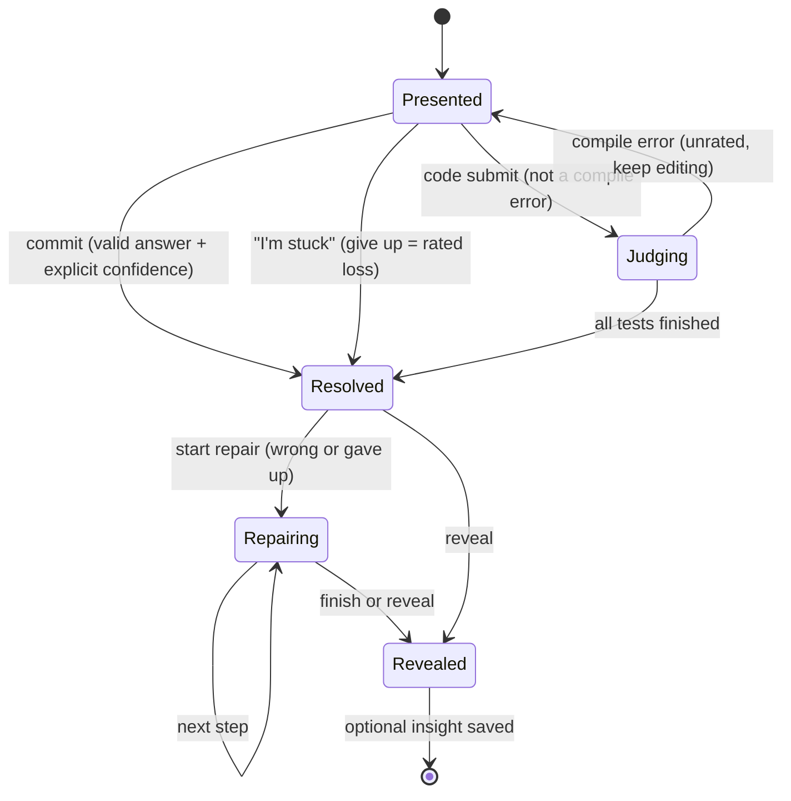
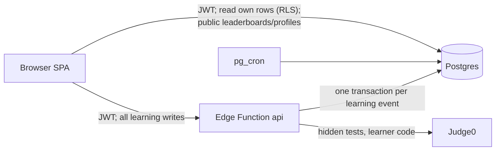

# Eleanor: the rated gym for your own thinking

Product and system specification · v2 · revised 20 October 2026

**Status: proposed. No application, content bank, database, or user data exists yet.** This version replaces the single-user, local-only pilot (preserved as [doc-v1-pilot.md](docs/archive/doc-v1-pilot.md)) with a hosted, multi-user product. Implementation order, prompts, and acceptance tests live in [docs/execution.md](docs/execution.md). Evidence and caveats live in [docs/research.md](docs/research.md).

> Think first. Commit an answer and how sure you are. Get rated like a chess player. Prove it a week later on a problem you have never seen.

Eleanor is chess-style rated practice for judgment, logic, mathematics, and code. Every learner has a rating per track that rises as they improve. Every problem has a rating too. A learner model picks the next problem so it is hard enough to stretch you but solvable about 70% of the time. Two things no rated platform measures sit beside the rating: **calibration** (do you know when you are right?) and **echoes** (can you still do it days later, on a changed problem?).

---

## 1. Product decisions

| Question | v2 decision | Changed from v1 because |
| --- | --- | --- |
| Who is it for? | Ambitious learners aged **16+**: students, graduates, and professionals who want to think without leaning on AI. | Owner decision. 16+ avoids under-16 consent rules in the MVP. |
| What do people practise? | Four rated tracks: **Judgment** (probability, risk, estimation, decisions), **Logic**, **Math**, and **Code** (Codeforces-style programming). | Owner decision to include coding alongside reasoning. |
| How is difficulty chosen? | A learner model (§6) built on Glicko ratings for learners, concepts, and problems, plus a flow controller. | A multi-user product gives the model enough data to calibrate problem difficulty. |
| What is the core loop? | Read → attempt unaided → commit answer **and** confidence → see result, rating change, and the model's own forecast → repair step by step if wrong → reveal → optional one-line insight → **echo** days later. | Same think-first principle, now rated. |
| Is there AI in the product? | **No.** Concept explanations, hints, repair steps, and feedback are written and reviewed by people. Grading is deterministic. | Owner decision. |
| Is it competitive? | **Yes.** Public per-track and overall leaderboards, titles, and public profiles, with explicit integrity rules (§9). | Owner decision. This overrides v1's ban on public correctness leaderboards. |
| Where does data live? | **Supabase** (Auth + Postgres + Edge Functions). Private work is readable only by its owner through row-level security, with export and account deletion. | Owner decision. Accounts and cross-device use need a server. |
| What is the MVP? | Auth, onboarding and placement, adaptive rated sets on all four tracks, echoes, repair ladders, concept cards, Daily Crux, progress, playbook, leaderboards, profiles, admin and model health, export and deletion. | See [execution.md](docs/execution.md). |
| What comes after the MVP? | Weekly Rated Rounds with calibrated scoring, Daily Crux discussion, follows and clubs, code plagiarism checks, nightly item recalibration, and further arenas such as chess, each behind its own gate (§12). | Keeps the launch buildable. |

**Claims policy (unchanged):** Eleanor trains and measures named skills on its own problems. It never claims to raise IQ, prevent cognitive decline, or make anyone smarter in general. A higher rating means you solve harder problems of this kind; echo results show retention and near transfer. Nothing more is claimed without evidence (see [research.md](docs/research.md#1-conclusions-that-the-evidence-can-support)).

---

## 2. Why people leave learning products, and what Eleanor does instead

Every mechanism below is a design hypothesis grounded in research. None is a promise about outcomes. Sources are in [research.md §7](docs/research.md#7-sources-added-for-the-v2-design).

| Why people quit | Eleanor's mechanism | Grounding | Guardrail |
| --- | --- | --- | --- |
| **Too easy → bored; too hard → anxious.** | Every problem is chosen to give about a 70% chance of success at *your* current rating. Learners pick an intensity: Steady (80%), Balanced (70%), or Stretch (55%). | Flow theory; Elo/IRT adaptive practice (Math Garden, Pelánek). | The target is a tunable product choice, not the "85% law". The model's own calibration is monitored (§6.9). |
| **No visible growth.** | Chess-style rating per track, a rating graph, peak rating, titles, and a concept map that fills in as you prove concepts. | Self-determination theory (competence); performance graphs support competence need satisfaction (Sailer et al., 2017). | A rating measures performance on Eleanor problems, not a person's worth or intelligence. |
| **Progress feels fake.** | **Echoes:** a concept comes back after 1, 3, 7, and 21 days in a new form. A concept is *Proven* only after unaided echo successes. | Spacing and testing effects (Cepeda et al., 2006; Roediger & Karpicke, 2006). | Echoes measure near transfer and retention only. |
| **Wrong answers just feel bad.** | **Mistake fingerprints:** a wrong answer is matched against known misconception values ("90% is the detector's hit rate; you left out the base rate"). In code, the failing test group names the bug class. | Diagnostic bug models (Brown & Burton, 1978); task-focused feedback (Kluger & DeNisi, 1996; Hattie & Timperley, 2007). | Feedback is about the task, never about the person. |
| **Being shown the answer teaches little.** | **Repair ladder:** after a miss, rebuild the solution step by step. Each intermediate value is checked before the full solution appears. | Productive failure followed by consolidation (Sinha & Kapur, 2021). | Repair is unrated support. It never changes the rating. |
| **Blocked mass practice is dull and forgettable.** | Sets interleave concepts and never repeat a concept twice in a row. | Interleaving in mathematics (Rohrer & Taylor, 2007). | |
| **Sessions end on a failure, so returning feels bad.** | The last problem of each set targets a slightly higher chance of success (+5 points). After two misses in a row, the next target rises by 10 points. | Peak-end rule (Kahneman et al., 1993). | Never lowers the bar on rated difficulty beyond the stated targets; it changes selection, not grading. |
| **Lonely.** | **Daily Crux:** one shared problem a day, then the crowd's reveal (how many solved it, how sure they were, the most common wrong answers) and a shareable result. Public leaderboards and profiles. | Relatedness need (self-determination theory). | Daily Crux is unrated, so spoilers cannot inflate ratings. |
| **Streak guilt and notification spam.** | A weekly goal ("train on 3 days") with no streak counter, no debt, and no guilt notifications. Sets have a clear end. | Spacing beats massing; respects autonomy. | No infinite feed. "Another set" is offered after a summary screen. |
| **Running out of problems or memorising answers.** | Reasoning problems are **generators**: reviewed templates with constrained random parameters and several contexts, so every attempt is fresh. | Parameterised exercises are long-standing practice in adaptive systems. | Templates are reviewed and verified by two independent computations (§7). |
| **No sense of autonomy.** | Choose tracks, intensity, set length (3, 5, or 8), when rating changes are shown, and whether to appear on leaderboards. | Self-determination theory (autonomy). | Choices never change how the rating is computed. |

### What has not been combined before

Each piece exists somewhere. As far as this audit found, no platform combines them (a product hypothesis, not a market study):

1. **A two-number identity: rating and calibration.** Chess and Codeforces rate how hard a problem you can solve. Eleanor also measures whether your stated confidence matches reality, and shows both on your profile.
2. **The model shows its own forecast, and is held to the same standard.** After you commit, you see "You said 90%. Eleanor forecast 62%." The model's predictions are scored with the same reliability diagram as yours (§6.9). The forecaster you compare yourself against is itself audited.
3. **Echo-proven mastery.** Mastery is earned only by unaided success on changed problems days later, never by one correct answer.
4. **Mistake fingerprints in every track,** from misconception values in reasoning problems to labelled test groups in code.
5. **Infinite reviewed generators,** so the rating never runs out of fresh, verified problems at your level.
6. **Authored repair instead of answer-dumping,** with no AI anywhere in the learning loop.

---

## 3. Tracks and concepts (launch map)

A **track** has its own rating. A **concept** is a teachable idea with an authored concept card, prerequisites, and an entry rating. A **family** groups templates or problems that exercise the same mechanism; echoes draw from the same family. An **item** is one template at one difficulty level, or one code problem, and carries a rating.

| Track | Concepts (id suffix · entry rating · prerequisites) |
| --- | --- |
| **Judgment** `judgment.*` | `frequencies` 800 · `estimation` 900 · `conditional` 900 ← frequencies · `expected-value` 1000 ← frequencies · `risk-framing` 1000 ← frequencies · `base-rates` 1100 ← conditional · `independence` 1100 ← conditional · `regression` 1400 ← conditional · `odds` 1500 ← base-rates |
| **Logic** `logic.*` | `deduction` 800 · `ordering` 900 · `counting` 1000 · `conditionals` 1000 ← deduction · `knights` 1100 ← deduction · `pigeonhole` 1300 ← counting · `invariants` 1400 ← counting · `games` 1500 ← invariants |
| **Math** `math.*` | `ratios` 800 · `percent-change` 900 ← ratios · `linear` 1000 ← ratios · `geometry` 1000 · `sequences` 1100 ← linear · `divisibility` 1100 · `functions` 1200 ← percent-change, linear · `optimization` 1500 ← functions |
| **Code** `code.*` | `implementation` 800 · `math` 1000 ← implementation · `sorting-greedy` 1100 ← implementation · `prefix` 1200 ← implementation · `two-pointers` 1300 ← sorting-greedy · `binary-search` 1400 ← sorting-greedy · `graphs` 1500 ← implementation · `strings` 1500 ← implementation · `dp` 1600 ← prefix |

A concept is **unlocked** when every prerequisite is at least *Practiced* (§6.7), or when the learner's track rating is at least the concept's entry rating plus 100. Strong learners skip ahead without busywork.

Every concept has a **concept card**: a short authored explanation, one worked example, and common traps. Reading it before an attempt counts as instruction, not assistance, so the attempt stays rated. Concept cards are the Khan-style lesson layer. They are human-written; no model generates or paraphrases them.

---

## 4. The experience

### 4.1 Screens

| Screen | Purpose |
| --- | --- |
| **Landing** | What Eleanor is, a sample problem playable without an account, honest claims, and sign-in. |
| **Onboarding** | Age confirmation (16+), terms, handle, leaderboard visibility (no preselected answer), track choice, intensity, a 2-problem unrated confidence tutorial, then placement. |
| **Today** | Per-track cards (rating, title, "Start set"), due echoes, today's Daily Crux, weekly goal dots, and any open set to resume. |
| **Set player** | One problem at a time: prompt, concept-card link, answer input, confidence input, Commit, "I'm stuck"; then result, repair, reveal, insight; then the end-of-set summary. |
| **Daily Crux** | The shared problem, then the crowd reveal and share text. |
| **Progress** | Rating graphs with uncertainty bands, the concept map, calibration (yours vs. the model's), echo record, active misconceptions with "practise this". |
| **Playbook** | Your one-line insights grouped by concept, editable and deletable. |
| **Leaderboards** | Overall and per-track top 100, your rank, title colours, and a provisional marker. |
| **Profile** (public) | Handle, titles, ratings, rating graph, calibration badge, proven-concept count. Never answers, playbook, or attempt contents. |
| **Settings** | Intensity, set size, rating-change timing, leaderboard visibility, reduced motion, theme, export data, delete account. |
| **Admin** | Model health, item residuals, content retirement, integrity flags, reports, moderation actions. Requires the `admin` role in app metadata. |

The visual direction is calm, adult, and precise: generous working space, readable type, restrained colour, and title colours as the main accent. Difficulty comes from the reasoning, not from speed, tiny controls, or clutter.

### 4.2 One problem



1. **Presented.** The prompt, answer format, and units are shown. The concept card is one click away. There is no timer, no hint, and no correctness cue.
2. **Commit.** The learner enters an answer and answers *"How likely is it that your answer is correct?"* with no preselected value: a slider plus a numeric field, stored as a probability between 0 and 1. A format check that does not depend on the answer catches likely unit mistakes ("You typed 0.083 for a % answer. Did you mean 8.3%?"). An optional "I used outside help" toggle makes the attempt unrated.
3. **Resolved.** The server grades the answer and applies the rating update in one transaction (§10.4). The learner sees correct or incorrect, any mistake fingerprint, the problem's rating, Eleanor's forecast next to their own confidence, and the rating change (immediately, or at the end of the set, per settings; the default is the end of the set).
4. **Repair (if wrong or gave up).** An ordered ladder of authored steps, each asking for a checkable intermediate value. A wrong step shows its explanation and moves on. Repair never touches ratings.
5. **Reveal.** A worked solution, the effective representation (frequency table, diagram, invariant), and for code the editorial plus reference solutions.
6. **Insight.** Optional: "One sentence for next time." It goes into the Playbook. On a later echo, the saved insight is shown **after** that echo is committed, never before.

**Invariants**, enforced by the server rather than the client:

- One rated result per attempt. The first commit is immutable. Repeated or concurrent requests return the stored result (idempotent transitions).
- Nothing correctness-related (answer, steps, solution, item rating, forecast) leaves the server before the attempt is resolved.
- "I'm stuck" is always available. It counts as a rated loss, like resigning in chess. Leaving and returning is a pause: the attempt waits, it is never rerolled, and it is never scored as wrong.
- A rated set must be finished (each problem committed or given up) before a new rated set starts in that track. Sets idle for 14 days are closed and their open attempts are marked `abandoned` with no rating change.
- No keystroke, clipboard, tab-switch, or paste tracking. Speed is never a rating input.

### 4.3 A set

A set holds 3, 5, or 8 problems (default 5) from one track. It contains up to 2 due echoes first, then model-selected problems that interleave concepts. It ends with a summary: rating before and after, problems with their ratings, fingerprints caught, echoes passed, and one suggested next step. "Another set" is offered; it is never automatic. After three sets in one day, the summary notes that spacing beats massing. That is information, not a block.

### 4.4 Onboarding and placement

Placement means the first 8 rated problems in a track, chosen at a 50% target. That is where an attempt tells the model most about an uncertain learner. Ratings start at 1200 with high uncertainty and move quickly (a first win against a 1200 problem moves the rating to about 1370). The learner sees "Placement 3/8" and a provisional "?" next to the rating until uncertainty falls (§6.8).

### 4.5 Daily Crux

- One problem per UTC day, the same instance for everyone, drawn from a curated list of template levels rated 1300–1700 and rotating across Judgment, Logic, and Math.
- **Unrated**, so spoilers and leaks cannot affect ratings.
- After committing: the number of solvers, % correct, mean confidence of correct vs. incorrect solvers, the top 5 submitted answers and the share matching each misconception, and your result in the crowd ("You were in the 34% who solved it, and more sure than 80% of them").
- Share text, copied only when the learner clicks: `Eleanor Daily #214 ✅ · 80% sure · solved by 34% · eleanor.app/daily`.

---

## 5. Problem formats

| Answer type | Input | Correct when |
| --- | --- | --- |
| `number` | Decimal, thousands commas, scientific notation, `a/b` fractions, Unicode minus; optional `%` suffix only when the unit is `%`. | `|x − a| ≤ max(abs, rel·|a|) + 1e-9` (inclusive). |
| `integer` | Whole number. | Exact equality. |
| `estimate` | Positive number with unit. | `|log10(x / a)| ≤ L`, for example `L = 0.3` (within a factor of about 2). |
| `choice` | One option among at least 6. | Option id matches. |
| `multi` | A subset of options (for example, Wason cards or knights). | Exact set equality. |
| `sequence` | An ordering of labelled items (keyboard reorder controls; drag is optional). | Exact order. |
| `code` | Source in Python 3, C++17, or JavaScript (Node). | All hidden tests pass within limits (§8). |

Parse errors are shown before commit and never count as wrong answers. Choice items need at least 6 options, or a combined outcome space of at least 6, so guessing rarely succeeds (the model has no guessing parameter; §6.10).

---

## 6. The learner model: ERM-1 (Eleanor Rating Model)

ERM-1 treats each rated response as a game between a learner and an item, the approach Pelánek (2016) describes for Elo in education and Lichess uses for puzzles. It uses Glicko-1 (Glickman, 1999), so every rating carries an uncertainty that sets how fast it moves.

### 6.1 Ratings maintained

| Subject | Rating `r`, deviation `RD` | Start | Floor | Updated by |
| --- | --- | --- | --- | --- |
| Learner × track | per track | 1200, 350 | RD 70 | every rated response in the track |
| Learner × concept | per concept | track rating at first encounter, 250 | RD 70 | rated responses on items of that concept |
| Item | template level or code problem | author estimate (§7.4), 250 | RD 30 | rated responses from learners whose track RD ≤ 150; never if `anchor` |

### 6.2 Update rule (one response = one game)

Constants: `q = ln(10)/400`, `c = 15` RD points of growth per √day of inactivity, maximum RD 350.

```text
g(RD)  = 1 / sqrt(1 + 3 q² RD² / π²)
E      = 1 / (1 + 10^(−g(RD_opp) · (r − r_opp) / 400))         # expected score
d²     = 1 / (q² · g(RD_opp)² · E · (1 − E))
RD'    = max(RD_floor, sqrt(1 / (1/RD² + 1/d²)))
r'     = r + q · (1/(1/RD² + 1/d²)) · g(RD_opp) · (s − E)       # uses the unfloored variance
before each update: RD ← min(350, sqrt(RD² + c² · days_since_last_update))
```

`s = 1` for correct, `0` for incorrect or give-up. The item plays the same game with `s_item = 1 − s`. The learner's track and concept ratings each play the item. The item plays the learner's **track** rating, the more stable estimate. All updates for one response use the pre-update values and are applied together.

**Reference vectors.** Implementations must reproduce these within 0.01 ([execution.md, task 1.2](docs/execution.md#task-12-learner-model-erm-1)):

| Case | Self (r, RD) | Opponent (r, RD) | s | E | r' | RD' |
| --- | --- | --- | --- | --- | --- | --- |
| New learner wins against a new item | (1200, 350) | (1200, 250) | 1 | 0.5000 | 1370.21 | 274.75 |
| New learner loses against a new item | (1200, 350) | (1200, 250) | 0 | 0.5000 | 1029.79 | 274.75 |
| Settled learner wins against a harder item | (1500, 70) | (1650, 40) | 1 | 0.2981 | 1519.01 | 70.00 |
| Settled learner loses against a harder item | (1500, 70) | (1650, 40) | 0 | 0.2981 | 1491.93 | 70.00 |
| Settled learner wins at about 70% | (1500, 70) | (1353, 40) | 1 | 0.6984 | 1508.17 | 70.00 |
| Settled learner loses at about 70% | (1500, 70) | (1353, 40) | 0 | 0.6984 | 1481.10 | 70.00 |
| Item loses to a learner | (1650, 40) | (1500, 70) | 0 | 0.6991 | 1643.78 | 39.79 |
| Mid-RD learner loses | (1400, 120) | (1300, 60) | 0 | 0.6377 | 1353.06 | 114.08 |

Inactivity: RD 70 grows to 107.94 after 30 days, and from 70 to 110 in 32 days.

### 6.3 What is rated

| Attempt kind | Rated? |
| --- | --- |
| Placement, model-selected, or echo attempt in a rated set | Yes |
| Give-up ("I'm stuck") | Yes, as a loss |
| "I used outside help" declared before commit | No |
| Unrated-practice set, Daily Crux, repair steps, code resubmissions after the first judged submission | No |
| Compile error | No (keep editing) |
| Abandoned (set idle 14 days) | No |
| Attempt on an item later retired as defective | Its rating events are reversed by replay (§9.4) |

### 6.4 Choosing the next problem

For each slot in a set:

1. **Due echoes first** (at most 2 per set, oldest due first, distinct families).
2. **Choose a concept** among unlocked concepts in the track by maximising a priority, sampled with a seeded softmax (temperature 0.15) so sets vary but stay reproducible:

   ```text
   priority = 0.6·misconception_active + 0.4·weakness + 0.3·uncertainty + 0.3·staleness + 0.2·novelty − 1.0·used_in_this_set
   weakness    = clamp((r_track − r_concept) / 200, 0, 1)
   uncertainty = clamp((RD_concept − 70) / 180, 0, 1)     # an unseen concept counts as 1
   staleness   = clamp(days_since_concept_practised / 14, 0, 1)
   novelty     = 1 if the concept has never been attempted, else 0
   misconception_active = 1 if any misconception tied to this concept has weight ≥ 1.5
   ```
   The same concept is never chosen for two consecutive slots.
3. **Choose a target success probability `p*`** (the flow controller):
   - Placement (the first 8 rated attempts in a track, after which track RD is about 115–145): `p* = 0.50`.
   - Otherwise by intensity: Steady `0.80`, Balanced `0.70`, Stretch `0.55`.
   - After 2 consecutive rated losses in this set: `+0.10` for the next slot (cap 0.85).
   - Last slot in the set: `+0.05` (peak-end; cap 0.85).
4. **Target difficulty:** `b* = r_basis + 400 · log10((1 − p*) / p*)`, where `r_basis` is the track rating during placement and the concept rating afterwards. At 1500: `p*` 0.5 → 1500, 0.55 → 1465, 0.7 → 1353, 0.8 → 1259, 0.85 → 1199.
5. **Choose the item** in that concept: published, not retired, no exposure to its family in the last 3 days (echoes excepted). Pick uniformly at random among items within 50 points of the closest match to `b*`. If none is within 300, fall back to the next concept by priority.
6. **Generate the instance** server-side with a fresh seed and a context skin the learner has not seen recently.

### 6.5 Echo schedule

After a rated attempt on a concept, the family schedules an echo. Intervals are 1 → 3 → 7 → 21 days. A correct unaided echo advances one interval; an incorrect one returns to 1 day. Echoes prefer a different template (representation) in the family, then a different skin, always with a new seed. Code echoes draw another problem from the same family. A learner's due echoes are capped at 10; the oldest beyond that are dropped (logged, never punished). Missed days create no debt.

### 6.6 Misconception profile

Each detected fingerprint updates `weight ← weight · 0.5^(days_since_last/14) + 1` for that (learner, misconception). A weight of at least 1.5 makes the misconception active. Active misconceptions raise their concept's selection priority and appear on Progress with their explanation and "practise this".

### 6.7 Concept mastery states

These states are transparent rules, not a latent model:

| State | Rule |
| --- | --- |
| `new` | Never attempted. |
| `learning` | Attempted, no unaided correct answer yet. |
| `practiced` | At least 1 unaided rated correct answer. |
| `proven` | At least 2 unaided correct **echoes**, the latest at least 3 days after the first correct answer, on items rated at least the concept's entry rating. |
| `needs_review` | Was proven, but the latest echo was incorrect or no echo succeeded in 45 days. |

The concept map shades each concept by `r_concept − r_track` and shows its state badge.

### 6.8 Ratings people see

- **Provisional:** a track RD above 110 shows `1342?`.
- **Overall rating:** the precision-weighted mean of track ratings with RD ≤ 150: `Σ(r/RD²) / Σ(1/RD²)`.
- **Titles** (by rating, per track and overall):

| Rating | Title | Rating | Title |
| --- | --- | --- | --- |
| < 1000 | Novice | 1800–1999 | Expert |
| 1000–1199 | Apprentice | 2000–2199 | Master |
| 1200–1399 | Thinker | 2200–2399 | Grandmaster |
| 1400–1599 | Analyst | ≥ 2400 | Legend |
| 1600–1799 | Strategist | | |

- **Calibration** (over the last 100 rated answers with confidence; shown once at least 30 exist): Brier score `mean((p − y)²)`, calibration error `Σ nₖ|p̄ₖ − ȳₖ| / N` across bins `[0,.2) [.2,.4) [.4,.6) [.6,.8) [.8,1]`, overconfidence gap `mean(p) − mean(y)`, and the sample size, always together. The profile badge **Well-calibrated** requires calibration error ≤ 0.05 with N ≥ 50. Brier is never shown alone, and calibration never merges into the rating.

### 6.9 The model is held to the same standard

Each rated attempt stores the model's forecast `E` (concept rating against item). Model health (admin) shows the model's Brier score, log loss, and reliability diagram over the last 30 days. It also shows per-item residuals `mean(s − E)`, flagging any item with |residual| > 0.15 and n ≥ 50 for review. It tracks rating drift: the mean rating of learners with more than 100 attempts, and anchor-item performance. **Anchors** are about 10% of items per track, frozen once they have at least 200 responses and stable ratings. They pin the scale against drift.

### 6.10 Validation and known ceilings

A synthetic simulation (run 20 October 2026; it verifies mechanics, not learning) used 500 learners × 120 responses, 300 items with author estimates off by an SD of 150, 10% anchors, and slow learning (+0.5 per attempt). Median rating error was 98 after 8 responses, 48 after 40, and 40 after 60 (90th percentile 103). Success after placement was 71% against a 70% target. Items with n ≥ 30 recovered their true difficulty to a median error of 36. The [execution plan](docs/execution.md#task-15-model-simulation-gate) makes a version of this a pass/fail gate.

Known ceilings, each with an upgrade path:

- **Fast population-wide learning drifts the scale.** At +2 per attempt, median error grew to about 100 after 120 attempts even with anchors and the RD floor of 70. Upgrade: nightly batch re-estimation of item difficulty with fixed anchors (§12).
- **One dimension per track.** Concept ratings capture within-track differences. A true multidimensional IRT model waits for data showing it predicts better.
- **No guessing parameter.** Enforced by requiring at least 6 options for choice items.
- **Instance-level difficulty varies within an item.** Template levels constrain parameters tightly; per-instance residuals are monitored.

---

## 7. Content system

### 7.1 Generated templates (Judgment, Logic, Math)

A template is a reviewed TypeScript module that turns `(level, seed, skin)` into a problem. It contains:

| Part | Contract |
| --- | --- |
| Identity | `id`, `version`, `family`, `concept`, `track`, `status` (`draft`, `reviewed`, `published`, `retired`), `review { author, reviewer, reviewedAt }`. |
| Levels | 3–6 levels, each with an `initialRating` and parameter ranges. Higher levels add steps, representations, or traps, not just bigger numbers. |
| `sample(rng, level)` | Draws parameters satisfying the constraints; deterministic for a given seed. |
| `solve(params)` | The canonical answer. |
| `verify(params, rng)` | An **independent** computation (Monte Carlo simulation, brute-force enumeration, or a different formula) that must agree with `solve`. |
| `render(params, skin)` | Prompt as structured blocks (paragraph, table, list, code, note). Plain text only; no HTML or Markdown execution. |
| `answer` | Answer type, unit, and tolerance. |
| `misconceptions` | `{ id, value(params), feedback }`: values a known wrong method produces. |
| `steps` | The repair ladder: `{ prompt, answer(params), tolerance, explain }`. |
| `solution(params)` | Worked solution blocks. |
| `skins` | At least 2 contexts (for example, medical screening, factory defects, spam filters). |

### 7.2 Code problems

A code problem is a directory containing:

- the statement as blocks, with input/output format and constraints;
- samples;
- a test generator (`gen.py`) and an input validator;
- a reference solution plus a slow brute-force solution;
- at least 2 known-wrong solutions;
- labelled **test groups** (for example, "minimal: n = 1", "overflow: answers exceed 2³¹", "performance: n = 2·10⁵ needs O(n log n)");
- an editorial;
- time and memory limits.

Every problem is multi-test (first line `t`), so each group is one judged file.

### 7.3 Verification (`npm run content:check`)

**Templates.** For every level and 2,000 seeds:

- parameters satisfy constraints;
- `solve` is finite and agrees with `verify` within a tenth of the tolerance;
- every misconception value differs from the answer, and from every other misconception value, by more than the tolerance;
- the repair steps' final value equals the answer;
- rendering produces non-empty blocks;
- 1,000 random seeds per level produce at least 50 distinct parameter sets.

**Code problems.**

- The validator accepts every generated input.
- The reference solution passes every group within half the time limit.
- The brute-force solution matches the reference solution on all small tests.
- Each known-wrong solution fails the group it is labelled for.

**Bank.**

- Ids are unique.
- Every concept has a published item and a concept card.
- Every family can produce an echo.
- Prerequisites form a graph with no cycles.
- Every Daily Crux entry exists and is rated 1300–1700.

### 7.4 Review workflow and initial difficulty

Author (a person, optionally helped by a coding agent in the repository) → `content:check` → a **human reviewer** checks wording, ambiguity, leakage in prompts and steps, skins, and level ordering → the reviewer's name and date are recorded → `published`. A coding agent must never fill in the reviewer field. The initial item rating comes from the level rubric: 800 + 200 per difficulty step, adjusted by the reviewer (±100). Published templates change only by a new `version`. Defective versions are `retired`; their attempts are excluded and ratings replayed (§9.4). Learner history is never deleted.

### 7.5 Launch inventory

| Track | Concepts | Templates or problems | Items (levels) |
| --- | --- | --- | --- |
| Judgment | 9 | 14 templates, each with 2+ skins | ~65 |
| Logic | 8 | 12 templates | ~55 |
| Math | 8 | 12 templates | ~55 |
| Code | 9 | 45 problems (5 per concept, rated 800–2000) | 45 |
| Daily Crux | — | 60 curated template levels | (reused) |

Content is the critical path. Two reference templates and two reference code problems are built with the engine. The rest is authored in parallel ([execution.md, phase 6](docs/execution.md#phase-6-launch-content-parallel-human-review-is-the-critical-path)).

---

## 8. Coding track

- **Judge:** Judge0, hosted or self-hosted, called only from Edge Functions. Learner code never runs in Eleanor's own infrastructure. Languages: Python 3, C++17, JavaScript (Node). Language ids are pinned from the judge's `/languages` list at deploy time.
- **Run vs. submit:** "Run" executes the samples or custom input. It is unrated and limited to 20 runs per 10 minutes. "Submit" asks for confidence ("How likely is it that this passes every hidden test?") and judges the hidden test groups in order.
- **Verdicts:** Accepted · Wrong answer on group *k* · Time limit on group *k* · Runtime error on group *k* · Compilation error. The failing group's label is the bug fingerprint ("Your solution fails the 'overflow' group: some answers exceed 2³¹").
- **Rated rules:** The first submission that compiles is the rated result. A compile error is unrated and you keep editing. Later submissions are unrated repair. The editorial and reference solutions appear on reveal.
- **Output checking:** Whitespace-insensitive tokens by default, with optional absolute/relative 1e-6 floating-point checking per problem.
- **Limits:** Source ≤ 64 KB, at most 12 test groups, at most 1 MB per test file, and a maximum of 5 MB of tests per problem.

---

## 9. Competition and integrity

### 9.1 Leaderboards

- Overall plus one per track, showing the top 100 and your own rank.
- **Eligibility:** at least 20 rated attempts in the track, an effective RD ≤ 110 (inactivity inflation applied at read time, so inactive accounts drop off after about a month), leaderboard visibility on, and not banned.
- Refreshed every 10 minutes.
- Leaderboards show handles, titles, and ratings only.

### 9.2 Public profiles

A public profile shows handle, join date, ratings, titles, rating graph, calibration badge, and proven-concept count. It never shows answers, confidence values, playbook entries, or code. Learners who hide themselves from leaderboards also get a private profile.

### 9.3 Honest competition without surveillance

Public ratings create an incentive to paste problems into an AI model. Eleanor's responses avoid invasive monitoring:

1. **Pledge and an honest path.** Signup includes an explicit honour pledge. Every problem has an "I used outside help" toggle and an unrated-practice mode, so honesty costs nothing.
2. **Generators.** Every learner sees a different instance, so answers cannot be shared or looked up.
3. **Statistical review flags, outcomes only.** These are for human review, never automatic punishment:
   - a gain of more than 400 in one track within 7 days at RD ≤ 110;
   - over 30 consecutive rated attempts, a success count whose binomial tail probability under the model's forecasts is below 10⁻⁴.
4. **Reports** from other users.
5. **Code similarity review** (after the MVP).

There is still no keystroke, clipboard, paste, tab-switch, or timing surveillance. Confirmed cheating leads to leaderboard removal and unrating of the affected attempts via replay. Every action is recorded with a reason, and appeals go by email.

### 9.4 Deterministic replay

Ratings are a fold over rated attempts in commit order. `model:replay` recomputes every track, concept, and item rating from scratch under a model version. It is used to remove confirmed cheating, exclude retired items, and test parameter changes offline before release. Replay output is compared with live ratings before it replaces them.

---

## 10. Architecture

### 10.1 Stack

| Layer | Choice |
| --- | --- |
| Web app | React + TypeScript + Vite single-page app, React Router, `@supabase/supabase-js`, CodeMirror 6 for code, hand-built SVG charts, plain CSS with custom properties and a dark mode. |
| Auth | Supabase Auth: email magic link / OTP and Google OAuth, with PKCE. |
| Data | Supabase Postgres with row-level security on every table, `pg_cron` for scheduled jobs, and a materialised view for leaderboards. |
| Server logic | One Supabase Edge Function, `api` (Deno, TypeScript), with a small router. Pure domain code (grading, model, selection, templates) lives in `supabase/functions/_shared/`, is unit-tested with Vitest, and is imported by the function and the scripts. |
| Code judge | Judge0 over HTTPS from the Edge Function. |
| Hosting | Static SPA on any static host (Vercel, Netlify, or Cloudflare Pages); Supabase cloud project. |

The same pure functions compute grades and ratings in the function, the simulation, and replay, so they cannot drift apart.

### 10.2 Trust boundaries



- **The browser can never write** attempts, ratings, echoes, or results. Those tables have select-only policies for their owner. Every learning write goes through `api`, which verifies the JWT and runs one Postgres transaction.
- **Secrets never reach the browser:** answers, steps, solutions, and code tests live in tables with RLS enabled and no client policies.
- The browser writes directly (through RLS and column grants) only to its own settings and playbook.

### 10.3 Data model (summary; full DDL in [execution.md, task 2.1](docs/execution.md#task-21-schema-rls-and-database-tests))

| Area | Tables |
| --- | --- |
| Identity | `profiles` (handle, age/terms confirmation, preferences, leaderboard visibility, ban) |
| Content | `tracks`, `concepts`, `concept_cards`, `families`, `items` (rating, RD, anchor, status), `instances` (public prompt), `instance_secrets`, `code_tests`, `daily` |
| Learning | `sets`, `attempts`, `transitions` (idempotency), `code_submissions`, `echoes`, `playbook` |
| Model | `track_ratings`, `concept_ratings`, `misconception_stats`, `rating_events` (append-only, model version, forecast) |
| Community and integrity | `leaderboard` (materialised view), `reports`, `integrity_flags`, `moderation_actions` |

### 10.4 Transactions and idempotency

Every learning action carries a client-generated `transitionId`, reused on retry. Inside one transaction, `api`:

1. inserts the transition (or returns its stored response);
2. locks the attempt row and checks its state;
3. locks the learner's track and concept rating rows and the item row;
4. grades, computes all rating updates with the pure model, and writes the attempt, `rating_events`, ratings, misconception stats, echo schedule, and concept state;
5. stores the response on the transition and commits.

Two tabs or a double click cannot produce two first commits. A failed transaction changes nothing, and the client shows the error with the draft intact.

### 10.5 Privacy, data rights, and safety

- Private by default: attempts, answers, confidence, playbook, and code are visible only to their owner (and to admins for moderation, which is logged).
- No third-party analytics, ads, or session replay. Product metrics come from Eleanor's own database.
- **Export:** a JSON file with the profile, ratings, attempts, playbook, and submissions.
- **Delete account:** removes the profile and all personal rows (cascade) and the auth user. Item ratings keep their aggregate statistical updates; this is disclosed.
- Age gate: the learner confirms they are 16 or older; any report of an under-16 account leads to deletion.
- Terms and privacy pages ship with the MVP. Production email uses a custom SMTP provider.

### 10.6 Accessibility (release requirement)

- Semantic controls and visible focus throughout; the full set flow works with the keyboard only.
- Screen-reader labels for inputs, errors, and charts, with a table alternative for every chart.
- The confidence control works as a slider and as a numeric field.
- `sequence` answers have keyboard reorder controls.
- Reduced motion, WCAG 2.2 AA contrast, zoom to 200%, and no timers in practice.

---

## 11. Knowing whether it works

| Level | Metric | Why |
| --- | --- | --- |
| **North star** | Proven concepts per weekly active learner per month. | Rewards learning that lasts, not minutes spent. |
| Growth | Median track-rating change per 100 rated attempts; peak-rating events. | Ratings adjust for difficulty, unlike raw accuracy. |
| Retention | Week-1 and week-4 return; sets per active learner per week; set completion rate. | Engagement, read alongside learning. |
| Calibration | Median learner calibration error at attempts 50 vs. 300. | A test of whether the calibration loop helps. |
| Model | Model reliability diagram, log loss, item residuals, drift. | The model must stay calibrated (§6.9). |
| **Guardrail** | Rising sets per learner with flat proven concepts or flat rating growth. | Engagement outrunning learning is a failure, whatever retention shows. |
| Integrity | Flags per 1,000 learners and confirmed rate; share of attempts declared as helped. | Leaderboard health. |

After launch, a **held-out checkpoint** (a fixed 12-problem form per track, never used in practice, taken at most monthly and unrated) gives a measurement independent of the adaptive model. Claims widen only with evidence, as in v1: from "practised" to "improved on these held-out problems" to "outperformed a comparison under a stated protocol".

---

## 12. After the MVP (each behind its own entry gate)

| Feature | Shape | Entry gate |
| --- | --- | --- |
| **Rated Rounds** | Weekly, 90 minutes, synchronous, 5 fresh problems (A–E) across tracks, with standings and an editorial afterwards. **Calibrated scoring:** each solved problem scores `base × (1 + log-score bonus)` from the stated confidence, so honest certainty wins. Separate round rating with Codeforces-style performance updates. Virtual participation afterwards is unrated. | MVP retention target met; 25 unpublished reviewed problems per round in stock; code similarity checks live. |
| Daily Crux discussion | A spoiler-gated thread, opened after committing, with reporting and moderation. | Moderation tools and staffing exist. |
| Follows and clubs | Follow friends, compare per-track graphs; small clubs with a weekly shared set. | Leaderboard integrity is stable. |
| Code similarity | Token-shingle similarity on accepted rated submissions; ≥ 0.9 opens a review. | Code track has more than 1,000 rated submissions per week. |
| Nightly recalibration | Batch maximum-likelihood item difficulties with fixed anchors, replacing online item updates. | Model health shows drift above 30 points per month. |
| **New-peak boards** | Monthly boards ranking rating gain above each learner's own previous peak. This rewards growth and cannot be gamed by sandbagging. | Leaderboards live for one season. |
| Chess and other arenas | v1 gates still apply (licensing, accessibility, review). See [the archived v1 expansion table](docs/archive/doc-v1-pilot.md#10-expansion-without-changing-the-learning-contract). | Core tracks retain; content pipeline has spare capacity. |
| Installable app | PWA with offline reading of concept cards (practice stays online). | Mobile share of traffic above 50%. |
| Revenue | Free core; a paid tier for deeper analytics, unlimited echoes history, and clubs. No pay-to-win, no paid hints. | Repeated use and stated willingness to pay. |

---

## 13. Deliberately excluded

- AI explanations, AI hints, AI grading, and AI-generated content at runtime.
- Keystroke, clipboard, paste, tab-switch, or speed-based suspicion scoring.
- Speed in the rating, compulsory timers in practice, and waiting gates before help.
- Streak counters, guilt notifications, infinite feeds, pay-to-skip.
- IQ, "brain age", or general-intelligence scores and claims.
- Under-16 accounts in the MVP.
