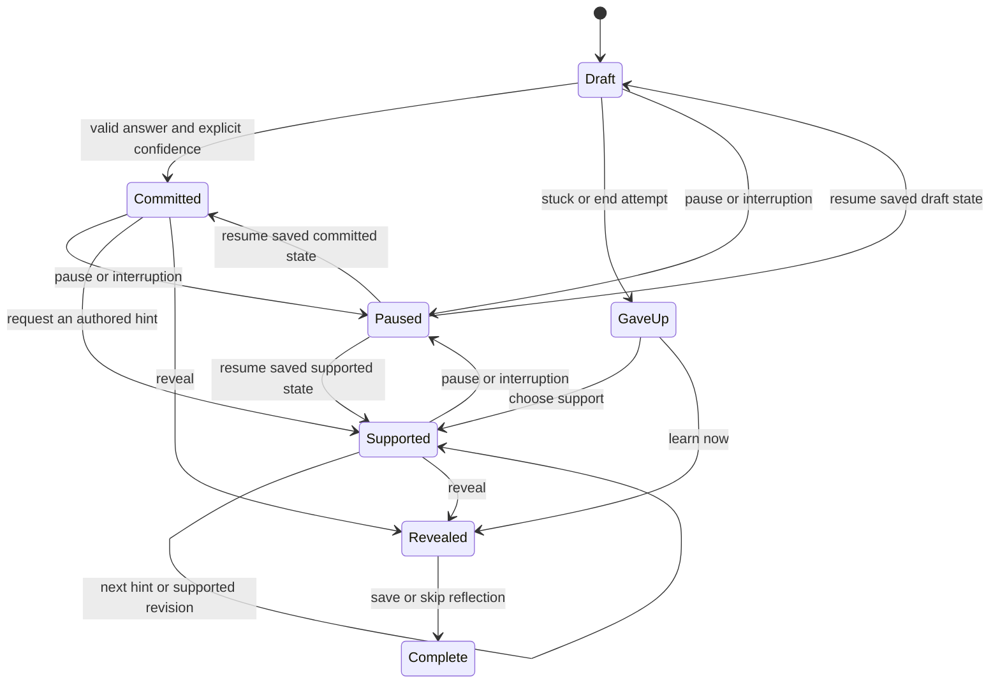
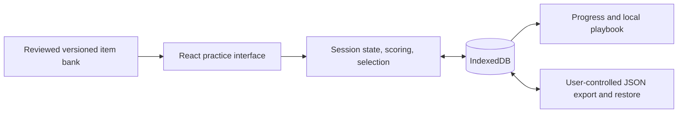

> **Superseded on 20 October 2026** by [doc.md](../../doc.md) v2 and [execution.md](../execution.md). Kept for history; relative links inside this copy may not resolve.

# Eleanor: thinking practice for the AI era

Research-informed product and system design · revised 19 October 2026

**Status: a proposed build specification. No application, content bank, database, or evaluation results exist yet.** Eleanor is the working name; “Crux” in the original brief is not a separate product.

Eleanor is a finite daily practice: solve a meaningful problem yourself, commit an answer and confidence, get useful feedback, and later try a new problem that requires the same idea. Its success criterion is better performance without assistance on fresh tasks. Whether this particular design achieves that is an experiment, not an established finding.

Read [the research audit](docs/research.md) for evidence and limitations, [the delivery plan](docs/plan.md) for implementation order and acceptance criteria, and [AGENTS.md](AGENTS.md) for contributor context. The [original brief](docs/archive/initial-brief.md) is retained as superseded historical input.

## 1. Product decisions

| Question | Decision for the first release |
| --- | --- |
| Who is it for? | One adult, initially the builder, who regularly uses AI and wants to practise independent reasoning. Later recruit adults with similar goals. |
| What does it promise? | Practice in named skills, transparent feedback, and honest measurement of unaided performance. No claims about IQ, preventing cognitive decline, treating attention disorders, or protecting jobs. |
| What ships first? | Calibration Court: short, realistic numerical judgment problems with an explanation of the learner’s approach. |
| What is the core loop? | Attempt → commit answer and confidence → optional authored hints → reveal and explain → delayed twin. |
| Where is the AI? | None is needed to test the loop. Add an optional conversational debrief only after the deterministic version works. |
| Where is personal work stored? | In the learner’s browser, with export, restore, and deletion. No account or cloud sync in the personal pilot. |
| What counts as learning? | Practice twins provide retention and near-transfer signals; a separate fixed assessment provides the primary pilot comparison. |
| What is deliberately deferred? | Chess, Rule Lab, generative tutoring, twelve-dimensional ratings, payments, streak mechanics, social play, and institutional sales. |

The longer-term ambition remains a serious, adult practice across several reasoning domains. The first release tests its learning mechanism before adding more formats.

The original Strength/Gap modes, daily edge-of-ability challenge, weekly Breakpoint Report, and business model remain deferred ideas. A later stretch task should be opt-in, prerequisite-aware, followed by instruction, and evaluated by subsequent application rather than time spent struggling. Free daily practice and paid depth are possible commercial hypotheses after repeated use demonstrates value.

### Position in the existing landscape

Interactive problem solving and guided AI tutoring already exist. [Brilliant](https://brilliant.org/faq/), [Khanmigo](https://www.khanmigo.ai/), and [Lichess practice](https://lichess.org/practice) are relevant references. The proposed distinction is the combination of recorded independent commitments, delayed application, and explicit uncertainty feedback. This is a product hypothesis; the research audit does not establish an uncontested market gap.

## 2. What the evidence changes

The linked [evidence register](docs/research.md#2-evidence-register) distinguishes published experiments, observational findings, preprints, and design inferences.

| Evidence | Consequence for Eleanor | Boundary |
| --- | --- | --- |
| Some experiments find worse unaided performance after answer-oriented AI assistance. | Record independent work before assistance and measure later unaided work. | This does not establish permanent impairment or effects across all AI use. |
| Purpose-built tutors can support learning. | Preserve scaffolding, feedback, and opportunities to explain. | Prompting a general chatbot to be Socratic is not a validated tutor. |
| Cognitive training often improves trained and related tasks, with weak evidence for far transfer. | State exactly which tasks improved; hold out assessment content. | A chess improvement is not evidence of better executive decisions. |
| Productive failure depends on instructional design and prerequisites. | Follow effort with consolidation; offer prerequisite instruction when needed. | A difficult task or a forced waiting period alone is not productive failure. |
| Confidence and performance can diverge. | Capture confidence before feedback and show it beside accuracy. | Brier score alone is not a pure calibration measure. |
| Retrieval practice has substantial supporting evidence. | Revisit the underlying idea through new applications. | An exact optimal schedule for these tasks is unknown. |

The decisions below are explicit starting policies. Session length, review intervals, difficulty thresholds, and pilot gates are tunable hypotheses, not research constants.

## 3. The first usable experience

Use three views, with settings accessible from each:

- **Today:** one bounded session, due reviews, and a clear end. No feed or public rank.
- **Practice:** the problem, an answer field with units, a small reasoning scratchpad, confidence input, support, and debrief.
- **Progress:** comparable assessment results, practice performance by task family, confidence versus outcomes, and the learner’s saved insights.

The visual direction is calm and adult: readable typography, clear diagrams, generous space for working, restrained color, and direct feedback. Difficulty comes from the reasoning rather than speed, tiny controls, or decorative complexity.

### Session policy

Aim for 15–20 minutes; this is a recommendation, not a timeout. Serve at most three substantive problems: up to two due twins and one new anchor. The first session may have only the anchor. A learner can stop, pause, or choose a shorter session without penalty. The cap applies to practice; a separately started assessment contains its fixed 24-item form.

For each problem:

1. Show the task, units, acceptance tolerance, and prerequisite reference. An optional prerequisite lesson occurs before the attempt and is recorded as instruction, not assistance on an already-started attempt.
2. The learner writes an approach, works in the scratchpad or on paper, and enters an answer. The app does not infer effort from word count or elapsed time.
3. The learner commits the answer and answers: **“How likely is it that this answer meets the stated criterion?”** Confidence has no preselected value. Store a probability from 0 to 1; display a percentage.
4. Preserve this first commitment. The learner can reveal the explanation immediately or request an authored nudge, a strategy question, or a partial step and try again. Supported revisions are separate records.
5. Reveal the verified answer, contrast the learner’s approach with an effective representation, and invite one sentence about what to try next time. Reflection is optional and never an accuracy score.
6. Schedule an unseen twin, initially for at least 24 hours later. A second twin is initially due seven days after the anchor debrief. Report the actual delay.

**“I’m stuck” is always available.** It closes the independent attempt as a give-up without inventing an answer or confidence, then offers support. **“End attempt and learn”** can reveal the solution immediately. Help has no currency, score penalty, or artificial delay. The cost is simply that supported work does not count as independent performance.

After the session, show a brief completion screen with the insight and next review. Missed sessions produce no debt, guilt notification, or accumulating mandatory workload. Once the finite bank is exhausted, offer due reviews or end the session; do not silently relabel repetitions as novel tasks.

### Attempt state and invariants



- Only the first commitment before task-specific help is eligible as the independent answer. Later assistance does not erase that earlier snapshot.
- If help preceded any answer, record a give-up and supported work; there is no independent confidence score.
- Assistance exposure is monotonic within an attempt. Refresh, back navigation, reopening, or a model failure cannot reset it.
- Never send correctness feedback, solution text, or answer-derived UI cues before the commitment or explicit give-up. Once the answer is revealed, that item is no longer novel.
- Pause and interruption are not wrong answers. On reload, offer resume; an abandoned interrupted attempt remains reported separately.
- A committed answer persists before reveal. Failed storage writes must be visible and must not advance the durable state.
- An assessment uses stricter behavior: no hints or item-by-item correctness during the form. Feedback release follows the frozen protocol; baseline item feedback stays withheld until the endline closes. Leaving or requesting instruction is allowed and makes the form incomplete or assisted, as appropriate.

A local application can enforce these rules in its interface; it cannot prevent a user inspecting downloaded solutions or consulting another device. This is personal practice, not a secure exam.

## 4. Worked example

A fictional factory makes 1,000 components. One percent are defective. A detector flags 90% of defective components and 10% of nondefective components. If a component is flagged, what is the probability it is defective? The task explicitly assumes these rates apply to this batch.

The correct calculation is nine defective flags and 99 nondefective flags: `9 / (9 + 99) = 8.333…%`. The item accepts answers within **0.1 percentage point** of this value, including the boundary. The solution and acceptance range must be computed from the same versioned parameters.

A learner submits `90%` with `80%` confidence. Their first answer is wrong and their binary Brier loss is `(0.8 - 0)^2 = 0.64`. If they had submitted `8.3%` at the same confidence, the loss would be `(0.8 - 1)^2 = 0.04`.

The first hint asks which population belongs in the denominator. A later hint suggests counting flagged components in a batch of 1,000. The worked solution shows the frequency table. A supported correction is visible as learning activity, while the first answer remains wrong in the independent record.

A twin changes rates and representation, not just character names. With 2% defects and the same detector, the answer becomes `18 / (18 + 98) ≈ 15.52%`. Another twin can ask the learner to reconstruct counts from a diagram. Reviewers must check that these still exercise the intended mechanism without introducing new prerequisites. These examples are exposed documentation fixtures and cannot be used in the builder’s assessment.

The answer’s probability and the learner’s confidence are different quantities: `8.3%` describes the factory outcome; `80%` describes confidence in the submitted calculation. Label both clearly and test that users understand the distinction.

## 5. Content is the main product asset

### Initial bank

Build a six-item engineering fixture first: two families, each containing an anchor and two twins. Exclude it from personal evaluation once its solutions have been seen.

The personal pilot then needs **60 reviewed practice items: 20 families × three items**. A family is one tightly related task template and its variants, not every task using a broad mechanism such as Bayes’ rule. Use one renderer, `numeric_judgment`, with a structured numerical answer, explicit units, and an open reasoning field. Start with base rates, conditional probability, denominator selection, and expected-value comparisons. Use invented scenarios with sufficient data; no trivia, live forecasts, or ambiguous real-world “correct” judgments.

Separately prepare two assessment forms of 24 items each, matched by mechanism and provisional difficulty. The assessment bank therefore contains **48 additional items**, outside the 60 practice items. For a learning-oriented personal pilot, both practice problems and assessment forms must be prepared without exposing their solutions to the participant before baseline. If the builder has authored or reviewed the practice bank, those items and twins are already exposed; run a usability pilot rather than presenting them as unseen independent work. Independently prepared assessments alone do not undo that exposure.

Do not call 60 variants 60 independent concepts. Report both item and family counts. Treat variants within a family as related observations.

### Minimum item contract

| Field group | Required information |
| --- | --- |
| Identity | Stable `item_id`, immutable `version`, `family_id`, renderer type, content-bank version. |
| Purpose | Primary skill, up to two secondary tags, mechanism, prerequisites, provisional difficulty band. |
| Role | `anchor`, `twin_24h`, `twin_7d`, or `assessment`; assessment form and matched-pair identifier where relevant. |
| Task | Prompt, diagram alternative text where needed, parameters, units, accepted input syntax, visible correctness criterion. |
| Verification | Expected result or deterministic evaluator, numerical tolerance, worked derivation, verifier version and checks. |
| Teaching | Ordered authored hints, common misconception, debrief, reflection prompt. |
| Review | `draft`, `verified`, `reviewed`, or `retired`; reviewer, date, provenance, reuse permission, and change rationale. |

Content validation rejects duplicate identities, missing twins, invalid parameter ranges, undefined units, nonfinite values, unavailable prerequisites, missing provenance, and unexplained solution changes. Render content as text and known diagram components; item files and imported text never supply executable code or raw HTML.

Only reviewed items enter practice. A solver establishes numerical or logical properties; it does not establish clarity, fairness, pedagogical value, or the absence of answer leakage. Human review is required for those. An unclear or incorrect item is retired, its affected outcomes marked invalid for scoring, and derived summaries recomputed without deleting historical work.

### Review workflow

Author → validate shape and parameters → independently recompute answer → review wording and hint leakage → check twin equivalence and prerequisite burden → publish a versioned bank. Review is a recorded action, not a boolean automatically set by the authoring model. During the solo stage, label any self-reviewed items and their solutions as known to the builder; use another reviewer before beta.

Keep assessment families out of practice, hints, retrieval notes, tutor examples, and model-generation prompts. Merely choosing a different item ID is not enough if it exposes the same assessment template.

## 6. Measurement rules

### Four distinct records

| Record | Purpose | What it can support |
| --- | --- | --- |
| First independent practice commitment | Track current performance before support. | Practice progress at its observed difficulty. |
| Supported revisions and debrief | Understand which help was used. | Descriptive learning activity, not unaided mastery. |
| First unseen delayed twin | Check retention and application of the trained mechanism. | A near-transfer signal at the recorded delay. |
| Fixed held-out assessment | Compare parallel forms outside the practice bank. | An exploratory comparison of the named tested skills. |

Twins count as near transfer, not general intelligence or proof of real-world benefit. A second presentation of the same item is retrieval practice, not another novel transfer observation. A twin with assistance or prior exposure cannot enter the unaided-twin numerator.

### Objective outcomes and confidence

For `numeric_judgment`, compute correctness from a finite number, the stated unit, and the versioned tolerance. Invalid input stays editable; do not score a parse failure as a reasoning error. Free-text rationale receives feedback but no automated correctness grade in version one.

For eligible answered items, let `p` be confidence and `y` be binary correctness:

```text
Brier loss = mean((p - y)^2)
Accuracy among answers = correct / eligible answered
Overconfidence gap = mean(p) - mean(y)
Completion = eligible answered / valid presented
Solve rate = correct / valid presented
```

Use the binary convention above, with a range of 0–1 and lower being better. A correct answer at certainty has loss 0; a wrong answer at certainty has loss 1; any answer at 50% confidence has loss 0.25.

Brier loss combines aspects of calibration and discrimination; it is not a stand-alone calibration index. Show a reliability plot with fixed confidence bins, the number of observations in each bin, mean confidence, and observed correctness. Start with five bins `[0,.2)`, `[.2,.4)`, `[.4,.6)`, `[.6,.8)`, `[.8,1]`; omit empty bins. Below 30 eligible answers, display the available observations as provisional and suppress trend claims. These display thresholds are product choices. The scoring rationale is grounded in [proper scoring rules](https://doi.org/10.1198/016214506000001437).

Always show sample size, task mix, and assistance/exposure exclusions beside a score. Skips have no Brier value because there is no submitted answer and probability. They remain in completion and solve-rate denominators. Do not hide declining completion behind better calibration among the few answered tasks.

For a started, closed fixed assessment form, report correct answers divided by all valid assigned items, with give-ups and unreached items counted as not solved; also report answered-only accuracy and the number unreached. A wholly missing assessment is missing data, not automatically a zero; follow the prespecified analysis. If a system failure or invalid item changes the form, show it explicitly and use a prespecified matched valid subset for comparison. Do not quietly replace difficult items.

A changing adaptive practice mix makes raw weekly accuracy and Brier comparisons misleading. Compare fixed parallel assessments for the pilot; describe adaptive practice separately. Do not combine subjective rubric scores, speed, and correctness into a single “thinking score.”

### Skills and mastery

Retain the original twelve-skill map as a content taxonomy, not a validated latent-ability model:

| Skill | Initial treatment |
| --- | --- |
| Framing | Reflection about the representation used; qualitative only. |
| Rule discovery | Planned for Rule Lab. |
| Lookahead | Planned for chess. |
| Estimation | Later numerical tasks with explicit tolerances; not open-ended Fermi grading yet. |
| Probabilistic and causal reasoning | Numerical probability and expected-value subskills first; causal inference later. |
| Debiasing | Tag targeted mechanisms; test performance on new contexts rather than labeling a person “unbiased.” |
| Argument and critique | Later rubric-based tasks with reviewed scoring. |
| Divergent thinking | Later creative practice; no validated originality score selected. |
| Verification | Later flawed-and-correct mixed examples. |
| Calibration | Confidence versus objective outcomes, kept separate from content difficulty. |
| Structural and spatial reasoning | Planned board and rule tasks. |
| Persistence | Descriptive give-up, return, and help-use patterns; no personality rank. |

A successful anchor alone never earns “mastered.” Show “applied on 2 delayed variants” with dates and assistance status when both twins were independently correct. That is a record of those tasks, not proof of a general trait. Slower work, assistive technology use, or requesting help must not lower a skill rating.

## 7. Selection and review scheduling

The personal pilot uses reviewed difficulty bands and simple rules. It does not fit item difficulties and twelve learner abilities from one person’s sparse history.

For a session, capture the start time and eligible content-bank version, then:

1. Resume an unfinished session before creating a new one. Persist the selected item IDs so reload cannot reroll the session.
2. Select at most two overdue unseen twins, oldest due first; break ties by stable item ID. Never serve two members of the same family in one session. Require at least 24 hours since the most recent solution exposure in that family.
3. Add one unseen anchor with satisfied prerequisites. Prefer the least-practised primary mechanism, then the current difficulty band, then stable ID. If both twin slots are occupied, the new anchor still fits within the three-item cap.
4. If no item satisfies the rules, offer an explicitly labeled review or finish. Never relax assessment isolation or pretend an exposed item is new.

A new anchor starts at the middle reviewed band unless the learner chooses easier or requests prerequisite instruction. For future anchors, use a rolling window of the last five valid, previously unseen anchor attempts at the current band. Count explicit give-ups as not solved for this convenience rule, without inventing confidence. Move down one band if at most two were independently correct, up one if all five were correct, otherwise stay; clamp to available bands. Reset the window on a band change. Supported revisions, twins, repeats, assessments, interruptions, and invalid items never enter it; later help does not erase an earlier independent commitment. This adjusts workload, not a skill rank, and is not a calibrated success-probability model.

The initial twin windows are 24 hours and seven days after the anchor debrief. If a preceding family solution was seen less than 24 hours ago, postpone the later twin; keep the actual scheduled and completed times. Do not reschedule seven days as if that delay had been observed when it was actually two weeks. Missed sessions do not increase the next session’s cap.

A failed twin offers instruction and optional later review. The two-twin bank does not provide infinite fresh reassessments. Add reviewed variants when needed and label repeat retrieval separately.

Elo/IRT or Glicko-style adaptation becomes a separate experiment only after enough independently answered data supports held-out probability calibration. If introduced, freeze item parameters for each evaluation cohort and anchor the scale to avoid ability/difficulty drift. Do not use response speed as a capability score. FSRS may later schedule recall of saved insights; it is not evidence that a learner can solve a fresh reasoning problem.

## 8. Architecture

### Personal pilot

Use **React + TypeScript + Vite**, static content files, and IndexedDB. This matches a browser-only application without authentication or server rendering; see the [React setup guidance](https://react.dev/learn/build-a-react-app-from-scratch) and [Vite static deployment guidance](https://vite.dev/guide/static-deploy). These are recommendations for the first implementation, not installed dependencies.



Use ordinary functions for state transitions, scoring, and selection. Use the platform’s transactional storage; do not introduce an event framework, microservices, vector database, queue, custom agent orchestration, or a second frontend framework.

A suggested future layout is `src/session/`, `src/content/`, `src/scoring/`, `src/storage/`, and `src/ui/`, with pure logic beside its focused tests. Do not create empty folders now. The delivery plan names proposed commands to establish when implementation begins.

### Minimum persistent records

| Record | Essential fields and purpose |
| --- | --- |
| Settings | Schema version, local learner ID, session timezone, accessibility preferences, selected difficulty band. |
| Content snapshot | Bank version and the item versions needed to reproduce recorded results; retain retired versions used by history. |
| Session | ID, start/end, selected item IDs, status, selection-policy version. |
| Assessment | Assignment ID, protocol/form/version, fixed item IDs and order, start/close status, and feedback-release eligibility. |
| Attempt | ID, practice-session or assessment-assignment link, item/version/family, mode, start/pause/resume status, first answer and confidence, first-commit time, assistance/prior-exposure declaration, grade/verifier version, terminal reason. |
| Support event | ID, attempt ID, ordered hint exposure or solution reveal, supported answer revision, timestamp. |
| Reflection | User’s optional insight, item link, update time; editable and deletable. |
| Review obligation | Anchor attempt, target twin, scheduled time, completed time, status. |

Keep first commitments immutable in ordinary use. Store support events append-only while the local history exists; deletion must still remove them. Derived charts and selection summaries are recomputable, not a second source of truth. Store timestamps/deadlines in UTC and display them in the chosen timezone. Session duration excludes explicit pauses and is not a measure of thinking time. The application is not a forensic event recorder: do not capture keystrokes, clipboard contents, browsing history, tab-switch counts, or continuous scratchpad replay.

Persist the state transition, its necessary support record, and any new review obligation in one IndexedDB transaction. Use stable attempt IDs and transition IDs to make double clicks and retries idempotent. The first commitment is compare-and-set: another tab cannot overwrite it. On a stale state, reload the persisted attempt and explain the conflict.

### Durability and privacy

Browser storage is local, not a backup or encryption boundary. Browsers can evict best-effort data; private browsing and clearing site data can remove it. An origin change also changes which storage the application can access. [MDN documents these limitations](https://developer.mozilla.org/en-US/docs/Web/API/Storage_API/Storage_quotas_and_eviction_criteria).

Offer persistent-storage requests where supported and an explicit export reminder. Export a versioned JSON document containing content versions, settings, sessions, answers, support, and insights. The exported file contains private work; say so at download time.

For version one, restore replaces local data after a preview and an explicit warning, with an opportunity to export the existing database first. Validate the entire import before writing: schema version, size limits, IDs and references, enum values, finite numbers, confidence range, and content/version consistency. Restore atomically; reject unsupported future versions and conflicting records without partially changing the database. Do not add a general multi-device merge engine.

On a storage error, retain the current in-memory work, offer a rescue export, and make the unsaved state obvious. Do not claim an answer was saved or reveal on a failed durable transition. Reopening a working browser is not a backup strategy; test export and restore before relying on the pilot.

Keep the journal, answers, and reflections local by default. Self-host assets; include no third-party analytics or session replay. A static host still sees ordinary web requests such as IP addresses, so do not claim absolute anonymity. Local storage does not promise offline loading of the application; an installable offline app is deferred. “Delete all local data” clears learner records and cached personal state; it cannot delete exports the user saved elsewhere. Shared-device users must understand that another person with access to the same browser profile may read their work.

### Hosted beta: a later, explicit change of boundary

Add a small server and Postgres only when shared participant storage, private assessment delivery, or the optional LLM requires it. Reuse the domain functions; no microservice migration is necessary. Keep the local-only practice mode available, and request a deliberate import/upload rather than silently sending historical journals.

The server owns authorization, assessment assignment, attempt commits, grading, and reveal eligibility. Send public problem fields before commitment and fetch protected solutions only afterward. Isolate each learner’s data, test cross-user access, version migrations, rate-limit costly endpoints, use secure sessions, and keep secrets server-side. Cloud export/deletion, backup-retention behavior, and operational logging must be specified before enrollment. A local database plus an account does not constitute sync; defer general offline conflict resolution.

No pgvector or generation queue is justified by the initial workload. If measured content-generation throughput later requires background work, use an existing queue and a reviewed publish step.

## 9. Assistance and model policy

Version one’s hint ladder is reviewed content. No model is allowed to invent a hint, grade the objective answer, change the recorded confidence, or award mastery.

An optional first LLM experiment happens **after reveal**. Send only the current problem, verified derivation, the learner’s deliberately shared response, and a bounded conversation. Ask the tutor to identify a specific misconception and request an explanation. Do not send the rest of the journal by default. Model availability must never block practice, scoring, export, or the authored debrief.

If a later feature chooses pre-reveal hints with a model, let it return only an allowed hint ID; the application displays the reviewed hint text. Invalid IDs, malformed output, timeouts, and provider errors fall back to authored support. General pre-reveal generated prose would require a new leakage evaluation and is outside this release.

Store prompt/model/evaluation versions and operational metadata, with minimized, redacted, time-limited provider logs. Treat user text and item text as untrusted input. Models receive no database mutation tools, arbitrary network tools, secrets, or assessment-bank access. System prompts alone are not a confidentiality control; [OWASP’s prompt-injection guidance](https://genai.owasp.org/llmrisk/llm01-prompt-injection/) explains the threat class.

Before exposing a model feature, run a fixed evaluation set covering correctness against verified solutions, unsupported assertions, attempts to request answers early, prompt injection, privacy leakage, and outage behavior. Pre-reveal control tests require zero unauthorized reveals in that suite; this is a release criterion, not a guarantee against every possible attack. Any critical failure blocks the affected feature. Re-run on every prompt, provider, or model change. Record both judged sample size and disagreements; question-count is not a learning metric.

Set a per-session call/token cap and a monthly budget before enabling a provider. Estimate cost from measured input/output tokens and current official pricing; no fixed cost estimate is credible before choosing a model. Provider data-use and retention settings are a deployment decision, not an assumption.

## 10. Expansion without changing the learning contract

| Arena | Minimum useful form | Verification and measurement | Entry gate |
| --- | --- | --- | --- |
| Sparring Board | Curated chess positions; commit a move and plan, then inspect an explanation. | Legal-move validation, offline Stockfish analysis, reviewed acceptable moves and alternatives. Grade move quality separately from prose; near-equal moves must not become arbitrary errors. | Core loop and backups work; board input is accessible; content has a recorded review and license. |
| Rule Lab | One bounded deterministic interactive world family. | Solver checks goal reachability and termination; capture actions and an explanation of the discovered rule. An optimal-path ratio is only valid if the optimum is established. | Chess or Court shows repeat use; simulator and solver agree; a non-drag interaction exists. |
| Red Team the Machine | Reviewed analyses, some flawed and some correct. | Objective error labels; report misses and false alarms. Learners must be able to say “no flaw.” | A reliable review process can establish correctness and plausibility. |
| Constraint Studio | A small set of creative briefs, learner drafts first. | Separate human-reviewed quality and originality judgments. Embedding distance is exploratory, not an authoritative creativity score. | Rubric agreement and bias audits are acceptable for the intended feedback. |
| Proof and Principle Dojo | Narrow mathematical counterexample or invariant tasks. | Domain-specific checks; symbolic algebra is not a proof verifier for arbitrary natural-language arguments. Lean only for formally represented tasks. | Prerequisites, representations, and verification scope are explicit. |
| Go and social modes | Add only after their underlying practice value is shown. | Precomputed reviewed analysis before expensive live engines; no correctness leaderboard. | Measured demand and a bounded maintenance budget. |

Stockfish is GPLv3; check the obligations for the exact binary and distribution before shipping it. [Its official repository](https://github.com/official-stockfish/Stockfish) explains source and license requirements. Do not assume Lichess code, chess-piece art, benchmark environments, datasets, and engine outputs all share one license. Record provenance individually.

Student, researcher, and executive lenses remain future content preferences and session budgets. They do not justify separate applications or unsupported inferences about a person’s cognitive type.

## 11. Accessibility and engagement

Use semantic controls, visible keyboard focus, readable contrast, clear validation, screen-reader labels, reduced-motion support, and a confidence control operable by keyboard and direct numeric entry. Diagrams need an equivalent textual or tabular representation wherever the task permits it. Boards must support click/select and keyboard moves rather than requiring dragging. See [W3C timing guidance](https://www.w3.org/WAI/WCAG22/Understanding/timing-adjustable.html) and [dragging alternatives](https://www.w3.org/WAI/WCAG22/Understanding/dragging-movements).

Timers are optional and pausable, never gates to support or speed-based rewards. Users may reason on paper or with assistive technology. Do not treat pasting an answer, switching windows, or a short attempt as evidence of cheating. Offer voluntary external-assistance and prior-exposure declarations, with no moralizing language.

Use finite sessions, visible improvements on specified tasks, and the learner’s own insight log for motivation. Rest days are ordinary. Notifications are opt-in if added. Defer streaks and ranks; do not create pay-to-skip assistance, infinite practice prompts, or a public aggregate intelligence score.

## 12. How to decide whether to continue

The [delivery plan](docs/plan.md) separates the engineering period, baseline, 14-day personal pilot, and later controlled feasibility beta. The personal pilot can establish that the loop is usable and provide exploratory learning signals; it cannot establish a causal effect.

Before the pilot, record the assessment forms, scoring and exclusion rules, actual target skills, acceptable burden, and what outcome would justify another cycle. Do not alternate hint weeks and direct-answer weeks for one person and call the result causal: learning carries over, forms differ, and order effects are unavoidable.

For a later 30–50-person beta, randomize adults to a prespecified full-loop condition and an active comparison matched for content coverage and intended time. Keep both groups’ held-out assessment procedures identical and analyze at the participant level. This is a feasibility study; sample-size planning for an efficacy claim must use an explicit meaningful effect and uncertainty. A user-count milestone is not a reason to publish a success claim.

The primary signal is performance on the named held-out tasks. Confidence quality, completion, hint dependence, burden, and return behavior explain the result. If engagement rises while held-out performance stays flat, investigate the content and instructional loop before adding retention mechanics. Publish null or adverse results as readily as favorable ones, with consent and an analysis that respects repeated items, related families, missing data, and participant attrition.
