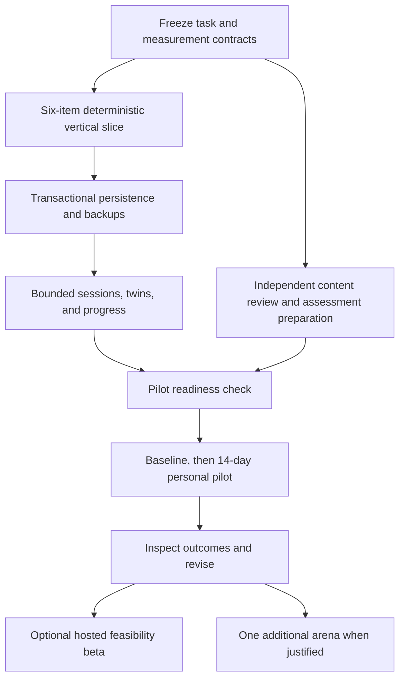

> **Superseded on 20 October 2026** by [doc.md](../../doc.md) v2 and [execution.md](../execution.md). Kept for history; relative links inside this copy may not resolve.

# Eleanor delivery and evaluation plan

Proposed plan · 19 October 2026 · all implementation work is pending

The objective is a usable, private thinking-practice loop whose records can distinguish independent answers, supported work, and later independent application. [doc.md](../doc.md) defines behavior and architecture; [research.md](research.md) explains the evidence and uncertainty. This plan does not authorize or claim an existing deployment.

## 1. Starting state and scope

The initial folder contained only `doc.md`, with no application, package manifest, lockfile, tests, CI, database, or Git repository. This documentation pass changes the product specification, adds this plan and a research audit, and adds root agent instructions. The original brief is preserved in [the archive](archive/initial-brief.md). There are no code callers, fixtures, exports, or runtime configuration to migrate in this pass.

The first implementation reaches the practice interface, session state, numerical-answer validation, content schema and fixtures, deterministic scoring, local storage, export/restore/deletion, session selection, progress, assessment mode, and their focused tests. Omitting any of those would leave the pilot unreliable or uninterpretable.

The main user risks are misleading progress claims, invalid content, lost private work, accidental disclosure through a later cloud feature, inaccessible interaction, and contaminated assessments. The work packages below address those before adding breadth.

### Planning assumptions

- One builder and one adult pilot participant initially; one browser profile and no concurrent-device synchronization.
- One task renderer, numerical judgment, with deterministic correctness and unscored free-text reasoning.
- React, TypeScript, Vite, npm, and IndexedDB are proposed choices, not installed infrastructure.
- A trustworthy independent preparer is needed for practice and assessment content the participant has not already reviewed. Without one, the builder’s pilot is a usability study; development can proceed without pretending otherwise.
- Content authorship and review are real work. Independently reviewed content, not UI construction, may be the critical path.

Budget roughly 10–15 focused engineering days for the personal-pilot software, plus content preparation/review and a separate 14-day use period. Depending on reviewer availability, this is roughly four to seven calendar weeks, not a two-week promise. Estimates are planning allowances, not evidence about implementation speed. Do not trade away backup, accessibility, or content checks to meet a date.

## 2. Dependency order

Content preparation can overlap with software work. The baseline must precede exposure to training or assessment solutions. Beta infrastructure and arena expansion are conditional, rather than dates that automatically become commitments.

## 3. Work packages

### P0 — Freeze the smallest testable contract

Write the initial content blueprint and a short pilot protocol before adding product code. Fix the numerical input syntax, unit handling, confidence wording, correctness tolerance, state transitions, exclusion rules, outcome denominators, and content-review checklist described in the specification.

Reserve assessment families before authoring the practice bank. Record which items and mechanisms the participant has already seen. Use the documentation’s factory example only as an exposed engineering fixture.

**Exit criteria:**

- [ ] One sample anchor and its two twins have independently checked calculations, published tolerances, and ordered hints.
- [ ] The first-commitment, give-up, pause, support, and reveal rules have an agreed written interpretation.
- [ ] A prospective protocol names the participant, task coverage, forms, assistance rules, outcomes, missing-data treatment, and practical continuation gates.
- [ ] Clean forms can be prepared independently, or the protocol explicitly declares a usability-only pilot.

### P1 — Ship one complete in-memory problem loop

Establish the toolchain, supported runtime version, lockfile, static build, and a focused test harness. Implement the numerical task, scratchpad, explicit confidence input, immutable first commitment, authored hint ladder, supported revision, verified reveal, and optional insight. Use six exposed fixture items: two families of three.

Use ordinary React state and pure domain functions. Do not build a generic arena framework, plugin system, authoring CMS, or model gateway. A small contract for the one renderer is enough.

**Exit criteria:**

- [ ] A learner can complete a correct attempt, a wrong attempt, and an honest give-up without a forced timer.
- [ ] The interface distinguishes task probabilities, confidence, independent outcomes, and supported revisions.
- [ ] Blank/invalid answers and unset confidence cannot be committed; parse errors preserve the draft.
- [ ] No correctness cue appears before commitment or explicit give-up.
- [ ] Keyboard navigation covers every action; errors, units, and controls have accessible labels.
- [ ] Small tests cover Brier boundaries, answer/tolerance boundaries, and forbidden state transitions.

### P2 — Make the work survive and remain private

Add versioned IndexedDB records and transaction-based writes. Persist the first commitment before reveal and preserve assistance history. Add reload/resume, stale-tab handling, error states, export, restore, and delete-all. The output is a personal tool that can safely retain valuable work.

**Exit criteria:**

- [ ] Refresh after commitment preserves the exact first answer, confidence, item version, and support state.
- [ ] Double submission and competing tabs do not create a second first answer or duplicate review obligations.
- [ ] A rejected write is visible; it does not silently reveal, claim to save, or discard the in-memory draft.
- [ ] Export → empty database → restore reproduces records and recomputed scores.
- [ ] Invalid, oversized, future-version, and referentially inconsistent imports leave the current database unchanged.
- [ ] Restore previews replacement and offers an export of existing data first; deletion removes all local personal state.
- [ ] Actual browser checks cover persistent-storage refusal, quota/write failure, and the limits of private browsing.
- [ ] Inspecting network traffic confirms that no answers, scratchpads, or reflections are uploaded by the personal mode.

### P3 — Add finite sessions, delayed twins, and honest progress

Implement the persisted three-problem session cap, due-twin selection, family spacing, deterministic tie breaks, and simple band changes. Add the progress view and an assessment mode with fixed forms and delayed feedback. Show missingness, sample sizes, and assistance/exposure labels before polishing charts.

**Exit criteria:**

- [ ] At most two due twins and one new anchor are assigned; same-family items never appear together.
- [ ] A later twin is held back until at least 24 hours after the family’s most recent solution exposure.
- [ ] Resuming a session preserves its assignments; exhaustion offers a labeled repeat or a clear end.
- [ ] A missed week never creates a longer mandatory session or false “seven-day” observation.
- [ ] Rolling five-anchor band changes use only eligible anchors at the current band, counting explicit give-ups as not solved; changes reset the window and stay within available bands.
- [ ] Brier, reliability bins, accuracy, solve rate, and completion match the specification; zero denominators produce “no data,” not zero performance.
- [ ] Fewer than 30 eligible answers produce provisional observations without trend claims.
- [ ] Invalid content can be retired and excluded without removing the user’s work.
- [ ] Assessments never appear in ordinary selection or inherit the three-item practice cap; baseline item feedback remains withheld until the endline closes.

### P4 — Prepare and review the pilot bank

Prepare the content inventory below. Each publishable item needs provenance, reviewer identity, numerical verification, clear units and tolerances, reviewed hints, and a family-level comparison. A schema check cannot replace content review.

| Inventory | Count | Use |
| --- | --- | --- |
| Engineering fixtures | 6 items / 2 families | Development and demonstration; already exposed and excluded from pilot outcomes. |
| Practice bank | 60 items / 20 families | Each family has one anchor, one first delayed twin, and one second delayed twin. |
| Assessment A | 24 items | Baseline, independent of practice families. |
| Assessment B | 24 items | Parallel endline form, with matched mechanism/difficulty coverage. |
| Total initial inventory | 114 items | Six exposed fixtures plus 108 practice/assessment items. |

Use a practice-family blueprint such as six base-rate families, six conditional-probability families, four denominator/reframing families, and four expected-value families. Review overlap explicitly; these are content categories, not four independent psychological factors. Each assessment form can contain six items per category, with difficulty and reading burden matched. Equal counts alone do not equate forms.

**Exit criteria:**

- [ ] The bank inventory reconciles; every practice family has both reviewed twins, and every assessment item has a form/matched-pair record.
- [ ] A second reviewer checks answers and ambiguity for any beta content. Self-reviewed content is labeled and known-solution exposure is recorded.
- [ ] No assessment family, solution, or distinctive template leaked into practice or tutor examples.
- [ ] For a learning-oriented pilot, the participant has not prepared or reviewed practice or assessment solutions before baseline. Otherwise mark the period usability-only and do not treat known twins as unseen.
- [ ] The content checker and a family-level human review both pass; unresolved items remain unpublished.
- [ ] Content and protocol versions are frozen for the observation period; corrections use retirement/versioning rather than silent edits.

### P5 — Run the personal pilot after the readiness check

Keep engineering time separate from observation time. Do not backfill missing confidence, reconstruct old unaided answers from memory, or count debugging as a training session.

| Relative time | Activity |
| --- | --- |
| Before day 0 | Rehearse all software flows on exposed fixtures, test backups, freeze the protocol, and reserve independent forms. |
| Day 0 | Complete assessment A unaided before training. No item-by-item feedback; postpone assessment solutions until the endline is complete. |
| Days 1–14 | Use bounded practice sessions; record problems, actual delays, first commitments, help use, completion, burden, and optional insights. |
| Days 15–16 | Pause training. Complete assessment B approximately 48 hours after the final practice session; record the actual delay. |
| After B closes | Reveal assessment feedback, inspect outcomes and missingness, export a backup, and write a short pilot report. |

The learner may see aggregate baseline results before training if the protocol says so, but do not reveal baseline item answers or targeted coaching that would compromise endline comparison. The ordinary practice debrief remains available throughout.

**Practical continuation gates, specified before the pilot:**

- [ ] At least 10 of 14 planned sessions were used voluntarily, with the actual session count and typical duration reported. This is a usability threshold, not a learning-effect threshold.
- [ ] No unexplained missing commitments, undetected content errors, or failed recovery of exported work.
- [ ] The learner can explain the difference between their numerical answer, confidence, and supported correction.
- [ ] Baseline and endline results are reported with their denominators, exposure conditions, and form limitations, even if flat or worse.
- [ ] The report identifies which content or debriefs helped and which caused confusion; it names one bounded next change.

Do not pass/fail efficacy using a p-value from one participant or a handful of related items. Before starting, record a personally meaningful improvement criterion in correct answers out of 24 and acceptable burden. Treat that criterion descriptively, since form differences, practice effects, expectations, and regression to the mean remain. If results are flat, inspect content and measurement before broadening the feature set. If clean forms were unavailable, report usability only.

### P6 — Optional controlled feasibility beta

Recruit approximately 30–50 adults only after the private loop and content review process work. Use a four-week parallel randomized feasibility design, with a manageable planned dose, for example three sessions per week. The beta schedule is a prespecified study protocol; it does not change the personal mode’s daily recommendation.

The full-loop condition includes independent commitments, authored scaffolding, debrief, and spaced variants. The active comparison uses standard independent problem solving and authored worked feedback, with matched content coverage and intended effort. Both groups receive the same independent assessment procedures. No control group needs an unrestricted answer-giving chatbot.

Freeze an explicit content assignment/schedule that makes the intended comparison interpretable; turn off uncontrolled adaptation for the study. If the comparison changes the whole bundle, say the study estimates the bundle’s effect, not the isolated effect of confidence input or twins. Match expectations and planned time without forcing people to wait; record actual time and completion.

**Before enrolling anyone:**

- [ ] Freeze randomization, allocation handling, training schedules, assessment-form order, endpoints, exclusions, missing-data rules, and analysis before seeing arm outcomes.
- [ ] Counterbalance A/B assessment order across participants and arms, or document why that is infeasible. Estimate form differences and avoid treating related items as independent participants.
- [ ] Define primary held-out solve rate, confidence outcomes, feasibility endpoints, and exploratory outcomes; set a minimum practically meaningful effect for planning a later study.
- [ ] Analyze by randomized assignment at participant level. Retain noncompleters in the accounting; provide sensitivity analyses rather than only a completer leaderboard.
- [ ] Do not replace a missing endline with a numeric zero in a standard completed-form analysis. Prespecify imputation or bounds where justified, report attrition by arm, and distinguish missing forms from skipped items within a presented form.
- [ ] Estimate uncertainty and feasibility rather than claiming the study is adequately powered by virtue of having 30–50 people. Use outcome variance, attrition, and the meaningful effect to plan a larger follow-up.
- [ ] Obtain informed participation and explicit research-data consent, with an appropriate ethics review route if conducted as institutional research. Publish no private notes or identifiable work without separate consent.
- [ ] If hosted data collection is necessary, implement the server boundary in the specification, user isolation, restricted assessment delivery, retention, backup/deletion behavior, and recovery checks before enrollment.

Report feasibility, adverse/frustrating experiences, content defects, null results, and uncertainty alongside promising changes. A credible negative or inconclusive report is more useful than an unsupported launch claim.

### P7 — Add one capability justified by the pilot

Choose a single next change from observed demand: more reviewed Court families, better consolidation, optional post-reveal dialogue, or curated chess. Do not add all of them to satisfy a calendar phase.

For chess, start with offline reviewed Stockfish analysis and curated positions. For Rule Lab, start with one simulator/solver family. For a model, start with optional post-reveal debriefs and a fixed evaluation suite. The architecture and content gates in [doc.md](../doc.md#10-expansion-without-changing-the-learning-contract) apply before release.

## 4. Verification matrix

Tests protect outcomes and user work; avoid snapshots that merely restate markup. [Vitest](https://vitest.dev/guide/) is a reasonable small harness for pure logic, and [Playwright](https://playwright.dev/docs/intro) for browser state, persistence, and flows. Both are proposed development dependencies; confirm supported versions together when installing them.

| Concern | Smallest meaningful check |
| --- | --- |
| Numerical input | Empty input, malformed decimals, percent-unit confusion, nonfinite values, unsupported syntax, and accepted tolerance endpoints. |
| Scoring | Certainty right/wrong, 50% confidence, averaging, missing scores, invalid outcomes, bin boundaries including 100%, and zero-denominator presentation. |
| State | Reveal requires durable commitment or explicit give-up; first answer is immutable; support exposure survives reload; pause does not become failure. |
| Selection | A fixed clock and tiny bank demonstrate the cap, due order, family spacing, stable tie breaks, exhaustion, and assessment exclusion. |
| Adaptation | A five-attempt fixture crosses each band threshold, including give-ups and boundary bands; supported revisions and twins cannot change it. |
| Persistence | Real-browser transaction failures, duplicate commits, stale tabs, refresh after each irreversible learning event, and content-version reconstruction. |
| Backup | Round trip, rejected import leaves original data intact, explicit replace preview, unsupported version rejection, and delete-all. |
| Content | Schema, references, published state, parameter constraints, recomputed result, item/family counts, and human-reviewed hint/twin validity. |
| Assessment | Fixed 24-item form independent of the practice cap, baseline feedback withheld until endline, no training scheduling, interrupted/assisted labels, and correct assigned-item denominators. |
| Accessibility | Keyboard-only session, screen-reader labels and errors, readable confidence controls, zoom, contrast, and non-drag alternatives when boards arrive. |
| Privacy | Network inspection and logs show no personal-mode answer/reflection uploads; exports accurately disclose private contents. |
| Hosted boundary, later | Cross-user reads/writes rejected; protected answers withheld; duplicate commit idempotency; export/deletion and recovery work. |
| Model, later | Grounding, leakage/injection cases, malformed output, privacy, caps, and fallback run against every changed prompt/model version. |

Also verify the documentation’s worked example independently: `9/108 × 100 ≈ 8.3333`, the twin `18/116 × 100 ≈ 15.5172`, and losses `0.64`/`0.04`. They are reference fixtures, not evidence of product effectiveness.

### Commands to establish during P1

**None of these scripts exists yet.** Add the scripts and actual implementation files before presenting them as working commands. Use npm and commit `package-lock.json`; pin a compatible supported Node runtime. Use one lint/format configuration rather than duplicating style policy in agent instructions.

| Proposed script | Contract |
| --- | --- |
| `npm ci` | Reproduce the dependency graph once the lockfile exists. |
| `npm run dev` | Start the local Vite application on a stable origin/port so development records remain accessible. |
| `npm run check` | Type-check and run the configured lint checks. |
| `npm test -- src/scoring/brier.test.ts` | Run a targeted logic test once that file exists; use `vitest run` as the test script. |
| `npm run content:check` | Validate the supplied content bank, including family relationships and deterministic expected results. |
| `npm run test:e2e -- tests/session.spec.ts` | Run the targeted browser flow once implemented. |
| `npm run build` | Create the static production build. |

Add CI only when these checks actually run. For the first software release, run check, content validation, the focused logic suite, browser persistence/backup flows, and build. Repeat broader checks only when new changes or a failure justify them. Record actual results rather than checking boxes because the plan names a command.

## 5. Risk and decision register

| Risk or unknown | Current response | Trigger for a different approach |
| --- | --- | --- |
| Content burden exceeds the schedule. | Cut renderer/arena breadth; retain review, twins, and honest pilot labeling. | More authoring capacity or demonstrated demand for a second arena. |
| Builder knows practice or assessment answers. | Independently prepared content or a usability-only pilot; known twins are never novel outcomes. | A separate unexposed adult sample and controlled protocol. |
| Browser data is lost. | Transaction handling, backup rehearsal, persistent-storage request, and an explicit limitation. | Users need automatic cross-device recovery and accept a hosted storage boundary. |
| Confidence input is misunderstood. | Clear units, onboarding examples, and teach-back checks. | Revise wording and recollect valid observations before interpreting trends. |
| Adaptive scores look better because tasks got easier. | Separate fixed held-out evaluation and report the practice mix. | Validated, anchored item models and sufficient data for matched comparisons. |
| Help becomes the whole activity. | Distinguish supported work; inspect delayed independent application and prerequisite gaps. | Change instruction/content before imposing punitive hint limits. |
| Model output is wrong or leaks an answer. | No model in the initial loop; later optional, bounded use with authored fallback. | Demonstrated useful feedback plus passing versioned evaluations. |
| Engagement grows without learning. | Keep sessions finite and put held-out outcomes before retention metrics. | Revise the learning loop; do not compensate with streaks or notifications. |
| Commercial demand is weak. | No payments, accounts, or sales motion in the personal pilot. | Adults repeatedly choose the practice and articulate value worth paying for. |

## 6. Immediate next implementation task

Implement **P1’s six-item numerical-judgment loop**, carrying over P0’s state/scoring contracts. Include a first commitment, authored support, verified reveal, one delayed-twin representation, and focused scoring/state tests. Then complete P2 before collecting longitudinal personal data.

No backend, model provider, live content generation, multi-arena abstraction, billing, or landing page is needed for that task. The success criterion is a complete understandable interaction with correct outcomes, followed by reliable storage—not a screenshot of a dashboard.
