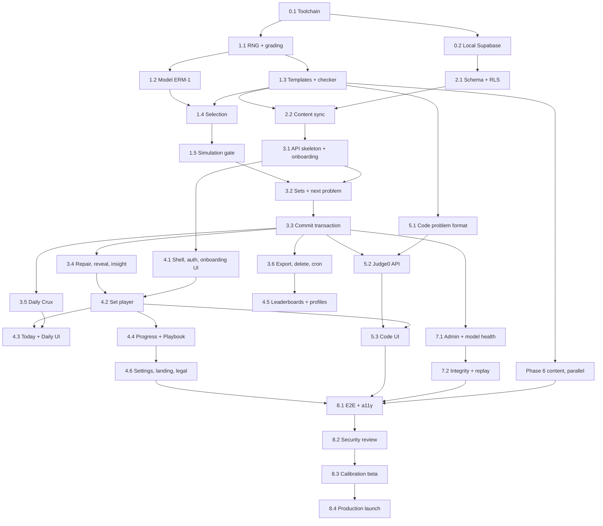

# Eleanor MVP Implementation Plan

> **For agentic workers:** REQUIRED SUB-SKILL: use superpowers:subagent-driven-development (recommended) or superpowers:executing-plans to implement this plan one task at a time. Steps use checkbox (`- [ ]`) syntax for tracking. Each task contains a **copy-paste prompt** for a fresh coding-agent session.

**Goal:** Ship the Eleanor MVP. That is a hosted, rated thinking gym with four tracks (Judgment, Logic, Math, Code), the ERM-1 learner model, echoes, repair ladders, Daily Crux, public leaderboards, and full data rights, running on Supabase with no AI in the product.

**Architecture:** A Vite + React SPA reads its owner's rows directly through Postgres row-level security. Every learning write goes through one Supabase Edge Function (`api`), which runs one Postgres transaction per learning event. Grading, the rating model, selection, and the problem generators are pure TypeScript in `supabase/functions/_shared/`. The same code runs in the Edge Function, the Vitest suite, the simulation, and replay. Code is judged by Judge0.

**Tech stack:** Node 22 LTS, npm, TypeScript (strict), React, React Router, Vite, Vitest, Playwright, Supabase (Auth, Postgres, Edge Functions on Deno, `pg_cron`), `@supabase/supabase-js`, `@supabase/server`, `postgres` (postgres.js), CodeMirror 6, Judge0.

**Spec:** [doc.md](../doc.md). Read it before any task. Section references such as `§6.2` point there. Evidence and caveats: [research.md](research.md).

**Status (20 October 2026): nothing in this plan has been implemented.** Commands named here do not exist until the task that creates them is done.

### How to use this document

1. Run tasks in order unless the dependency graph says otherwise. Phase 6 (content) can start in parallel once task 1.3 is done.
2. Start a **fresh agent session per task**. Paste the task's prompt. The prompt tells the agent what to read.
3. The agent works test-first. It writes the listed tests, watches them fail, implements, runs the listed commands, and reports **actual output**.
4. A task is done only when every "Done when" box is checked with evidence. Commit at the end of each task, with the attribution trailer from [AGENTS.md](../AGENTS.md).
5. 🔒 marks a **human gate**: secrets, accounts, content review, beta, and deploy. An agent prepares the work and stops for the owner.
6. This plan specifies contracts, schemas, formulas, and test cases exactly. It describes implementation code instead of spelling it all out, so each agent writes the code test-first against these contracts. If a contract here is wrong, fix it here first, then in code.

---

## Global Constraints

Every task implicitly includes these.

- **Runtime:** Node 22 LTS (`.nvmrc` = `22`), npm, and a committed `package-lock.json`. After it exists, install with `npm ci`. Docker Desktop is required for the local Supabase stack. Deno 2.x is required locally for `deno check`.
- **TypeScript:** `strict: true`. No `any` in `_shared`. `allowImportingTsExtensions: true` so `_shared` imports use explicit `.ts` paths, which Deno and Vite both accept.
- **`supabase/functions/_shared/` is pure.** No Deno, Node, DOM, network, clock, or `Math.random` access. Time arrives as a `Date` argument and randomness as an `Rng` argument. Imports are relative only.
- **Allowed runtime dependencies:** `react`, `react-dom`, `react-router-dom`, `@supabase/supabase-js`, `codemirror` plus the `@codemirror/lang-python`, `@codemirror/lang-cpp`, and `@codemirror/lang-javascript` packages.
  - In the Edge Function: `npm:@supabase/server` and `npm:postgres`.
  - Dev only: `vite`, `@vitejs/plugin-react`, `typescript`, `vitest`, `@playwright/test`, `@axe-core/playwright`, `eslint` (with the Vite template config), `supabase` (CLI), `tsx`, `postgres`.
  - Any other dependency needs a one-paragraph justification in the commit message.
  - Pin exact versions that are at least two weeks old.
- **No AI anywhere:** no model calls, no generated explanations, no generated content at runtime.
- **The browser never writes** to `sets`, `attempts`, `track_ratings`, `concept_ratings`, `rating_events`, `echoes`, `misconception_stats`, `code_submissions`, `instances`, `instance_secrets`, or `transitions`. All such writes go through `api`.
- **Before resolution,** the browser never receives an answer, step, solution, misconception value, item rating, or forecast.
- **Model constants are exactly those in §6.** `MODEL_VERSION = 'erm-1'`. Changing a constant means a new model version plus a replay.
- **Exact copy:** the confidence question is *"How likely is it that your answer is correct?"* For code it is *"How likely is it that this passes every hidden test?"* The give-up button reads **I'm stuck**. Feedback describes the task and the method, never the person. Nowhere does the product mention IQ, brain age, or intelligence scores.
- **Never:** keystroke, clipboard-read, paste, tab-switch, or speed tracking; timers in practice; streak counters; third-party analytics, fonts, or scripts.
- **Time:** store `timestamptz` in UTC. Daily Crux days are UTC dates. Display in the browser's timezone.
- **Content:** only `published` items are selectable. **A coding agent never sets `review.reviewer`, `reviewedAt`, or `status: 'published'`.** Only the human reviewer does.
- **Accessibility:** every interactive element is reachable and operable by keyboard, has a visible focus ring and an accessible name, and meets WCAG 2.2 AA contrast. Never use drag-only interactions. Respect `prefers-reduced-motion`.
- **Commits:** one task per commit (or a small series). The message ends with the `Co-Authored-By:` trailer naming the actual agent model.

## Review Focus

These input classes and failure modes are implied by the spec but easy to miss. Each one has a pinned test in the owning task.

1. **The same commit is sent twice or from two tabs.** Exactly one resolution and one set of rating events must result; the second call returns the first result. *Pinned in task 3.3 (concurrent commit test).*
2. **The network drops during commit.** The UI keeps the draft and confidence and retries with the **same** `transitionId`, so no duplicate is created and nothing is lost. *Pinned in task 4.2 (Playwright route-abort test).*
3. **Hostile or odd numeric input:** `"1,000.5"`, `"−3"` (Unicode minus), `"8.3 %"`, `".5"`, `"5."`, `"1/0"`, `"1e400"`, `"0x10"`, `""`, and `"12,34"`. Each parses or is rejected exactly as task 1.1 specifies, and a parse error never becomes a wrong answer. *Pinned in task 1.1.*
4. **Selection finds nothing:** no item near target, every family recently exposed, or a concept exhausted. Selection falls back to the next concept and then returns `none`; the API closes the set gracefully instead of erroring or looping. *Pinned in tasks 1.4 and 3.2.*
5. **Judge0 is down or times out.** The submission becomes `judge_error`, the attempt stays `presented` and unrated, and the learner can resubmit. *Pinned in task 5.2.*

---

## Repository map

```text
.nvmrc  package.json  package-lock.json  tsconfig.json  vite.config.ts  eslint.config.js  index.html  playwright.config.ts
src/
  main.tsx  App.tsx  styles.css
  lib/        supabase.ts  api.ts  useAction.ts  format.ts  database.types.ts (generated)
  pages/      Landing  Login  Onboarding  Today  SetPlayer  Daily  Progress  Playbook  Leaderboard  Profile  Settings  Admin  Legal
  components/ PromptBlocks  AnswerInput  ConfidenceInput  ResultPanel  RepairLadder  Reveal  InsightInput  SetSummary
              RatingChart  ReliabilityChart  ConceptMap  TitleBadge  CodeEditor  CodeVerdict
supabase/
  config.toml  seed.sql
  migrations/  0001_schema.sql  0002_rls.sql  0003_functions_cron.sql  …
  tests/       rls.test.sql
  functions/
    _shared/   rng.ts  grading.ts  model.ts  select.ts
               content/ types.ts  catalog.ts  instance.ts  registry.ts  cards/*.ts  judgment/*.ts  logic/*.ts  math/*.ts  code/*.ts
               code/compare.ts
               *.test.ts (Vitest, beside the code)
    api/       index.ts  router.ts  http.ts  db.ts  transition.ts  resolve.ts  judge0.ts
               routes/ onboarding.ts  sets.ts  attempts.ts  daily.ts  code.ts  account.ts  admin.ts  reports.ts
content/code/<slug>/  gen.py  validator.py  solutions/ref.cpp  solutions/brute.py  solutions/wrong_*.{cpp,py}
scripts/       content-check.ts  content-preview.ts  content-sync.ts  code-build.ts  simulate.ts  model-replay.ts  make-admin.ts
tests/api/     *.test.ts (Vitest against the local function)
tests/e2e/     *.spec.ts (Playwright)
```

## Accounts and secrets the owner provides 🔒

| Need | When | Notes |
| --- | --- | --- |
| Docker Desktop, Deno 2.x, Python 3.11+, g++ 11+ | Task 0.1 | Python and g++ are used only to build code-problem tests locally. |
| Supabase account and a production project | Task 8.4 | Local development uses `npx supabase start`. |
| Google OAuth client (web) | Task 4.1 locally (optional), task 8.4 in production | Redirect URI comes from the Supabase Auth settings. |
| Judge0 access: hosted plan or a self-hosted CE instance | Task 5.2 | Self-hosting needs a Linux VM that supports Judge0's sandbox; follow Judge0's own install docs. |
| Custom SMTP provider | Task 8.4 | The default Supabase email sender is rate-limited and not for production. |
| Static host (Vercel, Netlify, or Cloudflare Pages) and a domain | Task 8.4 | SPA rewrites and security headers. |

## Dependency graph



---

## Phase 0: Foundation

### Task 0.1: Repository and toolchain

**Files:** create `.nvmrc`, `package.json`, `package-lock.json`, `tsconfig.json` (plus the template's app and node configs), `vite.config.ts`, `eslint.config.js`, `index.html`, `src/main.tsx`, `src/App.tsx`, `src/styles.css`, `.gitignore`, and `supabase/functions/_shared/smoke.test.ts`. Modify `AGENTS.md` (Package Manager and File-Scoped Commands sections).

**Produces:** the scripts `dev`, `build`, `typecheck`, `lint`, `check`, `test`, and `test:watch`.

**Prompt:**

```text
You are implementing Task 0.1 of the Eleanor MVP. Read AGENTS.md, then docs/execution.md (the "Global Constraints" section and Task 0.1).

1. Run `git init` if this is not a repository yet. Add .gitignore entries for node_modules, dist, .env*, supabase/.env*, build/, playwright-report/, test-results/ and supabase/.temp.
2. Scaffold Vite React + TypeScript into the existing folder without deleting the docs. Use the current create-vite react-ts template, then remove its demo assets.
3. Set .nvmrc to 22. In package.json, set "engines": {"node": ">=22 <23"}.
4. In tsconfig, keep strict mode on, enable allowImportingTsExtensions with noEmit, and include src/, scripts/, tests/ and supabase/functions/_shared/. Exclude supabase/functions/api/ (Deno code, checked with deno check later).
5. Install the dev dependencies vitest, tsx and supabase (the CLI) with exact versions. Add these scripts:
   "dev": "vite --port 5173 --strictPort",
   "build": "tsc -b && vite build",
   "typecheck": "tsc -b --noEmit",
   "lint": "eslint .",
   "check": "npm run typecheck && npm run lint",
   "test": "vitest run",
   "test:watch": "vitest"
   Configure Vitest to include supabase/functions/_shared/**/*.test.ts and scripts/**/*.test.ts, and to exclude tests/api and tests/e2e.
6. Add supabase/functions/_shared/smoke.test.ts asserting 1 + 1 === 2. Run `npm test` and `npm run check` and paste the real output.
7. App.tsx renders an <h1>Eleanor</h1> only. No router yet.
8. Update AGENTS.md: replace "not installed yet" with the real Node version and the scripts that now run. Keep everything else.
9. Commit: "chore: scaffold Vite React TS toolchain".

Do not add any dependency not listed in Global Constraints.
```

**Done when:**

- [x] `npm ci && npm test && npm run check && npm run build` succeed (paste output).
- [x] `AGENTS.md` lists only commands that actually run.

### Task 0.2: Local Supabase stack and auth configuration

**Files:** create `supabase/config.toml`, `supabase/seed.sql` (empty for now), `.env.example`, `src/lib/supabase.ts`, and `supabase/.env.example`. Modify `package.json` (scripts) and `AGENTS.md`.

**Produces:** a `supabase` client export in `src/lib/supabase.ts`, and the scripts `db:start`, `db:stop`, `db:reset`, `db:types`, and `functions:serve`.

**Prompt:**

```text
You are implementing Task 0.2 of the Eleanor MVP. Read docs/execution.md (Global Constraints, Task 0.2) and doc.md §10.1–10.2.
Before writing config, fetch the current Supabase docs (context7 or supabase.com/docs) for: the CLI local development workflow, supabase/config.toml auth settings, and the new publishable/secret API keys.

1. Run `npx supabase init`. In config.toml:
   - set site_url = "http://127.0.0.1:5173" and additional_redirect_urls = ["http://127.0.0.1:5173/**", "http://localhost:5173/**"];
   - enable email auth with OTP/magic link, double-confirm changes, and no password sign-up for the product;
   - leave Google OAuth disabled locally unless env vars are present (use env(GOOGLE_CLIENT_ID) and env(GOOGLE_SECRET) as the docs describe);
   - set JWT expiry to 3600.
2. Add these scripts:
   "db:start": "supabase start",
   "db:stop": "supabase stop",
   "db:reset": "supabase db reset",
   "db:types": "supabase gen types typescript --local > src/lib/database.types.ts",
   "functions:serve": "supabase functions serve --env-file supabase/.env.local"
3. Add .env.example with VITE_SUPABASE_URL and VITE_SUPABASE_PUBLISHABLE_KEY.
   Add supabase/.env.example with APP_ORIGIN, JUDGE0_URL, JUDGE0_AUTH_HEADER, JUDGE0_AUTH_TOKEN and JUDGE0_LANGUAGES (JSON map, e.g. {"python":0,"cpp":0,"javascript":0}, filled in during Task 5.2).
4. Create src/lib/supabase.ts exporting `supabase = createClient(url, publishableKey, { auth: { flowType: 'pkce', persistSession: true, detectSessionInUrl: true } })`. Throw a clear error if either env var is missing. Install @supabase/supabase-js (exact version).
5. Run `npm run db:start`, copy the printed API URL and publishable key into .env.local (gitignored), and confirm `npm run dev` loads without errors.
6. Document in AGENTS.md: Docker is required, the db:* scripts, where local keys come from (`npx supabase status`), and the local email inbox URL printed by `supabase status`.
7. Commit: "chore: local Supabase stack and auth config".
```

**Done when:**

- [x] `npx supabase status` shows a running stack (paste the redacted output).
- [x] `npm run dev` serves the page and the console shows no Supabase env errors.

---

## Phase 1: Pure domain core (no database, test-first)

### Task 1.1: Seeded RNG, answer parsing, and grading

**Files:** create `supabase/functions/_shared/rng.ts`, `rng.test.ts`, `grading.ts`, `grading.test.ts`, and `content/types.ts` (only the `AnswerSpec`, `Answer`, `RawAnswer`, `Tolerance`, and `Block` types for now).

**Interfaces produced:**

```ts
// rng.ts
export type Rng = { next(): number /* [0,1) */; int(lo: number, hi: number): number /* inclusive */; pick<T>(xs: readonly T[]): T };
export function makeRng(seed: number): Rng;                              // mulberry32, seed coerced to uint32
export function hashSeed(...parts: (string | number)[]): number;         // FNV-1a 32-bit over parts joined by "|"

// content/types.ts (part)
export type Block =
  | { t: 'p'; text: string } | { t: 'note'; text: string } | { t: 'code'; text: string }
  | { t: 'list'; items: string[]; ordered?: boolean }
  | { t: 'table'; head: string[]; rows: string[][]; caption?: string };
export type Tolerance = { abs?: number; rel?: number };
export type Option = { id: string; label: string };
export type AnswerSpec =
  | { type: 'number'; unit?: string; tolerance: Tolerance }
  | { type: 'integer'; unit?: string }
  | { type: 'estimate'; unit: string; log10Tolerance: number }
  | { type: 'choice'; options: Option[] }
  | { type: 'multi'; options: Option[] }
  | { type: 'sequence'; items: Option[] }
  | { type: 'code'; languages: ('python' | 'cpp' | 'javascript')[] };
export type Answer = number | string | string[];
export type RawAnswer = string | string[];

// grading.ts
export type Parsed = { ok: true; value: Answer } | { ok: false; error: string };
export function parseNumber(raw: string, unit?: string): { ok: true; value: number } | { ok: false; error: string };
export function parseAnswer(spec: AnswerSpec, raw: RawAnswer): Parsed;
export function isCorrect(spec: AnswerSpec, expected: Answer, given: Answer): boolean;
export function matchMisconception(spec: AnswerSpec, list: { id: string; value: Answer }[], given: Answer): string | null;
export function formatWarning(spec: AnswerSpec, given: Answer): string | null;
```

**Rules:**

- **`parseNumber`:**
  - Trim. Map `−` (U+2212) to `-`.
  - If `unit === '%'`, strip one trailing `%`, optionally preceded by spaces. Otherwise a `%` is an error: "This answer is not a percentage."
  - Accept `^[+-]?(\d+(\.\d*)?|\.\d+)([eE][+-]?\d+)?$`, US thousands commas `^[+-]?\d{1,3}(,\d{3})+(\.\d+)?$` (strip the commas), and fractions `^[+-]?\d+\s*/\s*\d+$` with a nonzero denominator.
  - Reject empty input, non-finite results (`1e400`), hex, `12,34`, multiple dots, and anything else, each with a human-readable error.
- **`isCorrect`:**
  - `number`: `|x − a| ≤ max(abs ?? 0, (rel ?? 0)·|a|) + 1e-9`.
  - `integer`: `Number.isInteger(x) && x === a`.
  - `estimate`: `x > 0 && |log10(x/a)| ≤ L + 1e-12`.
  - `choice`: string equality.
  - `multi`: set equality.
  - `sequence`: array equality.
- **`matchMisconception`:** applies only when the answer is incorrect. It uses the same comparison as `isCorrect` against each value and returns the first id that matches.
- **`formatWarning`:** when `unit === '%'` and `0 < x < 1` and the input had a decimal point, it returns *"You entered a proportion. Did you mean {x·100}%?"* It never looks at the expected answer.

**Prompt:**

```text
You are implementing Task 1.1 of the Eleanor MVP. Read docs/execution.md (Global Constraints, Review Focus item 3, Task 1.1) and doc.md §5.
_shared code must be pure: no Date.now, no Math.random, no I/O.

Write the tests first (Vitest, beside the code):
- rng.test.ts: makeRng(42) produces the same first 5 values on every run (snapshot the numbers in the test); int(1,6) stays in [1,6] over 10,000 draws and hits every value; hashSeed('a',1) === hashSeed('a',1) and !== hashSeed('a',2).
- grading.test.ts. These must all hold:
  parseNumber('1,000.5') → 1000.5; parseNumber('−3') → -3; parseNumber('8.3 %','%') → 8.3; parseNumber('.5') → 0.5; parseNumber('5.') → 5;
  parseNumber('3/4') → 0.75; parseNumber('1/0') error; parseNumber('1e400') error; parseNumber('0x10') error; parseNumber('') error;
  parseNumber('12,34') error; parseNumber('8%') with no unit → error 'This answer is not a percentage.'; parseNumber('1.2.3') error.
  isCorrect({type:'number',tolerance:{abs:0.5}},10,10.5) true; same with 9.5 true; same with 10.5000001 false.
  isCorrect({type:'number',tolerance:{rel:0.01}},200,202) true; same with 202.01 false.
  isCorrect({type:'estimate',unit:'km',log10Tolerance:0.3},1000,1995) true; same with 2000 false (log10 2 = 0.30103); same with -5 false.
  isCorrect({type:'integer'},7,7) true; same with 7.0000001 false.
  isCorrect({type:'multi',...},['a','c'],['c','a']) true; same with ['a'] false. Sequence order matters.
  matchMisconception: a spec with abs 0.1, answer 8.333 and misconception {id:'base-rate-neglect', value:90} matches 90.05 and returns the id; it returns null for a correct answer; it returns null for 50.
  formatWarning({type:'number',unit:'%',tolerance:{abs:0.1}}, 0.083) → string containing '8.3'; same with 8.3 → null.
  parseAnswer: choice/multi/sequence reject ids not in the spec; multi rejects duplicates; sequence must be a permutation of the items.
Run the tests, watch them fail, implement, run again. Paste the output.
Commit: "feat(shared): seeded rng, answer parsing and grading".
```

**Done when:**

- [ ] `npm test -- supabase/functions/_shared/grading.test.ts` passes. Every case above is present.
- [ ] `npm run check` passes.

### Task 1.2: Learner model ERM-1

**Files:** create `supabase/functions/_shared/model.ts` and `model.test.ts`.

**Interfaces produced:**

```ts
export const MODEL_VERSION = 'erm-1';
export const PARAMS = {
  r0: 1200, rd0Learner: 350, rd0Concept: 250, rd0Item: 250, rdMax: 350,
  rdFloorLearner: 70, rdFloorItem: 30, c: 15, itemUpdateMaxLearnerRd: 150,
  provisionalRd: 110, leaderboardRd: 110, placementCount: 8, overallMaxRd: 150,
  echoIntervals: [1, 3, 7, 21] as const, maxDueEchoes: 10,
  misconceptionHalfLifeDays: 14, misconceptionActive: 1.5,
} as const;
export type Rating = { r: number; rd: number; lastAt: Date | null };
export type Intensity = 'steady' | 'balanced' | 'stretch';
export function inflate(x: Rating, now: Date): Rating;                     // RD ← min(rdMax, sqrt(rd² + c²·days)); lastAt unchanged
export function expected(self: Rating, opp: Rating): number;               // E from §6.2
export function update(self: Rating, opp: Rating, s: 0 | 1, floor: number, now: Date): Rating; // no inflation inside; sets lastAt = now
export function applyResponse(i: {
  track: Rating; concept: Rating | null; item: Rating & { anchor: boolean };
  s: 0 | 1; now: Date;
}): { track: Rating; concept: Rating; item: Rating; forecast: number; itemUpdated: boolean;
      events: { subject: 'track' | 'concept' | 'item'; before: Rating; after: Rating; expected: number; score: 0 | 1 }[] };
export function targetSuccess(c: { placement: boolean; intensity: Intensity; consecutiveLosses: number; isLastSlot: boolean }): number;
export function targetDifficulty(rBasis: number, p: number): number;     // rBasis + 400·log10((1−p)/p)
export function nextEchoInterval(prev: number | null, correct: boolean): 1 | 3 | 7 | 21;
export function decayMisconception(prev: { weight: number; lastAt: Date } | null, now: Date): { weight: number; lastAt: Date }; // adds 1 after decay
export type MasteryState = 'new' | 'learning' | 'practiced' | 'proven' | 'needs_review';
export function masteryAfter(m: { state: MasteryState; firstCorrectAt: Date | null; echoSuccesses: number },
  ev: { correct: boolean; rated: boolean; isEcho: boolean; itemRating: number; entryRating: number; now: Date }):
  { state: MasteryState; firstCorrectAt: Date | null; echoSuccesses: number };
export function displayState(state: MasteryState, lastEchoSuccessAt: Date | null, now: Date): MasteryState; // proven + >45 days → needs_review
export type CalPoint = { p: number; y: 0 | 1 };
export function calibration(points: CalPoint[]): null | {
  n: number; brier: number; calError: number; overconfidence: number;
  bins: { lo: number; hi: number; n: number; meanP: number; meanY: number }[] /* non-empty bins only */ };
export function title(r: number): 'Novice' | 'Apprentice' | 'Thinker' | 'Analyst' | 'Strategist' | 'Expert' | 'Master' | 'Grandmaster' | 'Legend';
export function overallRating(tracks: { r: number; rd: number }[]): number | null; // precision-weighted over rd ≤ 150
export function isProvisional(rd: number): boolean;                        // rd > 110
```

**`applyResponse` rules:**

- Inflate `track` and `concept` by inactivity first. A `null` concept starts at `{ r: track.r, rd: 250 }`.
- `forecast = expected(concept, item)`.
- Track update: track vs. item, floor 70.
- Concept update: concept vs. item, floor 70.
- Item update: item vs. **track** with `s_item = 1 − s`, floor 30. It happens only if `!item.anchor && inflatedTrack.rd ≤ 150`.
- Every update uses pre-update values.
- `events` lists each update that happened.

**Prompt:**

```text
You are implementing Task 1.2 of the Eleanor MVP: the ERM-1 learner model. Read doc.md §6 completely, then docs/execution.md Task 1.2. Implement exactly the formulas and constants given; do not "improve" them.

Tests first (model.test.ts). They must include:
1. Every reference vector in doc.md §6.2 (8 rows). Use update() with floor 70 for learner rows and floor 30 for the item row. Check r', RD' and E to within 0.01. Example: update({r:1200,rd:350},{r:1200,rd:250},1,70,now) → r 1370.21, rd 274.75.
2. inflate({r:1500,rd:70,lastAt:T},T+30 days).rd ≈ 107.94; T+10000 days → 350; lastAt null → unchanged.
3. targetDifficulty(1500,p) for p = 0.5/0.55/0.7/0.8/0.85 → 1500 / 1465.14 / 1352.81 / 1259.18 / 1198.67.
4. targetSuccess: placement → 0.5 regardless of the rest; balanced → 0.7; steady → 0.8; stretch → 0.55; balanced with 2 losses → 0.8; balanced with 2 losses on the last slot → 0.85 (cap); steady on the last slot → 0.85.
5. applyResponse: anchor items never change; a learner with track rd 200 does not update the item (itemUpdated false); a null concept starts from the track rating with rd 250; the forecast equals expected(concept, item); events has 2 or 3 entries.
6. nextEchoInterval(null,true) = 1; (1,true) = 3; (3,true) = 7; (7,true) = 21; (21,true) = 21; (7,false) = 1.
7. decayMisconception(null,T) → weight 1; ({weight:1,lastAt:T}, T+14d) → 1.5 (active threshold reached); (…, T+28d) → 1.25.
8. masteryAfter: learning → practiced on the first rated correct answer; echo successes only count when itemRating ≥ entryRating; proven needs echoSuccesses ≥ 2 AND now ≥ firstCorrectAt + 3 days; an incorrect rated echo while proven → needs_review; a correct echo from needs_review → proven; unrated events change nothing.
9. calibration([]) → null. A case with known values: points [(0.9,1),(0.9,0),(0.5,1),(0.1,0)] gives brier = (0.01+0.81+0.25+0.01)/4 = 0.27, overconfidence = mean p 0.6 − mean y 0.5 = 0.1, bins [0,.2) n1 and [.4,.6) n1 and [.8,1] n2; p = 1.0 falls in the last bin.
10. title(999) Novice, title(1000) Apprentice, title(2400) Legend. overallRating ignores tracks with rd > 150 and returns null if none remain.
Implement, run, paste output. Commit: "feat(shared): ERM-1 learner model".
```

**Done when:**

- [ ] All 8 reference vectors pass within 0.01.
- [ ] `npm test` and `npm run check` pass.

### Task 1.3: Template contract, catalog, content checker, and two reference templates

**Files:**

- Create `supabase/functions/_shared/content/types.ts` (complete), `catalog.ts`, `instance.ts`, `registry.ts`.
- Create `content/judgment/base-rate-screening.ts`, `content/logic/knights-two.ts`, and `content/cards/judgment.ts` (cards for `judgment.frequencies`, `judgment.conditional`, and `judgment.base-rates` only).
- Create `instance.test.ts`, `scripts/content-check.ts`, `scripts/content-check.test.ts`, and `scripts/content-preview.ts`.
- Modify `package.json` (add `content:check` and `content:preview`).

**Interfaces produced:**

```ts
// content/types.ts (additions)
export type TrackId = 'judgment' | 'logic' | 'math' | 'code';
export type Concept = { id: string; track: TrackId; name: string; summary: string; prereqs: string[]; entryRating: number; sort: number };
export type Review = { author: string; reviewer: string | null; reviewedAt: string | null; notes?: string };
export type Status = 'draft' | 'reviewed' | 'published' | 'retired';
export type Step<P> = { prompt: (p: P) => Block[]; answer: (p: P) => number; tolerance: Tolerance; explain: (p: P) => Block[] };
export type Template<P> = {
  id: string; version: number; track: Exclude<TrackId, 'code'>; concept: string; family: string;
  status: Status; review: Review;
  levels: { level: number; initialRating: number }[];      // 3–6 levels, initialRating strictly increasing
  skins: string[];                                         // ≥ 2
  sample(rng: Rng, level: number): P;
  solve(p: P): Answer;
  verify(p: P, rng: Rng): Answer;                          // independent method
  render(p: P, skin: string): Block[];
  answer(p: P): AnswerSpec;
  misconceptions: { id: string; value: (p: P) => Answer; feedback: (p: P) => string }[];
  steps: Step<P>[];                                        // last step's answer equals the final answer for number answers
  solution(p: P): Block[];
  dailyLevels?: number[];                                  // levels eligible for Daily Crux
};
export type ConceptCard = { conceptId: string; version: number; body: Block[]; status: Status; review: Review };
export type InstanceSecret = {
  answer: Answer;
  misconceptions: { id: string; value: Answer; feedback: string }[];
  steps: { prompt: Block[]; answer: number; tolerance: Tolerance; explain: Block[] }[];
  solution: Block[];
};
export type BuiltInstance = { prompt: Block[]; answerSpec: AnswerSpec; skin: string; secret: InstanceSecret };

// catalog.ts: the single source of truth for tracks and concepts (all 34 concepts from doc.md §3)
export const TRACKS: { id: TrackId; name: string; sort: number }[];
export const CONCEPTS: Concept[];

// instance.ts
export function itemId(t: { id: string; version: number }, level: number): string;   // `${id}@${version}#${level}`
export function buildInstance<P>(t: Template<P>, level: number, seed: number, skin: string): BuiltInstance;

// registry.ts
export const TEMPLATES: Template<any>[];          // the only `any`, documented, for the heterogeneous list
export const CARDS: ConceptCard[];
export function templateFor(itemId: string): { template: Template<any>; level: number };
```

**Reference templates:**

- **`judgment.base-rate.screening` v1.** Family `base-rate-screening`, concept `judgment.base-rates`. Skins: `factory`, `medical`, `spam`.
  - Parameters: base rate, sensitivity, false-positive rate, and population size.
  - Levels: 1 = rates given as natural frequencies (900); 2 = given as percentages (1100); 3 = percentages plus a distracting irrelevant statistic (1300); 4 = a two-stage test where both positive (1500).
  - Answer: `number`, unit `%`, tolerance abs 0.1.
  - Misconceptions: `base-rate-neglect` (= sensitivity), `inverse-conditional` (= P(flag | defect) written as the answer), `ignored-false-positives` (= 100).
  - `verify`: Monte Carlo with 200,000 simulated individuals; must agree within 0.5 percentage points.
  - Steps: true positives → false positives → total positives → final percentage.
  - Use doc v1's worked example as a level-2 fixture test: base 1%, sensitivity 90%, FPR 10% → 8.33%.
- **`logic.knights.two` v1.** Family `knights-basic`, concept `logic.knights`.
  - Two or three islanders each make one statement.
  - Answer: `multi` (which islanders are knights), with at least 6 combined outcomes counting the empty set. Three islanders gives 8 outcomes; level 1 uses three islanders, one of whom is silent.
  - `verify`: brute force over all 2ⁿ assignments; there must be exactly one consistent assignment, otherwise resample.
  - Misconceptions: `took-statement-at-face-value` (the assignment where every speaker is a knight).

**`content:check` rules (§7.3).** For every template and level, take 2,000 seeds from `makeRng(hashSeed(id, level, i))`:

- `solve` and `verify` agree (number answers within a tenth of the tolerance; others exactly);
- the answer is finite;
- each misconception differs from the answer and from every other misconception beyond the tolerance (misconceptions that coincide with the answer for a particular seed are dropped from that instance by `buildInstance`; the check fails only if more than 1% of seeds would drop all of them);
- the last numeric step equals the answer;
- `render` blocks are non-empty for every skin;
- at least 50 distinct parameter JSONs per 1,000 seeds.

Bank-level checks:

- ids are unique;
- every concept referenced exists in `CONCEPTS`;
- the prerequisite graph has no cycles;
- `initialRating` strictly increases by level;
- published items have `review.reviewer` and `reviewedAt` set;
- choice and multi answers have at least 6 outcomes.

Exit code 1 on any failure, printing every failure.

**`content:preview -- <templateId>`** writes `build/review/<id>.md`: for each level and each skin, 3 seeds rendered as text, with the answer, misconceptions, steps, and solution. This is the file the human reviewer reads.

**Prompt:**

```text
You are implementing Task 1.3 of the Eleanor MVP. Read doc.md §3, §5 and §7, and docs/execution.md Task 1.3. Use the types and rules exactly as written there.

1. catalog.ts: encode all 34 concepts from the doc.md §3 table (ids, names, a one-sentence summary each, prereqs, entry ratings, sort order).
2. instance.ts: buildInstance renders the prompt for the given skin; computes answerSpec and secret; drops misconceptions whose value is correct-equivalent for this seed; and returns plain JSON (no functions), so it can be stored as jsonb.
3. Write the two reference templates described in Task 1.3, with status 'draft' and review.reviewer null. Write 3 concept cards (draft). Plain-text blocks only.
4. Tests first:
   - instance.test.ts: the level-2 factory fixture (1%, 90%, 10%) gives answer 8.333… and the misconception values 90 and 100; its JSON round-trip is equal.
   - The knights template: every sampled instance has exactly one consistent assignment.
   - scripts/content-check.test.ts: feed the checker deliberately broken fake templates (verify disagrees; a misconception equals the answer on every seed; a cyclic prereq; a published template without a reviewer) and assert each failure is reported.
5. Implement scripts/content-check.ts and scripts/content-preview.ts (run with tsx) and add the npm scripts content:check and content:preview.
6. Run `npm test`, `npm run content:check` and `npm run content:preview -- judgment.base-rate.screening`. Paste the output and the first 40 lines of the preview.
Do NOT mark anything reviewed or published. Commit: "feat(content): template contract, checker and two reference templates".
```

**Done when:**

- [ ] `npm run content:check` exits 0 on the real bank and non-zero on each broken fixture (covered by the test).
- [ ] The preview file is readable by a non-programmer. 🔒 The owner skims it.

### Task 1.4: Selection engine

**Files:** create `supabase/functions/_shared/select.ts` and `select.test.ts`.

**Interfaces produced:**

```ts
export type ConceptState = { id: string; prereqs: string[]; entryRating: number; rating: number | null; rd: number | null;
  lastPractisedAt: Date | null; attempted: boolean; mastery: MasteryState; misconceptionActive: boolean };
export type ItemRow = { id: string; conceptId: string; familyId: string; rating: number; status: 'published' | 'retired' };
export type DueEcho = { id: string; familyId: string; conceptId: string; dueAt: Date };
export type SelectionInput = {
  now: Date; placement: boolean; intensity: Intensity; slotIndex: number; setSize: number; consecutiveLosses: number;
  trackRating: number; concepts: ConceptState[]; items: ItemRow[];
  familyLastExposure: Record<string, Date>; dueEchoes: DueEcho[];
  echoesInSet: number; conceptsUsedInSet: string[]; lastConcept: string | null;
};
export type Selection =
  | { kind: 'echo'; echoId: string; itemId: string; conceptId: string; pStar: number; bStar: number }
  | { kind: 'new'; itemId: string; conceptId: string; pStar: number; bStar: number }
  | { kind: 'none'; reason: 'no_unlocked_concepts' | 'no_items' };
export function unlocked(concepts: ConceptState[], trackRating: number): ConceptState[];
export function priority(c: ConceptState, i: { trackRating: number; now: Date; conceptsUsedInSet: string[] }): number;
export function selectSlot(input: SelectionInput, rng: Rng): Selection;
```

**Rules:** follow §6.4 exactly.

- Echoes go first: at most 2 per set, oldest `dueAt` first, distinct families, and the echo's item comes from its family and is chosen by the same `b*` rule.
- `unlocked`: every prerequisite is at least `practiced`, or `trackRating ≥ entryRating + 100`. Concepts with no prerequisites are always unlocked.
- Softmax temperature 0.15. Never the same concept as `lastConcept` unless it is the only candidate.
- Exclude families exposed within the last 72 hours (echoes excepted).
- Choose uniformly among items within 50 of the closest match to `b*`; fall back to the next concept by priority if the best gap is over 300.
- The basis rating is `trackRating` in placement and `concept.rating ?? trackRating` otherwise.

**Prompt:**

```text
You are implementing Task 1.4 of the Eleanor MVP: problem selection. Read doc.md §6.4 and §6.5, and docs/execution.md Task 1.4 plus Review Focus item 4. Use targetSuccess and targetDifficulty from model.ts (Task 1.2); do not duplicate them.

Tests first (select.test.ts), with a fixed clock and makeRng(7):
- unlocked: a prereq that is only 'learning' blocks; 'practiced' unlocks; trackRating ≥ entry + 100 unlocks regardless.
- priority: an active misconception adds 0.6; a concept already used in the set gets −1.0; an unseen concept has uncertainty 1 and novelty 1.
- Two due echoes from different families fill slots 0 and 1; a third due echo waits; two due echoes from the same family use only one slot.
- The same concept is never chosen for consecutive slots when an alternative exists.
- Families exposed less than 72h ago are excluded for new items but allowed for echoes.
- Placement chooses around trackRating (b* = trackRating at p 0.5).
- Item choice: with items rated 1340, 1360 and 1500 and b* 1352.8, only 1340/1360 are ever chosen (1,000 draws).
- Fallback: when the top concept's closest item is more than 300 away, the next concept is used; when there are no items at all → {kind:'none', reason:'no_items'}.
- Determinism: the same input and seed give the same selection.
Implement, run, paste output. Commit: "feat(shared): adaptive selection engine".
```

**Done when:**

- [ ] All listed tests pass.
- [ ] `select.ts` imports nothing outside `_shared`.

### Task 1.5: Model simulation gate

**Files:** create `scripts/simulate.ts` and `scripts/simulate.test.ts`. Modify `package.json` (add `model:simulate`).

**Prompt:**

```text
You are implementing Task 1.5 of the Eleanor MVP: a synthetic check that ERM-1 plus selection behave as doc.md §6.10 claims. This checks mechanics, not learning. Read doc.md §6 and docs/execution.md Task 1.5.

Write scripts/simulate.ts. It uses ONLY model.ts and select.ts (no copies of the formulas).
- One synthetic track with 6 concepts (no prereqs) and 300 items spread uniformly over true difficulty 500–2500. Each item's initial rating = true + N(0,150). 10% of items are anchors: their initial rating = true + N(0,40), rd 30, and they are never updated.
- 500 learners with true ability N(1300,300), start 1200/350, intensity balanced, and true ability += LEARN after each response (default 0.5).
- Each step: selectSlot (sets of 5, echoes disabled) → outcome ~ Bernoulli(1/(1+10^((itemTrue−learnerTrue)/400))) → applyResponse.
- Use makeRng(hashSeed('sim', seed)); a seeded Box–Muller for normal draws.
- Report, after 8/20/40/60/120 responses: the median and 90th-percentile |rating − true|; the success rate after placement; and the median |item rating − item true| for items with n ≥ 30.
- Exit non-zero unless (defaults: 120 responses, LEARN 0.5):
  median error at 60 ≤ 60; p90 at 60 ≤ 140; post-placement success in [0.66, 0.74]; item median error ≤ 60.
- Flags: --learn=2 prints the drift results without enforcing the gate (it documents the known ceiling in doc.md §6.10).

scripts/simulate.test.ts runs a small configuration (100 learners × 60) and asserts the success rate lies in [0.62, 0.78], so CI stays fast.
Run `npm run model:simulate` and `npm run model:simulate -- --learn=2`. Paste both outputs. If the gate fails, STOP and report. Do not tune constants without updating doc.md §6 and bumping MODEL_VERSION.
Commit: "test(model): simulation gate for ERM-1".
```

**Done when:**

- [ ] `npm run model:simulate` exits 0 (paste the numbers).
- [ ] The `--learn=2` drift output is pasted into the commit message body for the record.

---

## Phase 2: Database

### Task 2.1: Schema, RLS, and database tests

**Files:** create `supabase/migrations/0001_schema.sql`, `0002_rls.sql`, `0003_functions_cron.sql`, and `supabase/tests/rls.test.sql`. Modify `package.json` (add `test:db`).

**Schema (`0001_schema.sql`).** Write exactly this, adding only indexes and comments:

```sql
create table public.tracks (id text primary key check (id in ('judgment','logic','math','code')), name text not null, sort int not null);
create table public.concepts (
  id text primary key, track_id text not null references public.tracks, name text not null, summary text not null,
  prereqs text[] not null default '{}', entry_rating int not null check (entry_rating between 400 and 3000), sort int not null);
create table public.concept_cards (
  concept_id text primary key references public.concepts on delete cascade, version int not null, body jsonb not null,
  reviewer text not null, reviewed_at date not null);
create table public.families (id text primary key, concept_id text not null references public.concepts);
create table public.items (
  id text primary key, kind text not null check (kind in ('generated','code')),
  source_id text not null, source_version int not null, level int not null,
  track_id text not null references public.tracks, concept_id text not null references public.concepts,
  family_id text not null references public.families,
  rating double precision not null, rd double precision not null, n int not null default 0,
  anchor boolean not null default false, status text not null check (status in ('published','retired')),
  daily_eligible boolean not null default false, updated_at timestamptz not null default now());
create index items_select on public.items (concept_id, status, rating);

create table public.profiles (
  id uuid primary key references auth.users on delete cascade,
  handle text not null unique check (handle ~ '^[a-z0-9_]{3,20}$'),
  age_confirmed_at timestamptz not null, terms_accepted_at timestamptz not null, pledge_accepted_at timestamptz not null,
  leaderboard_visible boolean not null,
  intensity text not null default 'balanced' check (intensity in ('steady','balanced','stretch')),
  set_size int not null default 5 check (set_size in (3,5,8)),
  rating_reveal text not null default 'end_of_set' check (rating_reveal in ('each','end_of_set')),
  reduced_motion boolean not null default false,
  theme text not null default 'system' check (theme in ('system','light','dark')),
  weekly_goal int not null default 3 check (weekly_goal between 1 and 7),
  tracks text[] not null default '{judgment,logic,math,code}',
  handle_changed_at timestamptz, banned_at timestamptz, created_at timestamptz not null default now());

create table public.instances (
  id uuid primary key default gen_random_uuid(), item_id text not null references public.items,
  seed bigint not null, skin text, prompt jsonb not null, answer_spec jsonb not null, created_at timestamptz not null default now());
create table public.instance_secrets (
  instance_id uuid primary key references public.instances on delete cascade,
  answer jsonb not null, misconceptions jsonb not null, steps jsonb not null, solution jsonb not null);

create table public.sets (
  id uuid primary key default gen_random_uuid(), user_id uuid not null references public.profiles on delete cascade,
  track_id text not null references public.tracks, mode text not null check (mode in ('rated','unrated')),
  size int not null check (size in (3,5,8)), rng_seed bigint not null,
  created_at timestamptz not null default now(), closed_at timestamptz,
  close_reason text check (close_reason in ('completed','abandoned','exhausted')));
create unique index one_open_rated_set on public.sets (user_id, track_id) where closed_at is null and mode = 'rated';

create table public.attempts (
  id uuid primary key default gen_random_uuid(), user_id uuid not null references public.profiles on delete cascade,
  set_id uuid references public.sets on delete cascade, slot int,
  instance_id uuid not null references public.instances, item_id text not null references public.items,
  track_id text not null, concept_id text not null, family_id text not null,
  kind text not null check (kind in ('placement','selected','echo','unrated','daily')),
  echo_id uuid,
  state text not null default 'presented' check (state in ('presented','judging','resolved','revealed')),
  outcome text check (outcome in ('correct','incorrect','gave_up','abandoned')),
  rated boolean not null,
  answer jsonb, confidence double precision check (confidence >= 0 and confidence <= 1),
  declared_help boolean not null default false, misconception_id text,
  forecast double precision, item_rating double precision, rating_delta double precision,
  repair_step int not null default 0,
  presented_at timestamptz not null default now(), resolved_at timestamptz, revealed_at timestamptz,
  unique (set_id, slot), unique (user_id, instance_id),
  check ((outcome is null) = (state in ('presented','judging'))),
  check (outcome not in ('correct','incorrect') or confidence is not null));
create index attempts_user_time on public.attempts (user_id, resolved_at);

create table public.transitions (
  id uuid primary key, user_id uuid not null references public.profiles on delete cascade, kind text not null,
  attempt_id uuid references public.attempts on delete cascade, response jsonb not null, created_at timestamptz not null default now());

create table public.track_ratings (
  user_id uuid not null references public.profiles on delete cascade, track_id text not null references public.tracks,
  rating double precision not null, rd double precision not null, n int not null default 0,
  peak double precision not null, last_at timestamptz, primary key (user_id, track_id));
create table public.concept_ratings (
  user_id uuid not null references public.profiles on delete cascade, concept_id text not null references public.concepts,
  rating double precision not null, rd double precision not null, n int not null default 0, last_at timestamptz,
  state text not null default 'new' check (state in ('new','learning','practiced','proven','needs_review')),
  first_correct_at timestamptz, echo_successes int not null default 0, last_echo_success_at timestamptz,
  primary key (user_id, concept_id));
create table public.misconception_stats (
  user_id uuid not null references public.profiles on delete cascade, misconception_id text not null,
  concept_id text not null references public.concepts, weight double precision not null, last_at timestamptz not null,
  primary key (user_id, misconception_id));
create table public.rating_events (
  id bigint generated always as identity primary key,
  attempt_id uuid not null references public.attempts on delete cascade,
  user_id uuid not null references public.profiles on delete cascade,
  subject_type text not null check (subject_type in ('track','concept','item')), subject_id text not null,
  r_before double precision not null, rd_before double precision not null,
  r_after double precision not null, rd_after double precision not null,
  expected double precision not null, score smallint not null check (score in (0,1)),
  model_version text not null, created_at timestamptz not null default now());
create table public.echoes (
  id uuid primary key default gen_random_uuid(), user_id uuid not null references public.profiles on delete cascade,
  track_id text not null, concept_id text not null, family_id text not null,
  source_attempt_id uuid not null references public.attempts on delete cascade,
  interval_days int not null check (interval_days in (1,3,7,21)), due_at timestamptz not null,
  status text not null default 'due' check (status in ('due','done','dropped')),
  done_attempt_id uuid references public.attempts on delete set null);
create unique index one_due_echo_per_family on public.echoes (user_id, family_id) where status = 'due';
alter table public.attempts add constraint attempts_echo_fk foreign key (echo_id) references public.echoes on delete set null;

create table public.playbook (
  id uuid primary key default gen_random_uuid(), user_id uuid not null references public.profiles on delete cascade,
  attempt_id uuid not null unique references public.attempts on delete cascade,
  concept_id text not null references public.concepts,
  text text not null check (char_length(text) between 1 and 280),
  created_at timestamptz not null default now(), updated_at timestamptz not null default now());
create table public.daily (
  day date primary key, number int not null unique,
  instance_id uuid not null references public.instances, item_id text not null references public.items);

create table public.code_tests (
  item_id text not null references public.items on delete cascade, group_idx int not null,
  label text not null, fingerprint text not null, input text not null, expected text not null,
  primary key (item_id, group_idx));
create table public.code_submissions (
  id uuid primary key default gen_random_uuid(),
  attempt_id uuid not null references public.attempts on delete cascade,
  user_id uuid not null references public.profiles on delete cascade,
  language text not null check (language in ('python','cpp','javascript')),
  source text not null check (octet_length(source) <= 65536),
  confidence double precision check (confidence >= 0 and confidence <= 1),
  rated boolean not null, status text not null default 'queued' check (status in ('queued','done','error')),
  verdict text check (verdict in ('accepted','wrong_answer','time_limit','runtime_error','compile_error','judge_error')),
  failed_group int, compile_output text, judge_tokens text[] not null default '{}',
  created_at timestamptz not null default now(), finished_at timestamptz);
create table public.rate_events (
  user_id uuid not null references public.profiles on delete cascade, kind text not null, created_at timestamptz not null default now());
create index rate_events_lookup on public.rate_events (user_id, kind, created_at);

create table public.reports (
  id uuid primary key default gen_random_uuid(), reporter_id uuid references public.profiles on delete set null,
  target_id uuid not null references public.profiles on delete cascade, reason text not null check (char_length(reason) between 5 and 1000),
  created_at timestamptz not null default now(), resolved_at timestamptz, resolution text);
create table public.integrity_flags (
  id uuid primary key default gen_random_uuid(), user_id uuid not null references public.profiles on delete cascade,
  track_id text, kind text not null check (kind in ('rapid_gain','improbable_run','report','code_similarity')),
  detail jsonb not null, created_at timestamptz not null default now(), resolved_at timestamptz, resolution text);
create table public.moderation_actions (
  id uuid primary key default gen_random_uuid(), admin_id uuid not null, user_id uuid not null,
  action text not null check (action in ('ban','unban','unrate','note')), reason text not null,
  params jsonb not null default '{}', created_at timestamptz not null default now());
```

**RLS and grants (`0002_rls.sql`):**

- Enable RLS on **every** table.
- `revoke all on all tables in schema public from anon, authenticated`, then grant back only what follows:
  - `select` on `tracks`, `concepts`, `concept_cards`, and `families` to `anon, authenticated` (policy `using (true)`);
  - `select` on `daily` to `authenticated`;
  - `select` to `authenticated` with policy `user_id = (select auth.uid())` on `sets`, `attempts`, `track_ratings`, `concept_ratings`, `misconception_stats`, `rating_events`, `echoes`, and `code_submissions`;
  - `profiles`: `select` own row (`id = (select auth.uid())`), plus `update` own row restricted by column grants to `leaderboard_visible, intensity, set_size, rating_reveal, reduced_motion, theme, weekly_goal, tracks`;
  - `playbook`: `select`, `update (text, updated_at)`, and `delete` own rows, and `insert` with check `user_id = auth.uid()` plus an `exists` check that the attempt is the user's own and `state = 'revealed'`.
- No client grants at all on `items`, `instances`, `instance_secrets`, `code_tests`, `transitions`, `rate_events`, `reports`, `integrity_flags`, or `moderation_actions`.

**Functions and cron (`0003_functions_cron.sql`):**

- `public.public_profile(p_handle text) returns jsonb`: `security definer`, `set search_path = ''`. It returns `null` unless the profile is `leaderboard_visible` and not banned. It returns handle, created_at, per-track `{rating, rd_eff, n, peak}`, rating history points (track subject events: date and r_after, at most 500 per track), proven-concept count, and calibration inputs (the last 100 resolved rated attempts with confidence, as `[p, y]` pairs only). Grant execute to `anon` and `authenticated`.
- **Materialised view `public.leaderboard`:**
  - effective RD = `least(350, sqrt(rd^2 + 225 * extract(epoch from now() - coalesce(last_at, now())) / 86400))`;
  - eligible rows have n ≥ 20, effective RD ≤ 110, visible, and not banned;
  - the overall row per user is the precision-weighted mean of their eligible tracks;
  - columns are `track_id, handle, rating, n, rank`;
  - unique index on `(track_id, handle)`;
  - grant select to `anon, authenticated`.
- `pg_cron` schedules:
  - `refresh materialized view concurrently public.leaderboard` every 10 minutes;
  - daily at 03:00 UTC, `public.close_stale_sets()`: rated or unrated sets idle for 14 days or more are closed as `abandoned`, and their `presented` attempts become `outcome='abandoned', state='resolved', rated=false`;
  - daily at 03:30 UTC, `delete from public.rate_events where created_at < now() - interval '1 day'`.
  - Before writing the `create extension pg_cron` statement, check the current Supabase docs for the correct form.

**Prompt:**

```text
You are implementing Task 2.1 of the Eleanor MVP: database schema, RLS and database tests. Read doc.md §10.2–10.5 and docs/execution.md Task 2.1 (the SQL there is the contract; reproduce it exactly, adding only comments and obviously needed indexes). Fetch current Supabase docs for: RLS policies with (select auth.uid()), column-level privileges, pg_cron on Supabase, and pgTAP via `supabase test db`.

1. Write migrations 0001–0003 exactly as specified. The RLS policies follow Task 2.1. Use `(select auth.uid())` in policies for performance.
2. Write supabase/tests/rls.test.sql (pgTAP). Create two users A and B through auth.users inserts (as the docs show for tests), give them profiles, sets and attempts, then assert:
   - A cannot see B's attempts, ratings, echoes or rating_events;
   - authenticated cannot select instance_secrets, items, code_tests or transitions (zero rows or a permission error);
   - authenticated cannot insert into attempts, track_ratings or rating_events;
   - A cannot update their own profiles.handle or banned_at, but can update intensity;
   - anon can select from leaderboard and execute public_profile;
   - public_profile returns null for a profile with leaderboard_visible = false;
   - playbook insert fails for an attempt in state 'resolved' and succeeds for 'revealed';
   - deleting auth user A cascades: no A rows remain in any public table.
3. Add the script "test:db": "supabase test db". Run `npm run db:reset && npm run test:db` and paste the output. Then run `npm run db:types`.
Commit: "feat(db): schema, RLS and database tests".
```

**Done when:**

- [ ] `npm run test:db` passes every assertion above.
- [ ] `src/lib/database.types.ts` is generated and committed.

### Task 2.2: Content sync, seed, and admin script

**Files:** create `scripts/content-sync.ts`, `scripts/content-sync.test.ts`, and `scripts/make-admin.ts`. Modify `supabase/seed.sql` and `package.json` (add `content:sync`).

**Behaviour:** `content:sync` reads the catalog, `TEMPLATES`, `CARDS`, and (from phase 5) the code problems. It upserts tracks, concepts, published cards, families, and items into the database at `DATABASE_URL`, in one transaction.

- A new item gets `rating = initialRating, rd = 250`.
- An existing item **keeps its learned `rating`, `rd`, `n`, and `anchor`**.
- Only `status` and `daily_eligible` are synced for existing items.
- An item whose template version is no longer in the registry, or whose template is `retired`, becomes `retired`.
- It never deletes items.
- With `--include-drafts` it also syncs draft templates as `published`. That flag is for local development only: it refuses to run unless `DATABASE_URL` is a `127.0.0.1` or `localhost` URL.

**Prompt:**

```text
You are implementing Task 2.2 of the Eleanor MVP. Read docs/execution.md Task 2.2 and doc.md §7.4.
1. Implement scripts/content-sync.ts with the postgres (postgres.js) dev dependency, inside one transaction (sql.begin), following the behaviour in Task 2.2 exactly. Print counts: inserted, updated and retired items, by track.
2. Test first (scripts/content-sync.test.ts) against the local database: build the plan in a pure function `planSync(registry, existingRows)` and test it. A new item is inserted at its initialRating with rd 250; an existing item keeps rating, rd, n and anchor; a missing version is retired; nothing is deleted; --include-drafts is refused for a non-local URL.
3. scripts/make-admin.ts <email>: uses the local or production secret key and auth.admin.updateUserById to set app_metadata.role = 'admin'. It prints a warning that a fresh sign-in is needed.
4. seed.sql stays free of personal data: tracks only (concepts come from content:sync).
5. Run: npm run db:reset && npm run content:sync -- --include-drafts, then query `select track_id, count(*) from items group by 1` and paste the result.
Commit: "feat(content): database sync and admin script".
```

**Done when:**

- [ ] Running sync twice in a row changes nothing the second time (paste both outputs).
- [ ] The `planSync` tests pass.

---

## Phase 3: The `api` Edge Function

All routes live in one function, `supabase/functions/api`. Every route except the admin routes requires a signed-in user. Responses are JSON:

- success: `{ ok: true, data }`;
- failure: `{ ok: false, error: { code, message } }`, with HTTP 400 (`invalid`), 401 (`unauthenticated`), 403 (`forbidden`), 404 (`not_found`), 409 (`conflict`), 429 (`rate_limited`), or 500 (`internal`).

CORS allows only `APP_ORIGIN`.

### Task 3.1: API skeleton, idempotent transitions, and onboarding

**Files:** create `supabase/functions/api/index.ts`, `router.ts`, `http.ts`, `db.ts`, `transition.ts`, `routes/onboarding.ts`, `tests/api/helpers.ts`, and `tests/api/onboarding.test.ts`. Modify `supabase/config.toml` (function settings) and `package.json` (add `test:api`).

**Interfaces produced:**

```ts
// db.ts
export const sql: postgres.Sql;      // postgres(Deno.env.get('SUPABASE_DB_URL')!, { prepare: false, max: 3 })
// http.ts
export function ok(data: unknown, status?: number): Response;
export function fail(code: 'invalid' | 'unauthenticated' | 'forbidden' | 'not_found' | 'conflict' | 'rate_limited' | 'internal', message: string): Response;
export async function body<T>(req: Request, validate: (x: unknown) => x is T): Promise<T>;   // throws HttpError('invalid')
export function isUuid(x: unknown): x is string;
// transition.ts
export async function withTransition<T>(tx: postgres.TransactionSql, t: { id: string; userId: string; kind: string; attemptId?: string },
  run: () => Promise<T>): Promise<{ replayed: boolean; response: T }>;
// router.ts
export type Ctx = { userId: string; isAdmin: boolean; req: Request; params: Record<string, string> };
export function route(req: Request, ctx: Omit<Ctx, 'params'>): Promise<Response>;
```

**`withTransition` semantics:**

- It runs inside the caller's transaction.
- `insert into transitions (id, user_id, kind, attempt_id, response) values (…, '{}') on conflict (id) do nothing returning id`.
- If nothing is returned, it reads the stored row. A row with a different `user_id` or `kind` → 409. Otherwise it returns `{ replayed: true, response: stored }`.
- If a row is returned, it calls `run()`, updates `response`, and returns `{ replayed: false }`.

**Onboarding route.** `POST /onboarding` with body `{ handle, ageConfirmed: true, termsAccepted: true, pledgeAccepted: true, leaderboardVisible: boolean, tracks: TrackId[] (≥1), intensity }`.

- It validates every field; `leaderboardVisible` must be an explicit boolean.
- It creates the profile (409 `conflict` if the handle is taken or the profile exists) and one `track_ratings` row per chosen track at 1200/350, `peak = 1200`.
- `GET /me` returns the profile plus track ratings (with effective RD and the provisional flag computed from `model.ts`), or `{ profile: null }`.
- `POST /handle` changes the handle at most once per 30 days.

**Prompt:**

```text
You are implementing Task 3.1 of the Eleanor MVP: the api Edge Function skeleton. Read doc.md §10, docs/execution.md (the Phase 3 intro and Task 3.1). Fetch the current docs for @supabase/server (withSupabase with auth 'user', the Deno entrypoint shape), postgres.js transactions (sql.begin) and Supabase Edge Function environment variables. Pin exact npm: versions in the import specifiers.

1. index.ts wraps the router with withSupabase({ auth: 'user' }). Derive isAdmin from userClaims.appMetadata.role === 'admin'. Handle CORS preflight for APP_ORIGIN only. Catch errors: an HttpError maps to its code; anything else → 500 with a generic message, and the full error goes to console.error.
2. router.ts is a minimal pattern router (no framework): it matches "METHOD /path/:param" strings in order.
3. Implement db.ts, http.ts and transition.ts with the exact interfaces in Task 3.1. Validators are small hand-written type guards (no zod).
4. Implement POST /onboarding, GET /me and POST /handle as specified.
5. tests/api/helpers.ts: create a confirmed user with the local secret key (auth.admin.createUser), get a session with auth.admin.generateLink({type:'magiclink'}) then verifyOtp({token_hash, type:'magiclink'}), and expose call(path, body?, token).
6. Tests first (tests/api/onboarding.test.ts, Vitest; config in vitest.api.config.ts; script "test:api"):
   - unauthenticated → 401; a missing leaderboardVisible → 400; a bad handle 'Ab!' → 400; success creates track ratings at 1200/350;
   - onboarding twice → 409; a taken handle → 409; a second handle change within 30 days → 409;
   - withTransition: the same transition id twice returns replayed: true with an identical response; a different user reusing the id → 409.
7. Add `deno check supabase/functions/api/index.ts` to the check script.
Run: npm run db:reset && npm run content:sync -- --include-drafts, then npm run functions:serve (in the background), then npm run test:api. Paste the output.
Commit: "feat(api): edge function skeleton, idempotent transitions, onboarding".
```

**Done when:**

- [ ] `npm run test:api` passes the onboarding and transition tests.
- [ ] `npm run check` includes `deno check` and passes.

### Task 3.2: Sets and next problem

**Files:** create `supabase/functions/api/routes/sets.ts`, `supabase/functions/api/load.ts` (loads `SelectionInput` from the database), and `tests/api/sets.test.ts`.

**Routes:**

- **`POST /sets`** with `{ transitionId, track, mode: 'rated' | 'unrated' }`. If an open rated set exists for this track, it returns that set (resume). Otherwise it creates a set (`size` from the profile, `rng_seed = hashSeed(setId)`).
- **`POST /sets/:id/next`** with `{ transitionId }`. If the current slot's attempt is not yet resolved, it returns that attempt (no reroll). If all slots are resolved, it closes the set as `completed` and returns `{ done: true, summary }`. Otherwise, inside one transaction, it:
  1. loads the selection input for that track;
  2. calls `selectSlot` with `makeRng(hashSeed(set.rng_seed, slot))`;
  3. builds the instance with seed `hashSeed(set.id, slot, 'instance')` and a skin not used in the learner's last 5 attempts on that template if possible;
  4. inserts `instances`, `instance_secrets`, and the `attempts` row (`kind` = `placement` while the track's `n < 8`, otherwise `selected`; `echo` for echo selections; `unrated` in unrated sets; `rated = mode === 'rated'`).
  
  It returns the public attempt view. On `none`, it closes the set as `exhausted` and returns `{ done: true, summary, reason }`.
- **`GET /attempts/:id`** returns the public attempt view.

**Public attempt view (the only shape the client ever sees):**

```ts
type AttemptView = {
  id: string; setId: string | null; slot: number | null; kind: string; rated: boolean; state: string;
  track: TrackId; concept: { id: string; name: string }; prompt: Block[]; answerSpec: AnswerSpec;
  result?: { outcome: 'correct' | 'incorrect' | 'gave_up' | 'abandoned'; answer: Answer | null; confidence: number | null;
             misconception: { id: string; feedback: string } | null; forecast: number | null; itemRating: number | null;
             ratingDelta: number | null; repairStep: number; repairTotal: number };
  repair?: { index: number; prompt: Block[]; tolerance: Tolerance } | null;   // the next step to answer, if repairing
  reveal?: { solution: Block[]; answer: Answer; playbookNote: string | null; earlierNote: string | null };
};
```

`result` appears only when `state ∈ {resolved, revealed}`. `reveal` appears only when `state = revealed`. `earlierNote` is the learner's playbook note from a previous attempt in the same family, and only appears on echoes.

**Set summary:** rating before/after for the track, each attempt (concept, outcome, item rating, rating delta, fingerprint id), echoes passed, and a suggested next concept (the highest-priority concept).

**Prompt:**

```text
You are implementing Task 3.2 of the Eleanor MVP: sets and next-problem selection. Read doc.md §4.2–4.4 and §6.4–6.5, and docs/execution.md Task 3.2 and Review Focus item 4. Reuse selectSlot, buildInstance, targetSuccess and hashSeed; do not reimplement them.

1. load.ts: build a SelectionInput for (userId, track, set) from the database. That includes concept states (concept_ratings joined with the catalog, plus misconception activity from misconception_stats with decay computed at `now`), published items for the track, family exposure times (the latest resolved_at per family over this user's attempts), due echoes (status 'due', due_at ≤ now), consecutive rated losses in this set, and the concepts already used.
2. Implement the routes and the AttemptView exactly. Never include instance_secrets fields unless the state allows it.
3. Tests first (tests/api/sets.test.ts):
   - starting a rated set twice returns the same set;
   - next twice without resolving returns the same attempt (same id, same prompt);
   - the first attempts in a new track are kind 'placement';
   - the response JSON for a presented attempt contains none of: "answer", "solution", "steps", "misconceptions", "forecast", "itemRating" (assert on the raw JSON string);
   - another user's set or attempt → 404;
   - with every published item retired (update via SQL in the test) → next returns done with reason 'no_items' and the set is closed 'exhausted';
   - an unrated set creates attempts with rated = false;
   - a stub test for resolving all slots marks the set completed (resolve by direct SQL until Task 3.3 exists; replace it with real commits in Task 3.3).
Run the suite and paste the output. Commit: "feat(api): sets and adaptive next problem".
```

**Done when:**

- [ ] The tests pass. The no-leak assertion is present.

### Task 3.3: Commit and give up (the rated transaction)

**Files:** create `supabase/functions/api/resolve.ts`, `routes/attempts.ts` (commit, give-up), and `tests/api/commit.test.ts`.

**Interface produced (reused by code finalisation in task 5.2):**

```ts
export async function resolveAttempt(tx: postgres.TransactionSql, a: {
  attemptId: string; userId: string; now: Date;
  outcome: 'correct' | 'incorrect' | 'gave_up'; answer: Answer | null; confidence: number | null;
  declaredHelp: boolean; misconceptionId: string | null;
}): Promise<AttemptView['result']>;
```

**Routes:**

- **`POST /attempts/:id/commit`** with `{ transitionId, answer: RawAnswer, confidence: number, declaredHelp: boolean }`.
  - It rejects `confidence` that is not finite or is outside [0, 1].
  - It parses with `parseAnswer`; a parse failure → 400 `invalid` with the parse error, and nothing is stored.
  - It grades with `isCorrect` against `instance_secrets.answer`, then `matchMisconception`.
  - The attempt must be `presented`; otherwise → 409, unless this is a replayed transition.
- **`POST /attempts/:id/give-up`** with `{ transitionId }`. It records `gave_up` with `answer` and `confidence` null.

**`resolveAttempt` transaction order** (all inside `sql.begin` plus `withTransition`):

1. `select … from attempts where id = $1 and user_id = $2 for update`. Not found → 404; state not `presented` → 409.
2. `rated_effective = attempt.rated && !declaredHelp && attempt.kind !== 'daily' && attempt.kind !== 'unrated'`.
3. If `rated_effective`:
   1. lock `track_ratings` (user, track), `concept_ratings` (user, concept; it may not exist yet), and `items` (id), each `for update`;
   2. call `applyResponse` with `s = outcome === 'correct' ? 1 : 0`;
   3. write the new ratings (upsert the concept rating; `n += 1`; `peak = greatest(peak, r)`; `last_at = now`) and the item (`n += 1` only when updated);
   4. insert one `rating_events` row per event with `model_version = 'erm-1'`;
   5. `rating_delta = track.r' − track.r(before inflation)`;
   6. set `forecast` and `item_rating` (the pre-update item rating).
4. Even when not rated, store `forecast` and `item_rating` computed from current values without updating anything, so the result screen can still show them.
5. Mastery: when rated, apply `masteryAfter` and update `concept_ratings.state`, `first_correct_at`, `echo_successes`, and `last_echo_success_at`. If the concept row did not exist, create it from `applyResponse`'s concept output.
6. Misconception: if a misconception matched and the attempt was rated, upsert `misconception_stats` with `decayMisconception`.
7. Echoes (rated only):
   - for an echo attempt, mark that echo `done` with `done_attempt_id`, then insert the next due echo at `nextEchoInterval(prev, correct)`;
   - for any other attempt, insert an echo with interval 1 if the family has no `due` echo (`on conflict do nothing`);
   - then drop the oldest due echoes beyond 10.
8. Update the attempt: `state = 'resolved'`, plus outcome, answer, confidence, declared_help, misconception_id, forecast, item_rating, rating_delta, and `resolved_at = now`.
9. Return the `result` view.

**Prompt:**

```text
You are implementing Task 3.3 of the Eleanor MVP: the rated commit transaction, the heart of the product. Read doc.md §4.2 (invariants), §6.2–6.7 and §10.4, and docs/execution.md Task 3.3 and Review Focus item 1. Reuse applyResponse, masteryAfter, decayMisconception, nextEchoInterval, parseAnswer, isCorrect and matchMisconception. No formula may be written twice.

Tests first (tests/api/commit.test.ts):
1. A correct commit on a placement attempt: the track rating rises; rating_events has 2 rows (track, concept; the item is not updated because track rd > 150); the attempt is resolved; result.forecast is set.
2. Concurrency (Review Focus 1): fire 5 parallel commits on the same attempt with the SAME transitionId → all return identical results and exactly one set of rating_events exists. Fire 2 parallel commits with DIFFERENT transitionIds → one succeeds and one gets 409; still one set of events.
3. A parse error ('1/0') → 400; the attempt is still presented and no rows are written.
4. confidence 1.5 → 400. A missing confidence on commit → 400.
5. Give-up → outcome gave_up, the rating falls, confidence null, and the gave-up attempt is still rated.
6. declaredHelp true → resolved, no rating_events, no rating change, no echo created.
7. An unrated-set attempt → no rating_events.
8. A matched misconception (seed a known factory instance by building it in the test through buildInstance and inserting it) → result.misconception.id 'base-rate-neglect' and misconception_stats weight 1.
9. Echo flow: after a rated attempt, one due echo exists for the family at +1 day; resolving an echo attempt correctly creates the next at +3 days; 11 due echoes → the oldest becomes dropped.
10. Anchor items never change rating; an item changes only once track rd ≤ 150 (force rd 100 by SQL).
11. Replace the Task 3.2 stub: completing every slot through real commits closes the set as completed and returns a summary with correct deltas.
Then implement. Run the whole api suite and paste the output.
Commit: "feat(api): rated commit transaction with echoes, mastery and misconceptions".
```

**Done when:**

- [ ] The concurrency test passes 10 times in a row (`for i in $(seq 10); do npm run test:api -- commit || break; done`; paste the tail).
- [ ] The whole api suite passes.

### Task 3.4: Repair, reveal, and insight

**Files:** modify `supabase/functions/api/routes/attempts.ts`. Create `tests/api/repair.test.ts`.

**Routes:**

- **`POST /attempts/:id/repair`** with `{ transitionId, stepIndex, answer: string }`.
  - Allowed only when `state = 'resolved'` and outcome is `incorrect` or `gave_up`, and `stepIndex === repair_step`.
  - It grades the step with `parseNumber` and the step's tolerance.
  - It returns `{ correct, explain: Block[] | null (shown when wrong), next: { index, prompt, tolerance } | null }` and increments `repair_step`.
  - When steps run out, `next` is null.
  - It never changes ratings.
- **`POST /attempts/:id/reveal`** with `{ transitionId }`.
  - Allowed when `state = 'resolved'`; sets `state = 'revealed'` and `revealed_at`.
  - It returns the full view, including `reveal` and `earlierNote`.
  - A correct answer may reveal straight away.
- **Playbook:** the client inserts through RLS directly (task 2.1). No API route.

**Prompt:**

```text
You are implementing Task 3.4 of the Eleanor MVP. Read doc.md §4.2 steps 4–6 and docs/execution.md Task 3.4.
Tests first (tests/api/repair.test.ts):
- repair on a presented attempt → 409; repair on a correct attempt → 409;
- a wrong step returns its explanation and advances; a correct step returns explain null; stepIndex out of order → 409;
- the last step gives next null; repair never changes track_ratings (compare before and after);
- reveal before resolve → 409; reveal after resolve returns the solution and answer; reveal twice with the same transitionId replays;
- earlierNote: create a playbook entry on attempt 1 (family F), then reveal an echo attempt in family F → earlierNote equals that text; it is absent before reveal;
- RLS: a playbook insert by the client succeeds after reveal (use a user-scoped supabase-js client in the test).
Implement, run the api suite, paste output. Commit: "feat(api): repair ladder and reveal".
```

**Done when:**

- [ ] The tests pass.

### Task 3.5: Daily Crux and crowd stats

**Files:** create `supabase/functions/api/routes/daily.ts`, `supabase/migrations/0004_daily_stats.sql`, and `tests/api/daily.test.ts`.

**Behaviour:**

- **`GET /daily`**, in one transaction:
  1. `day = (now() at time zone 'utc')::date`.
  2. If there is no `daily` row: choose the track `['judgment','logic','math'][dayNumber % 3]`, where `dayNumber` counts days since `2026-11-01`, plus 1.
  3. List the eligible items (`daily_eligible`, published, in that track, rating 1300–1700) ordered by id and pick index `hashSeed('daily', day) % count`.
  4. Build the instance with seed `hashSeed('daily', day)` and skin index `dayNumber % skins.length`.
  5. Insert the instance, its secret, and the `daily` row `on conflict (day) do nothing`, then re-select.
  6. Upsert the user's `daily` attempt (`rated = false`, `set_id` null) `on conflict (user_id, instance_id) do nothing`.
  
  It returns `{ number, day, attempt: AttemptView }`. Commit, repair, and reveal reuse the attempt routes.
- **`public.daily_stats(p_day date) returns jsonb`** (`security definer`). It returns `null` unless the caller has a resolved daily attempt for that day. Otherwise it returns:
  - `n`;
  - `pctCorrect`;
  - `meanConfidenceCorrect` and `meanConfidenceIncorrect`;
  - `topAnswers` (the top 5 answers by count, after rounding to the tolerance);
  - `misconceptionShares`;
  - `callerPercentile`: among correct solvers, the share whose confidence was lower than the caller's.
- **`GET /daily/stats`** calls that function as the user, then adds `shareText`: `Eleanor Daily #{number} {✅|❌} · {round(conf·100)}% sure · solved by {pct}% · {APP_ORIGIN}/daily`.

**Prompt:**

```text
You are implementing Task 3.5 of the Eleanor MVP: Daily Crux. Read doc.md §4.5 and docs/execution.md Task 3.5.
Tests first (tests/api/daily.test.ts):
- two users calling GET /daily on the same day get the same instance id and the same prompt, but different attempt ids;
- 20 parallel first calls create exactly one daily row;
- daily commits create no rating_events and no echoes;
- stats before committing → null/403; after committing → n, pctCorrect and shareText present; shareText contains no answer value;
- with a fixed clock injected (pass `now` via a test-only header honoured ONLY when the env flag ELEANOR_TEST_CLOCK=1 is set, which is never set in production), days 0, 1 and 2 rotate judgment → logic → math.
Implement, run, paste output. Commit: "feat(api): Daily Crux with crowd stats".
```

**Done when:**

- [ ] The tests pass.
- [ ] There is a test showing the test-clock header is ignored when the flag is off.

### Task 3.6: Export, account deletion, reports, and scheduled jobs

**Files:** create `supabase/functions/api/routes/account.ts`, `routes/reports.ts`, and `tests/api/account.test.ts`.

**Routes:**

- **`GET /export`** returns a JSON document with `schemaVersion: 1`, `exportedAt`, the profile, track and concept ratings, rating_events (own), sets, attempts (including prompt, answer, confidence, outcome; never secrets for unresolved attempts), playbook, echoes, code_submissions (source included), and misconception_stats. The response carries `Content-Disposition: attachment; filename=eleanor-export-<handle>-<date>.json`.
- **`POST /account/delete`** with `{ confirmHandle }`. The handle must match. It deletes the auth user with the admin client; the cascade removes all public rows. It then refreshes the leaderboard (`refresh materialized view concurrently`).
- **`POST /reports`** with `{ handle, reason }`. Limited to 5 per user per day through `rate_events`. It inserts into `reports`.

**Prompt:**

```text
You are implementing Task 3.6 of the Eleanor MVP. Read doc.md §10.5 and docs/execution.md Task 3.6.
Tests first (tests/api/account.test.ts):
- the export contains the user's attempts and playbook, no other user's ids, and no instance_secrets for a presented attempt (string search);
- delete with the wrong handle → 400; delete with the right one → the auth user is gone, zero rows reference the id in every public table (query each table), the leaderboard no longer lists the handle, and the handle can be registered again by a new user;
- reports: the 6th report in a day → 429.
Implement, run, paste output. Commit: "feat(api): export, deletion and reports".
```

**Done when:**

- [ ] The tests pass, including the check that the deleted user's handle can be reused.

---

## Phase 4: Web app

**Design tokens** (put them in `src/styles.css` `:root`, with dark mode under `@media (prefers-color-scheme: dark)` and `[data-theme]` overrides):

- **Neutrals:** background, surface, border, text, and muted text.
- **One accent.**
- **Title colours:**

  | Title | Colour |
  | --- | --- |
  | Novice | gray |
  | Apprentice | green |
  | Thinker | teal |
  | Analyst | blue |
  | Strategist | violet |
  | Expert | orange |
  | Master | red |
  | Grandmaster | deep red |
  | Legend | gold on near-black |

  Each must reach WCAG AA contrast against both themes.
- **Fonts:** the system UI font stack only (no web fonts, no third-party requests), with tabular numerals for ratings.
- **Spacing:** a 4 px base.
- **Layout:** a 720 px content column for problems and a 1080 px maximum for dashboards.
- **Motion:** none when `prefers-reduced-motion` is set or the profile turns reduced motion on.

### Task 4.1: Shell, auth, and onboarding UI

**Files:** create `src/App.tsx` (router), `src/lib/api.ts`, `src/lib/useAction.ts`, `src/pages/Login.tsx`, `src/pages/Onboarding.tsx`, `src/components/TitleBadge.tsx`, `src/styles.css`, and `tests/e2e/auth.spec.ts`. Add `playwright.config.ts` and the `test:e2e` script.

**Interfaces produced:**

```ts
// api.ts: fetch wrapper for the api function
export async function api<T>(path: string, init?: { method?: 'GET' | 'POST'; body?: unknown }): Promise<T>; // throws ApiError {code, message, status}
// useAction.ts: idempotent user actions
export function useAction<A, R>(fn: (args: A & { transitionId: string }) => Promise<R>):
  { run(args: A): Promise<R>; pending: boolean; error: ApiError | null; reset(): void };
// The transitionId is created on the first run() and reused on retries until success or reset().
```

**Routes:** `/`, `/login`, `/onboarding`, `/today`, `/train/:setId`, `/daily`, `/progress`, `/playbook`, `/leaderboard/:track?`, `/u/:handle`, `/settings`, `/admin`, `/terms`, `/privacy`.

**Guard:**

- no session → `/login` (except `/`, `/u/*`, `/leaderboard*`, `/terms`, and `/privacy`);
- session with no profile → `/onboarding`.

**Prompt:**

```text
You are implementing Task 4.1 of the Eleanor MVP: app shell, auth and onboarding. Read doc.md §4.1, §4.4 and §10.6, and docs/execution.md (the Phase 4 intro and Task 4.1). Install react-router-dom (exact version). No UI library.

1. Router and guard as specified. A top bar holds the logo text, Today, Daily, Progress, Leaderboard and the profile menu. A skip-to-content link comes first.
2. Login: email magic link (signInWithOtp with emailRedirectTo = origin + '/today') and "Continue with Google" (signInWithOAuth, shown only when VITE_GOOGLE_ENABLED=1). Show a clear "check your email" state and errors.
3. Onboarding, one step per screen, Back allowed:
   (a) "I am 16 or older" checkbox, terms + privacy acceptance, and the honour pledge, with each text written out;
   (b) handle, with live validation ^[a-z0-9_]{3,20}$ and a taken error from the API;
   (c) leaderboard visibility as two radio buttons with NO preselected option ("Show me on public leaderboards" / "Keep my ratings private");
   (d) tracks (multi-select, at least 1) and intensity (Steady / Balanced / Stretch, each with its target % in plain words);
   (e) the confidence tutorial: two unrated static examples graded client-side with grading.ts, explaining that confidence is how sure you are your answer is right, NOT the answer's probability;
   (f) submit POST /onboarding through useAction, then go to /today.
4. api.ts adds Authorization: Bearer <access_token> and apikey: <publishable key> and parses the {ok, data|error} envelope.
5. Playwright (tests/e2e/auth.spec.ts) against local Supabase + functions + vite. Sign in by reading the magic link from the local email inbox API (see `supabase status`). Test: complete onboarding with the keyboard only; the leaderboard choice is required (submit is blocked until chosen); a taken handle shows an error; reloading mid-onboarding keeps the user on onboarding.
Run npm run test:e2e -- auth and paste output. Commit: "feat(web): shell, auth and onboarding".
```

**Done when:**

- [ ] The e2e test passes, keyboard only.
- [ ] `axe` reports no serious violations on Login or any onboarding step (add `@axe-core/playwright` checks).

### Task 4.2: Set player

**Files:** create `src/pages/SetPlayer.tsx`, `src/components/PromptBlocks.tsx`, `AnswerInput.tsx`, `ConfidenceInput.tsx`, `ResultPanel.tsx`, `RepairLadder.tsx`, `Reveal.tsx`, `InsightInput.tsx`, `SetSummary.tsx`, and `tests/e2e/set.spec.ts`.

**Component rules:**

- **`PromptBlocks`** renders `Block[]` as text nodes only. It never uses `dangerouslySetInnerHTML`. Tables get `<caption>` and `<th scope>`.
- **`AnswerInput`** has one variant per answer type:
  - `number`, `integer`, `estimate`: a text input with `inputmode="decimal"`, the unit as a visible suffix, and a live parse preview ("Read as 8.33%") or the parse error from `parseAnswer`;
  - `choice`: a radio group;
  - `multi`: checkboxes;
  - `sequence`: a list with "Move up" and "Move down" buttons for each item.
- **`ConfidenceInput`:**
  - the label is the exact confidence question;
  - quick-pick buttons for 10, 30, 50, 70, 80, 90, and 99, plus a numeric 0–100 field;
  - **no default**: Commit stays disabled until a value is chosen;
  - stored as `value / 100`.
- **Commit and give up.** **Commit** sends `{answer, confidence, declaredHelp}` through `useAction`. **I'm stuck** gives up after a confirmation that explains the rated loss. The "I used outside help" toggle sits under the confidence input.
- **`ResultPanel`:**
  - correct or incorrect, written as words with an icon, never colour alone;
  - the fingerprint feedback;
  - "You said {c}% · Eleanor forecast {f}%";
  - "Problem rated {itemRating}";
  - the rating delta, shown now or at the end of the set per `rating_reveal`.
- **`RepairLadder`** shows one step at a time, then **Reveal**.
- **`Reveal`** shows the solution, plus the earlier note on echoes.
- **`InsightInput`** takes at most 280 characters, inserts into `playbook` through supabase-js, and can be skipped.
- **`SetSummary`** shows the summary returned by `next` when `done`.
- **Resume:** opening `/train/:setId` calls `POST /sets/:id/next` and renders whatever state comes back. A reload never loses a committed result.
- **Network failure:** on any API failure, the draft answer and confidence stay on screen with a **Retry** button that reuses the same `transitionId`.

**Prompt:**

```text
You are implementing Task 4.2 of the Eleanor MVP: the set player. Read doc.md §4.2–4.3 and §5, docs/execution.md Task 4.2, Review Focus item 2, and the Global Constraints copy rules.
Build the components as specified. Use grading.ts for the live parse preview and formatWarning (it is pure and imported from supabase/functions/_shared). Never compute correctness client-side for rated attempts.

Playwright first (tests/e2e/set.spec.ts), seeded with --include-drafts content:
1. Keyboard-only: start a Judgment set, answer, pick a confidence, commit, see the result, repair one step, reveal, write an insight, go next, and finish all slots, then see the summary.
2. Commit is disabled until both a parseable answer and a confidence exist; typing '1/0' shows the parse error and keeps Commit disabled.
3. Review Focus 2: intercept the commit request with page.route and abort it once → the UI shows Retry with the answer and confidence intact → Retry succeeds → assert in the database that exactly one set of rating_events exists for the attempt, and that both request bodies carried the same transitionId.
4. A reload after commit shows the same result (no re-commit).
5. rating_reveal 'end_of_set' hides the per-problem delta and shows it in the summary; 'each' shows it immediately.
6. Rendering a prompt whose text contains "" shows it as literal text.
7. axe has no serious violations on presented, resolved, repair and revealed states.
Then implement. Run and paste output. Commit: "feat(web): set player with repair, reveal and insight".
```

**Done when:**

- [ ] All 7 e2e cases pass.
- [ ] The network-abort test shows one rating-event set.

### Task 4.3: Today and Daily Crux pages

**Files:** create `src/pages/Today.tsx`, `src/pages/Daily.tsx`, and `tests/e2e/today.spec.ts`.

**Today:**

- Per chosen track: rating (with `?` if provisional), title badge, "Placement k/8" while `n < 8`, and a Start or Resume set button.
- Due-echo count.
- The Daily Crux card (solved or not).
- Weekly goal dots: the days this local week with a resolved attempt, against `weekly_goal`. There is no streak number anywhere.

**Daily:** the problem through the same components as the set player. After commit, it shows the crowd stats and a Share button. The button uses `navigator.share` when available, otherwise `navigator.clipboard.writeText` on click. It never reads the clipboard.

**Prompt:**

```text
You are implementing Task 4.3 of the Eleanor MVP. Read doc.md §4.1, §4.5 and §2 (the weekly goal row), and docs/execution.md Task 4.3. Read ratings via supabase-js from track_ratings (RLS) and compute the display (effective RD, provisional flag, title) with model.ts.
E2E first: Today shows "Placement 0/8" for a new user; after one rated attempt, "Placement 1/8"; the Daily card links to /daily; after committing the daily, crowd stats appear and the share text has no answer value; the weekly dots count distinct local days, and the page contains no streak count.
Implement, run, paste output. Commit: "feat(web): Today and Daily Crux pages".
```

**Done when:**

- [ ] The e2e cases pass.

### Task 4.4: Progress and Playbook

**Files:** create `src/pages/Progress.tsx`, `src/pages/Playbook.tsx`, `src/components/RatingChart.tsx`, `ReliabilityChart.tsx`, `ConceptMap.tsx`, `src/components/charts.test.tsx`, and `tests/e2e/progress.spec.ts`.

**Progress content:**

- **Rating chart per track:** an SVG line from `rating_events` (track subject, `r_after` over time) with a ±RD band and a peak marker. A "Show as table" toggle gives the accessible alternative.
- **Concept map:** tiles grouped by track and ordered by entry rating. Each shows its state badge and a shade of `r_concept − r_track` (with a text label, not colour only), plus its prerequisites in text. Locked concepts say what unlocks them.
- **Calibration:**
  - `calibration()` over the last 100 rated resolved attempts with confidence; the panel is hidden below 30, with the message "Calibration appears after 30 rated answers (you have N)";
  - a reliability chart of your bins, each labelled with its n, beside the model's bins computed from the same attempts' `forecast` values;
  - Brier score, calibration error, overconfidence gap, and N shown together.
- **Echo record:** passed/total and the next due dates.
- **Active misconceptions** (weight ≥ 1.5 after decay), each with its feedback text and a "Practise this" link that starts a rated set (selection already prioritises it).

**Playbook:** notes grouped by concept, editable and deletable through RLS.

**Prompt:**

```text
You are implementing Task 4.4 of the Eleanor MVP. Read doc.md §6.7–6.9 and §4.1, and docs/execution.md Task 4.4. Hand-built SVG only, no chart library. Every chart has role="img", an aria-label summary, and a table toggle.
Tests first:
- charts.test.tsx (Vitest in the node environment, rendering with react-dom/server renderToString; no jsdom or testing-library dependency): RatingChart renders one point per event and the table toggle lists the same values; ReliabilityChart omits empty bins and prints n per bin.
- e2e: below 30 answers the calibration panel shows the "appears after 30" message with the right N; seed 40 attempts by SQL and the panel shows Brier, calibration error, gap and N together; editing and deleting a playbook note works and survives a reload.
Implement, run, paste output. Commit: "feat(web): progress, concept map, calibration and playbook".
```

**Done when:**

- [ ] The tests pass.
- [ ] Brier is never rendered without calibration error, gap, and N (asserted).

### Task 4.5: Leaderboards and public profiles

**Files:** create `src/pages/Leaderboard.tsx`, `src/pages/Profile.tsx`, and `tests/e2e/leaderboard.spec.ts`.

**Leaderboard:** tabs for Overall, Judgment, Logic, Math, and Code. Shows the top 100 from the `leaderboard` view, then "Your rank" (or why you are not listed: provisional, fewer than 20 rated, hidden, or inactive). Handles link to `/u/:handle`, and title colours come from `TitleBadge`.

**Profile:** calls `public_profile(handle)` and shows ratings, titles, rating graph, calibration badge, and proven count. A `null` result shows "This profile is private or does not exist". A **Report** button posts to `/reports`.

**Prompt:**

```text
You are implementing Task 4.5 of the Eleanor MVP. Read doc.md §9.1–9.2 and docs/execution.md Task 4.5.
E2E first: seed 3 eligible users and 1 hidden user by SQL, then refresh the view; signed out, the leaderboard shows the 3 in rating order and not the hidden one; a provisional user sees "provisional, N more rated problems needed" (or the RD-based reason); the profile page shows no answers or playbook text (assert on the page text); the hidden user's profile shows the private message; report submission works.
Implement, run, paste output. Commit: "feat(web): leaderboards and public profiles".
```

**Done when:**

- [ ] The e2e cases pass signed out and signed in.

### Task 4.6: Settings, landing, and legal pages

**Files:** create `src/pages/Settings.tsx`, `src/pages/Landing.tsx`, `src/pages/Legal.tsx`, and `tests/e2e/settings.spec.ts`.

**Settings** covers intensity, set size, rating reveal, leaderboard visibility, theme, reduced motion, weekly goal, and tracks (direct RLS updates on `profiles`); handle change (`/handle`); **Export my data** (`/export`, saved as a download); and **Delete account**, which requires typing the handle and then signs out.

**Landing** has:

- the one-line promise from doc.md;
- three short explanations (rating, calibration, echoes);
- a **playable static sample problem** graded client-side with an exposed fixture (the factory example; unrated, nothing stored);
- the honest-claims paragraph from doc.md §1;
- sign-in.

**Legal:** terms and privacy pages drafted from doc.md §10.5, with a visible banner: "Draft, needs review by the owner before launch".

**Prompt:**

```text
You are implementing Task 4.6 of the Eleanor MVP. Read doc.md §1, §4.1, §10.5 and docs/execution.md Task 4.6.
E2E first: changing intensity persists across reload; the export downloads a JSON file whose schemaVersion is 1; delete account with the wrong handle is blocked, with the right handle signs out, and signing in again leads to onboarding; the landing sample can be solved signed out and makes no network calls to /functions (assert via page.on('request')).
Implement, run, paste output. Commit: "feat(web): settings, landing and legal drafts".
```

**Done when:**

- [ ] The e2e cases pass.
- [ ] 🔒 The owner reviews the legal drafts before task 8.4.

---

## Phase 5: Coding track

### Task 5.1: Code problem format and local verification

**Files:**

- Create `supabase/functions/_shared/content/code/types.ts`, `supabase/functions/_shared/content/code/<slug>.ts` (2 reference problems: `code.prefix.range-sums` and `code.implementation.robot-walk`), and `content/code/<slug>/{gen.py,validator.py,solutions/ref.cpp,solutions/brute.py,solutions/wrong_*.{cpp,py}}`.
- Create `supabase/functions/_shared/code/compare.ts`, `compare.test.ts`, and `scripts/code-build.ts`.
- Modify `scripts/content-check.ts`, `scripts/content-sync.ts`, and `package.json` (add `content:code:build`).

**Interfaces produced:**

```ts
// content/code/types.ts
export type CodeProblem = {
  id: string; version: number; slug: string; concept: string; family: string; status: Status; review: Review;
  initialRating: number; statement: Block[]; inputFormat: Block[]; outputFormat: Block[]; constraints: Block[];
  samples: { input: string; output: string; explain?: Block[] }[];
  groups: { label: string; fingerprint: string }[];            // in judging order, ≤ 12
  limits: { cpuSeconds: number; memoryKb: number };
  checker: { kind: 'tokens' } | { kind: 'float'; abs: number; rel: number };
  editorial: Block[];
  wrong: { file: string; failsGroup: number }[];               // declared expectations for known-wrong solutions
};
// code/compare.ts
export function compareOutput(expected: string, actual: string, checker: CodeProblem['checker']): boolean;
```

**`code-build`** works on each problem:

1. Run `gen.py <group> <seed>`. It writes one multi-test input file per group to `build/code-tests/<slug>/<group>.in`.
2. Run the validator on every input (non-zero exit fails the build).
3. Compile and run `ref.cpp` to produce `.out` files, failing if any run exceeds `cpuSeconds × 0.5`.
4. Run `brute.py` on groups labelled small and require identical output.
5. Run each wrong solution and require it to fail exactly at its declared group (earlier groups pass).

`content:sync` reads `build/code-tests` and upserts `code_tests`. The api imports the problem's `.ts` metadata.

**Prompt:**

```text
You are implementing Task 5.1 of the Eleanor MVP: the code problem format. Read doc.md §7.2 and §8, and docs/execution.md Task 5.1. Python 3.11+ and g++ (C++17) are needed locally; check and print their versions first.
1. Write compare.ts with tests first. Tokens mode: '1 2\n3\n' equals '1 2 3' (whitespace-insensitive), and '1 2' does not equal '1 2 3'. Float mode with abs 1e-6: '0.3333333' equals '0.33333335', '0.334' does not equal '0.3333'. Also test trailing whitespace and CRLF.
2. Write the two reference problems in full: statement, samples, groups (for range-sums: samples, minimal n=1, negative values, overflow beyond 2^31, max n=2·10^5 with q=2·10^5), a reference solution, brute force, and two wrong solutions (int32 overflow → fails 'overflow'; O(n·q) → fails 'performance'). Status draft.
3. Implement scripts/code-build.ts as specified (child_process; this runs only locally on trusted author code) and extend content:check (metadata rules: ≤ 12 groups, samples present, limits set, every wrong solution's group exists) and content:sync (upload code_tests).
4. Run npm run content:code:build, npm run content:check and npm run content:sync -- --include-drafts. Paste the output, including both wrong solutions failing at their declared groups.
Commit: "feat(code): problem format, test builder and reference problems".
```

**Done when:**

- [ ] Both wrong solutions fail exactly where declared. The reference solution passes within half the limit.
- [ ] `compare` tests pass.

### Task 5.2: Judge0 integration in the API

**Files:** create `supabase/functions/api/judge0.ts`, `routes/code.ts`, and `tests/api/code.test.ts`. Modify `routes/attempts.ts`: commit returns 400 for code attempts, which must use `/code/submit`.

**Routes:**

- **`POST /code/run`** with `{ attemptId, language, source, input }`.
  - Limited to 20 per 10 minutes through `rate_events` (`kind='code_run'`); exceeding it → 429.
  - Submits a single Judge0 submission (base64) and polls until done, at most 20 s.
  - Returns `{ stdout (≤ 64 KB), stderr (≤ 8 KB), compileOutput, status, timeSeconds }`.
- **`POST /code/submit`** with `{ transitionId, attemptId, language, source, confidence, declaredHelp }`.
  - The attempt must be a code attempt in `presented` state.
  - It creates a `code_submissions` row. `rated` is true when the attempt is rated and no earlier non-compile-error submission exists.
  - It sends a Judge0 **batch** with one submission per test group (stdin = group input, the problem's CPU and memory limits, base64) and stores the tokens.
  - It sets the attempt to `judging` and returns `{ submissionId }`.
- **`GET /code/submissions/:id`** (polled by the client every 1.5 s, at most 90 s):
  - **Still queued:** if tokens are still `In Queue` or `Processing`, it returns `{ status: 'queued' }`.
  - **Finished:** inside one transaction, it locks the submission `for update` and returns the stored result if already `done`. Otherwise it computes the verdict from the groups in order with `compareOutput`:
    - any status 6 means `compile_error`: the attempt goes back to `presented`, unrated, and `rated` on this submission becomes false;
    - status 5 means `time_limit` at that group;
    - statuses 7–12 mean `runtime_error`;
    - a mismatch means `wrong_answer`;
    - otherwise `accepted`.
    
    For a non-compile-error result on a rated submission, it calls `resolveAttempt` with outcome `correct` or `incorrect`, the stored confidence, and `misconceptionId = 'code:' + failing group fingerprint`. Non-rated repair submissions only store the verdict.
  - **Judge0 failures:** network errors or Judge0 status 13/14 mean `judge_error`. The attempt returns to `presented`, nothing is rated, and the learner can resubmit.
- **Resolved code attempts:** `AttemptView.result` additionally carries `verdict` and `failedGroupLabel`. `reveal` carries the editorial and reference solutions, read from the problem metadata plus the files compiled into `_shared` at build time as strings.

**Prompt:**

```text
You are implementing Task 5.2 of the Eleanor MVP: Judge0 integration. Read doc.md §8 and docs/execution.md Task 5.2 and Review Focus item 5. Fetch the CURRENT Judge0 docs for the chosen host (POST /submissions/batch, GET /submissions/batch?tokens=..., base64_encoded=true, status ids, auth header). Do not rely on memory.
🔒 Ask the owner for JUDGE0_URL, the auth header name/token and the host choice, then run GET /languages and pin the ids for Python 3, C++17 (GCC) and JavaScript (Node) in supabase/.env.local as JUDGE0_LANGUAGES. Record the exact language versions in AGENTS.md.

1. judge0.ts: a thin client (fetch only). Encode and decode base64, and time out every call at 10 s. It must be injectable, so tests can pass a fake.
2. Implement the routes exactly as specified. Never execute learner code anywhere except Judge0.
3. Tests first (tests/api/code.test.ts) using a FAKE judge (the function reads JUDGE0_URL; point it at a tiny local fake server started by the test, which returns scripted statuses):
   - an accepted submission → resolved correct, rated, rating_events present;
   - wrong answer on group 3 → incorrect with misconception 'code:<fingerprint of group 3>' and failedGroupLabel set;
   - a compile error → the attempt is back to presented, no rating events, and the next submission is the rated one;
   - Review Focus 5: the fake judge returns 503 → judge_error, the attempt is presented, nothing is rated, and resubmitting works;
   - polling the same finished submission 5 times in parallel → one resolution;
   - the 21st run within 10 minutes → 429;
   - source over 64 KB → 400.
4. One manual smoke test against the real Judge0 host for each language using the range-sums reference solution (paste the verdicts).
Commit: "feat(api): Judge0-backed code judging".
```

**Done when:**

- [ ] The fake-judge suite passes.
- [ ] The real-host smoke test shows `accepted` for all 3 languages.

### Task 5.3: Code UI

**Files:** create `src/components/CodeEditor.tsx`, `src/components/CodeVerdict.tsx`, and `tests/e2e/code.spec.ts`. Modify `src/pages/SetPlayer.tsx` (the code answer type).

**UI:**

- Statement blocks, then input format, output format, constraints, and samples (each with a copy button that writes to the clipboard on click).
- A language selector, remembered per user in localStorage inside try/catch.
- A CodeMirror 6 editor (`codemirror` basicSetup plus the language package), with a "Use plain text editor" toggle for assistive technology.
- **Run** on samples or custom input, with an output panel.
- **Submit** asks for confidence with the code question. A "Judging…" state shows a polite live region.
- A verdict panel with the group label as the fingerprint, repair resubmits labelled "Unrated", and Reveal showing the editorial and reference solutions in tabs.
- The source draft autosaves to localStorage per attempt (try/catch) so a reload keeps the code.

**Prompt:**

```text
You are implementing Task 5.3 of the Eleanor MVP: the code UI. Read doc.md §8 and docs/execution.md Task 5.3. Install codemirror and the three language packages (exact versions).
E2E first (against the fake judge from Task 5.2): write code, run the samples, see the output; submit with confidence, see "Judging…", then the verdict; a compile error shows the compiler output and the next submit is still rated; a wrong answer shows the group fingerprint and the resubmit is labelled Unrated; a reload keeps the source draft; the plain-text editor toggle works with the keyboard only; axe passes.
Implement, run, paste output. Commit: "feat(web): code editor, run, submit and verdicts".
```

**Done when:**

- [ ] The e2e cases pass.

---

## Phase 6: Launch content (parallel; human review is the critical path)

Every content task produces **drafts**. A content task is finished only when 🔒 a human reviewer has:

1. read the `content:preview` output;
2. checked wording, ambiguity, leakage in prompts and steps, skins, level ordering, and misconception feedback tone;
3. set `status: 'published'` with their name and date.

Track progress in a checklist file, `content/REVIEW.md`, with one line per template, card, and problem: id, author, reviewer, date, notes.

**Content authoring prompt** (reused for tasks 6.2–6.4, changing `<TRACK>` and the list):

```text
You are authoring Eleanor problem templates for the <TRACK> track. Read doc.md §3, §5 and §7, and the two reference templates in supabase/functions/_shared/content/ (Task 1.3). Write ONLY drafts (status 'draft', reviewer null).
Template ids are `<track>.<listed name>` (for example `judgment.conditional.tree`).
For each template in the list below:
- choose a family id and 3–6 levels whose initialRating follows 800 + 200 per step (adjust ±100 with a comment saying why);
- write sample() with explicit parameter constraints so every instance is well-posed and has "nice" numbers where the level calls for it;
- write solve() AND an independent verify() (Monte Carlo, brute-force enumeration, or a different derivation; never a copy of solve);
- write at least 2 skins. Contexts are invented and realistic: no trivia, no real people, no live data, no culturally narrow knowledge, plain English at a 16+ reading level;
- write at least 2 misconceptions, each a value produced by a specific named wrong method, with task-focused feedback that explains the method's error in one or two sentences;
- write a 3–5 step repair ladder whose final step equals the answer;
- write a worked solution showing the effective representation;
- mark dailyLevels for levels rated 1300–1700 that read well as a standalone puzzle.
Then run npm run content:check (it must pass) and npm run content:preview -- <id> for each, and list the preview paths. Add a line per template to content/REVIEW.md with reviewer blank.
Do not edit model, selection, grading or API code.
```

### Task 6.1: Concept cards (all 34 concepts)

```text
Write a concept card (Block[]) for every concept in catalog.ts, status draft. Each card has a 120–250 word explanation, one worked example with different numbers from any template, and a "Common traps" list of 2–3 items. Plain text and tables only. Extend content:check: every concept has a card, and each card is between 120 and 400 words. Add the cards to content/REVIEW.md.
```

### Task 6.2: Judgment templates (14)

Run the authoring prompt with `<TRACK>` = Judgment, for:

- `frequencies.counting-table`
- `estimation.fermi-quantity` (an `estimate` answer, log tolerance 0.3)
- `conditional.two-way-table`
- `conditional.tree`
- `base-rate.screening` (already exists; extend to more skins)
- `base-rate.two-tests`
- `expected-value.bets`
- `expected-value.insurance`
- `risk-framing.relative-absolute`
- `risk-framing.nnt`
- `independence.compound-events`
- `independence.at-least-one`
- `regression.selection-effect`
- `odds.likelihood-ratio`

### Task 6.3: Logic templates (12)

Run the authoring prompt with `<TRACK>` = Logic, for:

- `deduction.chains` (`choice` with ≥ 6 options)
- `deduction.contrapositive` (a `multi` answer)
- `conditionals.card-selection` (Wason-style `multi`)
- `knights.two` (already exists)
- `knights.three-statements`
- `ordering.line-up` (a `sequence` answer)
- `ordering.schedule`
- `counting.arrangements`
- `counting.inclusion-exclusion`
- `pigeonhole.guarantee`
- `invariants.parity-moves`
- `games.take-away` (the answer is a winning first move, as an `integer`)

### Task 6.4: Math templates (12)

Run the authoring prompt with `<TRACK>` = Math, for:

- `ratios.rates-work`
- `ratios.unit-conversion`
- `percent-change.successive`
- `percent-change.reverse`
- `linear.word-equations`
- `linear.two-unknowns`
- `geometry.similar-triangles`
- `geometry.pythagoras-applied`
- `sequences.arithmetic-geometric`
- `divisibility.gcd-lcm-word`
- `functions.linear-vs-exponential`
- `optimization.fence-area` (no calculus required)

### Task 6.5: Code problems (45)

```text
You are authoring Eleanor code problems. Read doc.md §7.2 and §8 and the two reference problems (Task 5.1). For each concept in the code track (9 concepts), write 5 problems rated about 800, 1000, 1300, 1600 and 2000 relative to the concept's entry rating (never below 800). Each problem:
- has an original story and statement (do not copy Codeforces or any other judge; no copyrighted text);
- is multi-test (first line t);
- has a generator and a validator;
- has a reference solution in C++ AND Python (the Python one must pass within limits, or the problem must state that C++ is recommended and set limits so that an efficient Python solution still passes);
- has a brute-force solution;
- has at least 2 wrong solutions, each failing a declared labelled group;
- has an editorial;
- groups related problems into families so echoes exist (at least 2 problems per family).
Run npm run content:code:build and npm run content:check after each problem. Add every problem to content/REVIEW.md as draft.
```

### Task 6.6: Daily Crux list and review sign-off

```text
List at least 60 (template, level) pairs from dailyLevels across Judgment, Logic and Math (at least 18 per track), set daily_eligible through content:sync from the dailyLevels field, and extend content:check so it fails if fewer than 18 eligible published items exist per track. Produce build/review/daily.md showing today's and the next 6 days' Daily Crux (seeded as GET /daily would seed them) for the owner to read.
```

**Phase 6 is done when:**

- [ ] 🔒 `content/REVIEW.md` shows every item reviewed by a person who is not the item's author. Self-review is labelled and allowed only for the closed beta (task 8.3).
- [ ] `npm run content:check` passes with zero drafts selected by `content:sync` (the run without `--include-drafts`).
- [ ] The launch inventory in doc.md §7.5 is met (paste counts per track).

---

## Phase 7: Admin, model health, and integrity

### Task 7.1: Admin and model health

**Files:** create `supabase/functions/api/routes/admin.ts`, `supabase/migrations/0005_model_health.sql`, `src/pages/Admin.tsx`, and `tests/api/admin.test.ts`.

**Routes:** these require `isAdmin`; otherwise → 403.

- `GET /admin/model-health?days=30` returns the model's Brier score, log loss, and reliability bins (from `attempts.forecast` against outcomes on rated attempts), plus per-track counts. It also returns drift: the weekly mean rating of learners with more than 100 rated attempts, and the weekly mean residual on anchor items.
- `GET /admin/items?flagged=1` lists items with n ≥ 50 and |mean(s − E)| > 0.15 over their item rating events, plus counts.
- `POST /admin/items/:id/retire` with `{ reason }` sets the item to retired and records a moderation action (`note`).
- `POST /admin/items/:id/anchor` is allowed only when n ≥ 200.
- `GET /admin/flags`, `POST /admin/flags/:id/resolve`, and `GET /admin/reports`.
- `POST /admin/users/:id/action` with `{ action: 'ban' | 'unban' | 'unrate', from?: ISO, reason }`.
  - **ban:** sets `banned_at`, which hides the user from leaderboards on the next refresh.
  - **unrate:** sets `attempts.rated = false` for that user's rated attempts resolved at or after `from`, and queues a replay (task 7.2) by inserting a moderation action. It never deletes data.
  - Every action writes `moderation_actions`.

**Admin page:** a model reliability chart (reuse `ReliabilityChart`), Brier and log loss, a drift line, the flagged-items table with Retire, the flags and reports queues, and user actions with a reason field.

**Prompt:**

```text
You are implementing Task 7.1 of the Eleanor MVP. Read doc.md §6.9 and §9, and docs/execution.md Task 7.1.
Tests first (tests/api/admin.test.ts): a non-admin → 403 on every admin route; model-health on seeded attempts returns the expected Brier score (compute it by hand in the test); the flagged items list includes an item seeded with a residual of 0.3 over 60 events and excludes one with 40 events; anchoring with n < 200 → 409; ban hides the user after refreshing the leaderboard; unrate flips rated to false and writes a moderation action; no admin route returns another user's answers unless that is the explicit purpose (reports and flags show handles and statistics only).
Implement, run, paste output. Commit: "feat(admin): model health, item flags and moderation".
```

**Done when:**

- [ ] The tests pass.
- [ ] `make-admin` plus a fresh sign-in reaches `/admin`.

### Task 7.2: Integrity flags and deterministic replay

**Files:** create `supabase/migrations/0006_integrity.sql`, `scripts/model-replay.ts`, `scripts/model-replay.test.ts`, and `tests/api/integrity.test.ts`.

**Integrity job** (`public.scan_integrity()`, run daily by `pg_cron` at 04:00 UTC). It inserts flags without taking any action:

- **`rapid_gain`:** the track rating rose by more than 400 within 7 days, with the current RD ≤ 110.
- **`improbable_run`:** over a learner's last 30 rated attempts in a track, `z = (Σs − ΣE) / sqrt(Σ E(1 − E)) ≥ 3.72` (one-sided p ≈ 10⁻⁴; a normal approximation, marked in code with `ponytail: normal approx, exact Poisson-binomial if flags prove noisy`).
- Each kind is flagged at most once per user and track per 7 days.

**Replay (`npm run model:replay -- [--apply]`):**

- It reads every attempt with `rated = true` whose item is not retired, ordered by `(resolved_at, id)`.
- It starts every learner and concept from the model's start values, and every item from `initialRating` with rd 250. Anchors are re-frozen at their current values once replay passes the timestamp at which they were anchored.
- It recomputes with `applyResponse` into in-memory maps and prints:
  - learners whose track rating changes by more than 25;
  - the 20 largest item changes;
  - the overall mean shift.
- With `--apply`, inside one transaction it rewrites `track_ratings`, `concept_ratings`, item ratings, and `rating_events` (deletes, then reinserts, with a `model_version` suffix `+replay-<date>`), then refreshes the leaderboard.
- Without `--apply` it is read-only.
- It refuses `--apply` against production unless `--confirm-production` is passed. 🔒 The owner runs that.

**Prompt:**

```text
You are implementing Task 7.2 of the Eleanor MVP. Read doc.md §9.3–9.4 and docs/execution.md Task 7.2. Integrity flags are for HUMAN review. Never add automatic penalties, and never use timing, keystrokes, paste, or tab signals.
Tests first:
- integrity.test.ts: a seeded +450 gain in 5 days → one rapid_gain flag, and running scan twice still gives one flag; 30 wins against forecasts of 0.5 → improbable_run (z ≈ 5.48); a normal 70% run → no flag.
- model-replay.test.ts: (a) replaying a database built through the live API reproduces the live ratings to within 1e-9 (determinism); (b) after unrating one user's attempts, replay changes only that user's ratings and the affected items, and others shift only by the item effects; (c) without --apply the database is unchanged.
Implement, run, paste output. Commit: "feat(integrity): review flags and deterministic replay".
```

**Done when:**

- [ ] The determinism test passes (replay equals live).

---

## Phase 8: Hardening and launch

### Task 8.1: End-to-end and accessibility suite

```text
You are implementing Task 8.1 of the Eleanor MVP. Read docs/execution.md (Review Focus, Global Constraints) and doc.md §10.6.
1. Add tests/e2e/journey.spec.ts: a new user goes through onboarding → placement in Judgment (8 problems, mixing correct, wrong and stuck) → the provisional marker disappears once RD ≤ 110 (force time and data by SQL where needed) → an echo due the next day (advance the test clock) appears in the next set → Daily Crux → the Progress page shows the concept moving from learning to practiced → export → delete.
2. Run axe on every route, signed in and signed out, in light and dark themes. Zero serious or critical violations.
3. A keyboard-only run of the journey, plus a 200% zoom run at a 1280px viewport and a 375px mobile viewport, with no horizontal scrolling of the page.
4. Add GitHub Actions CI: npm ci → check → test → content:check → (supabase start) db:reset → test:db → test:api → test:e2e → build. Use the Supabase CLI setup action as documented. Cache npm and the Playwright browsers.
Paste the full CI-equivalent local run. Commit: "test: end-to-end journey, accessibility and CI".
```

**Done when:**

- [ ] CI is green on a pull request (link it).

### Task 8.2: Security and performance review

```text
You are implementing Task 8.2 of the Eleanor MVP: a security and performance review. Do not add features.
Check and fix (with a test for each fix):
1. RLS: run supabase db lint and the Supabase security advisor (CLI or dashboard; follow current docs) and fix every warning. Re-run test:db.
2. The api accepts only APP_ORIGIN for CORS; every body is size-capped (64 KB code, 8 KB otherwise); every id is validated as a uuid; every route checks user ownership in SQL.
3. Rate limits: sets created ≤ 30/hour, commits ≤ 300/hour, code runs (already done), reports (done), all via rate_events; return 429.
4. There are no secrets in the client bundle: grep dist/ for 'sb_secret', 'service_role' and the Judge0 host and token.
5. Static host headers: CSP default-src 'self'; connect-src 'self' https://<project>.supabase.co; img-src 'self' data:; style-src 'self' 'unsafe-inline' (only if CodeMirror requires it; check); frame-ancestors 'none'. Also Referrer-Policy no-referrer and Permissions-Policy with every permission denied. Write them for the chosen host (vercel.json, _headers or similar) with an SPA fallback rewrite.
6. Performance: a 300-attempt user loads Progress in < 1.5 s locally; EXPLAIN the selection-input queries and add missing indexes; the bundle gzip size is < 250 KB for the main chunk (lazy-load CodeMirror and Admin).
7. Run npm audit --omit=dev and resolve high/critical issues.
Report findings with evidence. Commit: "chore(security): hardening pass".
```

**Done when:**

- [ ] Every item above has evidence pasted.
- [ ] No high or critical findings remain.

### Task 8.3: Closed calibration beta 🔒

The owner runs this. An agent helps prepare it.

1. Deploy to a **staging** Supabase project with published content (self-review allowed and labelled for beta only).
2. Invite 50–200 testers aged 16+ for 2 weeks, with consent text explaining that beta ratings will be recomputed.
3. Collect at least 200 responses per item where possible. Then:
   - review `/admin/items?flagged=1`;
   - fix or retire defective items (as new versions);
   - adjust `initialRating` for new versions where the residual is large;
   - mark about 10% of items per track with n ≥ 200 and small residuals as **anchors**.
4. Run `npm run model:replay` (dry run, then `--apply`) on staging, confirming the model reliability diagram stays close to the diagonal (every bin with n ≥ 50 within ±0.05).
5. Read the feedback: confusing wording, confidence misunderstandings (the doc.md v1 teach-back check), and session length. Fix the top 5 issues.
6. **Gate:**
   - model calibration error ≤ 0.05;
   - zero open critical content defects;
   - week-1 return of at least 40% of testers;
   - at least 70% of testers can correctly explain the difference between a problem's probability and their confidence.
   
   Record the results in `docs/beta-report.md`, including any null or negative findings.

### Task 8.4: Production launch 🔒

```text
Prepare (and pause for the owner at each 🔒 step) the production launch of Eleanor. Follow the current Supabase docs for each step.
1. 🔒 The owner creates the production Supabase project (in the region closest to the expected users) and a static-host project.
2. supabase link; supabase db push; supabase functions deploy api; supabase secrets set APP_ORIGIN, JUDGE0_*. Confirm pg_cron jobs exist (select * from cron.job).
3. Auth: site URL and redirect URLs set to the production origin; 🔒 Google OAuth client configured; 🔒 custom SMTP configured; email templates use Eleanor's wording; OTP expiry 1 hour.
4. Content: npm run content:code:build && npm run content:sync against production with no --include-drafts. Paste the counts and verify zero drafts.
5. Carry over the beta's calibrated item ratings and anchors (export from staging items, import to production items, keyed by item id, in a reviewed SQL script). Learner data is NOT copied.
6. 🔒 Run make-admin for the owner. Smoke test: sign up, onboard, one set per track, a Daily Crux, export, delete a test account.
7. Turn on the backups appropriate to the plan (daily backups / point-in-time recovery) and add an uptime check on the site and the /functions/v1/api health route (add GET /health → {ok:true} without auth; set verify_jwt for that route as the docs require, or put it in a tiny separate function).
8. Update AGENTS.md and doc.md status lines from "proposed" to what is actually implemented and deployed, with the date.
Report every command and its output. Commit: "chore: production launch".
```

**Launch checklist:**

- [ ] Legal pages reviewed by the owner.
- [ ] Content counts meet §7.5.
- [ ] CI is green.
- [ ] The beta gate is met.
- [ ] Backups are on.
- [ ] Admin access works.
- [ ] Delete-account works in production.
- [ ] There are no third-party requests on any page (check in the devtools network tab).

---

## Phase 9: After the MVP (start only when doc.md §12 gates are met)

### Task 9.1: Rated Rounds (first post-MVP feature)

```text
Design and implement Rated Rounds as specified in doc.md §12. Begin by writing docs/rounds.md, a short spec covering:
- schedule (weekly, 90 minutes, a fixed UTC time rotating across 3 slots for timezones);
- registration;
- 5 unpublished problems (A–E, mixed tracks, code allowed);
- calibrated scoring: points = base(problem) × (1 + bonus), bonus = 0.25 × (1 + log2(confidence)) when correct and 0 when incorrect, clamped to [0, 0.25], so a correct answer at 100% gets the full bonus and one at 50% gets none;
- standings;
- a separate round rating with a Codeforces-style rank-based update (cite the method; write the formula and reference vectors as in doc.md §6.2);
- unrated virtual participation after the round;
- an editorial;
- integrity: code similarity checks before ratings are applied, and a 24-hour delay between the round and rating application for review.
Stop for owner approval of docs/rounds.md before writing code. Then follow this plan's task pattern (pure scoring and rating module with vectors → schema and RLS → api → UI → e2e).
```

Other §12 features each start with the same step: a written spec, owner approval, then pure module, schema, API, UI, and tests.

---

## Self-review record (20 October 2026)

- **Spec coverage.** Each spec section maps to these tasks:

  | doc.md section | Tasks |
  | --- | --- |
  | §2 mechanisms | 1.2–1.4, 3.3–3.5, 4.2–4.4 |
  | §3 catalog | 1.3, 6.1 |
  | §4 experience | 4.1–4.6 |
  | §5 formats | 1.1, 4.2 |
  | §6 model | 1.2, 1.4, 1.5, 3.3, 7.1 |
  | §7 content | 1.3, 5.1, phase 6 |
  | §8 code | 5.1–5.3 |
  | §9 integrity | 4.5, 7.1, 7.2 |
  | §10 architecture | 0.2, 2.1, 3.x, 8.2 |
  | §11 metrics | 7.1 (model), 8.3 (beta gate) |
  | §12 later | phase 9 |

  Retention and growth dashboards beyond model health are left to a post-launch task. Counts are queryable from the schema.
- **Placeholders:** none. Every command a task names is created by an earlier or the same task.
- **Interface consistency:**
  - `applyResponse`, `selectSlot`, `buildInstance`, `resolveAttempt`, `withTransition`, and `AttemptView` are defined once and referenced by name.
  - Attempt `kind` values (`placement`, `selected`, `echo`, `unrated`, `daily`) and `state` values (`presented`, `judging`, `resolved`, `revealed`) match the DDL.
- **Review Focus:** each of the 5 items has a pinned test (tasks 3.3, 4.2, 1.1, 1.4/3.2, 5.2).

### Execution handoff

Recommended execution method: **subagent-driven**, one fresh agent per task with a reviewer before the next task. The tasks depend on exact shared interfaces (model, selection, transactions), and a shipped mistake in the rated transaction would corrupt public ratings. Only replay could repair that.
